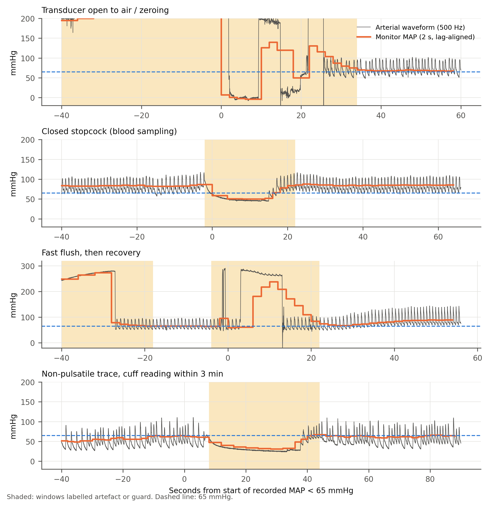
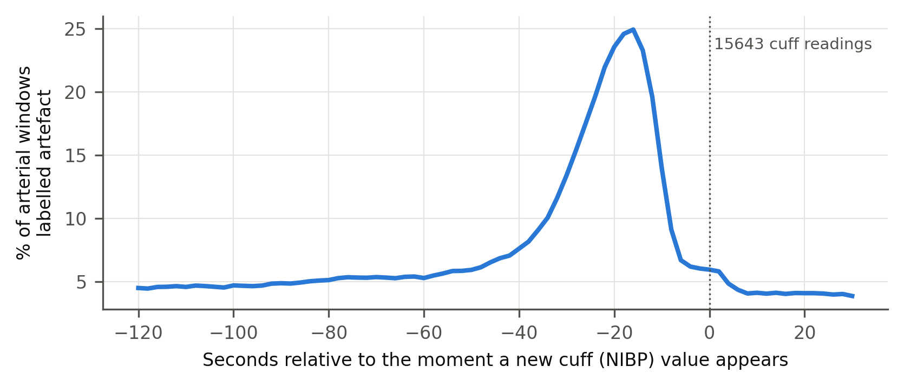
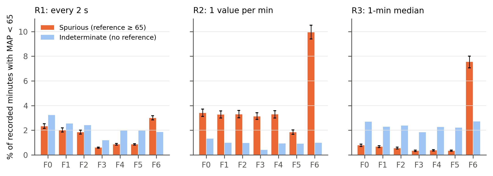
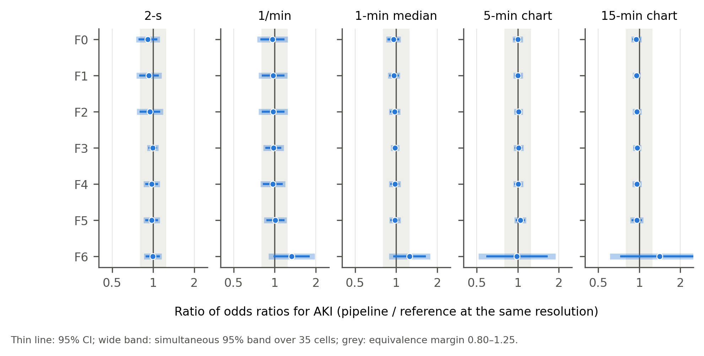

**Running title:** Arterial-line artefact and intraoperative hypotension

**Author:** Oleg Tropynin

**Affiliation:** Independent researcher, Karaganda, Kazakhstan

**Correspondence:** Oleg Tropynin, tropininoleg@gmail.com

**Keywords:** intraoperative hypotension; arterial pressure monitoring; artefacts; acute
kidney injury; measurement error; VitalDB

# Key points

- In 3,249 patients with continuous arterial monitoring, 2.3% of monitored time was
  waveform-flagged artefact. With per-minute medians and a range filter, 0.7% of recorded
  minutes with mean arterial pressure (MAP) below 65 mmHg were spurious against the waveform
  reference.

- For ≥ 10 min of MAP below 65 mmHg, which was not associated with acute kidney injury (AKI, by
  creatinine) after adjustment, artefact handling did not change the estimate (ratio of odds ratios 0.96,
  0.86–1.06). This verdict rested on 33 discordant patients and would not have survived two
  AKI cases among them. Post hoc, for exposures that were associated with AKI, pipeline and
  reference estimates were within a few per cent.

- Running-median smoothing and unfiltered area-under-threshold exposures distorted measured
  hypotension. Over a third of the unfiltered area below 55 mmHg was artefact (post hoc).

- Many brief, very deep recorded falls were waveform-flagged in retrospect (post hoc). Even so,
  one in five falls to 20–39 mmHg was not flagged at 10 s. A sudden fall should be treated as
  real until the waveform shows otherwise.

- Arterial artefact rose sixfold during the non-invasive cuff cycle, mostly as a non-pulsatile
  trace. This is consistent, in part, with occlusion of the cannulated arm.

# Abstract

**Purpose.** Evidence linking intraoperative hypotension to acute kidney injury (AKI) rests on
monitor numbers that include arterial-line artefacts. We asked how much recorded hypotension
is artefact and whether it biases the association.

**Methods.** In 3,249 adults from VitalDB, each 2-s monitor value was labelled
from the 500 Hz arterial waveform, giving a waveform reference, and compared with 420
retrospective processing pipelines. The primary estimand was the ratio of adjusted odds ratios
(ROR) for AKI by KDIGO creatinine criteria with ≥ 10 min of mean arterial pressure below
65 mmHg, comparing per-minute medians with a range filter against the reference. The
pre-specified equivalence margin was 0.80–1.25.

**Results.** Of monitored time, 96.3% was not waveform-flagged. With per-minute medians, 0.7% of
recorded hypotensive minutes were spurious against the reference; with one value per minute,
3.3%. AKI occurred in 91 of 2,563 patients (3.6%). Adjusted odds ratios were 0.94 (95% CI
0.60–1.48) with the reference and 0.90 (0.57–1.42) with the pipeline: ROR 0.96 (0.86–1.06),
within the margin. Exposure differed in 33 patients, none with AKI; two AKI cases among the 28
reclassified upwards would have made the verdict inconclusive. Spurious hypotension showed no
detectable association with AKI. Arterial artefact rose from 4% to 26% during cuff measurement.

**Conclusion.** With per-minute medians and a range filter, artefact handling did not
detectably change the association between hypotension and AKI, but this verdict rests on few
discordant patients. Post hoc, the same held for exposures associated with AKI. Running-median
smoothing and unfiltered area-based exposures should be avoided.

# Introduction

Intraoperative hypotension is associated with acute kidney injury (AKI), myocardial injury and
death [1–4]. Thresholds derived from these studies, typically a
mean arterial pressure (MAP) below 65 mmHg for more than a few minutes, now appear in consensus
statements and quality metrics [5]. Almost all of this evidence comes from retrospective
analyses of numbers stored by anaesthesia information management systems. These are one value
per minute or less, taken from the monitor rather than from the waveform the clinician sees.

Invasive arterial pressure is the reference standard of these studies. Yet the stored numbers
inherit every event that disturbs an arterial line:

- flushing;
- blood sampling through a stopcock;
- zeroing;
- a kinked or damped catheter;
- cuff inflation on the same limb [6–9].

Earlier work established three things:

- choosing among published artefact filters changes the measured incidence of hypotension up
  to twofold, but changed the association with myocardial injury little [10];

- coarser sampling inflates the measured burden of hypotension against a waveform reference,
  although its effect on outcome associations has only been extrapolated [11];

- how hypotension is modelled changes the estimated odds ratios [12].

Recent studies of the open VitalDB dataset relating arterial pressure to kidney injury applied
a single cleaning rule or did not describe one [13–15].

Four questions remain open:

1. When artefacts are identified from the waveform rather than from rules applied to the
   numbers, how much of recorded hypotension is artefact?

2. Do the artefact rule and the data resolution change the estimated association between
   hypotension and AKI when that association is estimated directly?

3. Is artefact misclassification *differential*? Arterial blood is sampled more often in
   sicker patients. If sampling artefact were recorded as hypotension preferentially in
   patients who later develop AKI, the error would bias published associations away from the
   null rather than towards it.

4. Which recorded low-pressure episodes are artefact, and how quickly can this be recognised?

We used the two parallel recordings in VitalDB, the 500 Hz waveform and the monitor's 2-s
numbers, to build a waveform-referenced MAP series. We compared it with 420 pipelines that a
retrospective study could plausibly use, in a pre-specified multiverse
analysis [16,17].

# Methods

## Design, data and reporting

We performed a retrospective cohort study of the open VitalDB dataset [18]:

- 6,388 non-cardiac surgical cases;
- Seoul National University Hospital, 2016–2017;
- anaesthesia records, laboratory results, monitor numerics (GE Solar 8000) and
  high-resolution waveforms.

The institutional review board approved data collection. The data are de-identified and
public, so no further approval was needed. Reporting follows STROBE and
RECORD [19,20].

The analysis protocol was written before any exposure–outcome association was computed and
was revised after an adversarial methods review. It was frozen by a tagged commit after the
whole analysis had run end to end on a randomly permuted outcome. The Supplementary Protocol
lists every amendment before the freeze, and every change and post hoc analysis after
unblinding, with dates and reasons. Post hoc analyses are labelled as such throughout.

A large language model (Claude Opus 5.5, Anthropic) was used under the author's direction to write the
analysis code, to review the methods adversarially before the freeze, to simulate peer review
of the draft and to draft the text. It also served, as described below, as a secondary
blinded rater. The author checked all code, outputs and text.

## Participants

We included adults under general anaesthesia whose record contained the 500 Hz arterial
pressure waveform (radial in 95%) and at least 30 min of reference-valid monitoring. Only the
first eligible case per patient was used.

For the AKI analysis we further excluded:

- transplantation;
- patients without a baseline creatinine;
- baseline estimated glomerular filtration rate (eGFR, CKD-EPI 2021 [21]) below
  15 mL min^−1^ 1.73 m^−2^;

- patients without a creatinine measurement within 7 days after anaesthesia.

## Waveform classification and the reference series

The monitor stores systolic, diastolic and mean arterial pressure every 2 s. This is the
stream that anaesthesia information management systems store and that retrospective studies
analyse. We used the waveform only to decide *whether* each 2-s monitor value was
trustworthy, never to replace it, so calibration differences between monitor and waveform
could not enter the comparison.

Each 2-s waveform window was labelled with the first category that applied:

- *zero*: mean below 15 mmHg and 2nd–98th centile range below 10 mmHg (transducer open to
  air or being zeroed);

- *high*: maximum above 250 mmHg or mean above 200 mmHg (fast flush);
- *non-pulsatile*: range below 8 mmHg, interdecile range below 3 mmHg, or no systolic
  upstroke (a rise above 8 mmHg within 100 ms) in the centred 6-s window. This covers a
  stopcock turned off to the patient and an occluded or kinked line;

- *noise*: minimum below −10 mmHg, or median absolute second difference ≥ 4 mmHg;
- *valid*: none of the above.

Hereafter, "artefact" means a value flagged by this classifier. Because the monitor averages
over several beats, windows from 2 s before to 8 s after any
artefact run were labelled *guard*. Eight seconds was the 95th centile of the time the monitor
took to rejoin the waveform after an artefact.

Thresholds were set on outcome-free data. A pulsatility criterion based on beat-to-beat
autocorrelation was discarded before the freeze because it labelled atrial fibrillation as
artefact. Figure 1 shows examples.

**Alignment and monitoring period.**

- *Lag.* The monitor numerics lag the waveform. The lag was estimated for each case by
  maximising the correlation between monitor MAP and the waveform window mean in valid
  windows. It was 4 s in 62% of cases and 6 s in 35%.

- *Monitoring period.* It ran from the first to the last uninterrupted 60 s of valid waveform
  within anaesthesia. It began a median of 9.9 min (IQR 6.3–15.8) after the start of
  anaesthesia, so much post-induction hypotension falls outside it [22].

**Reference series.** The reference was the lag-aligned monitor MAP restricted to valid
windows.

- Gaps of up to 3 min, bounded on both sides by at least 30 s of valid data, were bridged by
  linear interpolation between the medians before and after the gap. Bridging avoids a
  systematic loss of true hypotension that coincides with blood sampling.

- A minute was valid if at least half of its windows were valid or bridged.

## Retrospective pipelines

A pipeline turns the monitor numbers into an exposure, using the numbers alone.

*Filters* reproduced published rules:

- F0: none;
- F1: MAP below 20 or above 250 mmHg removed [13];
- F2: MAP below 30 or above 200 mmHg removed [23];
- F3: systolic above 250, diastolic below 15, MAP below 35 or above 150, or pulse pressure
  below 15 mmHg [11];

- F4: physiological consistency (MAP below 20 or above 200; systolic below 20 or above 300;
  systolic ≤ diastolic; pulse pressure below 5; diastolic below 5);

- F5: F4, then removal of values that differ from both neighbours by more than 30 mmHg [24];
- F6: F4, then a 7-point running median [10].

*Resolutions*:

- R1: every 2-s value;
- R2: one instantaneous value per minute;
- R3: the per-minute median;
- R4: a value charted every 5 min and held;
- R5: a value charted every 15 min and held.

R4 and R5 were evaluated at several phase offsets, and the estimates were averaged.

*Exposures*, each at thresholds of 55, 60 and 65 mmHg:

- cumulative minutes below the threshold, per 10 min, capped at 120 min;
- area under the threshold, per 100 mmHg·min, capped at the reference's 99th centile;
- time-weighted average below the threshold, in mmHg;
- the binary exposure "≥ 10 min below the threshold".

The reference was processed at every resolution in the same way. Each pipeline was compared
with the reference at the same resolution, so the contrast isolates waveform-based
cleaning. In total there were 420 pipeline specifications.

## Outcomes and covariates

The primary outcome was AKI by the KDIGO creatinine criteria [25]: an increase of
≥ 0.3 mg dL^−1^ within 48 h, or ≥ 1.5 times baseline within 7 days. Baseline was the last
creatinine within 30 days before surgery, otherwise the preoperative value.

Models were adjusted for:

- age and eGFR, as restricted cubic splines;
- sex, body mass index, ASA physical status ≥ 3 and emergency surgery;
- hypertension and diabetes;
- preoperative haemoglobin and albumin;
- department and surgical approach;
- log anaesthesia duration.

Vasopressors, fluids and blood loss were not included, because they may lie on the causal
path. With 91 events and 21 parameters there were 4.3 events per parameter. We
used Firth-penalised logistic regression with Wald intervals [26], and the two models that form each ratio
share the same adjustment set.

## Statistical analysis

**Measurement error.** Each recorded minute with MAP below 65 mmHg was classed against the
reference at the same resolution:

- *spurious*: reference ≥ 65 mmHg;
- *confirmed*: reference < 65 mmHg;
- *indeterminate*: no valid reference. Indeterminate minutes were never counted as artefact.

*Masked* minutes were reference minutes below 65 mmHg that the pipeline recorded as ≥ 65 mmHg.
For the binary exposure we report κ and the number of patients whose category differed.
Proportions have patient-cluster bootstrap CIs.

**Primary estimand.** The primary estimand was the ratio of odds ratios, ROR =
OR~pipeline~ / OR~reference~, for AKI with the binary exposure "≥ 10 min below 65 mmHg". It
compared F1 × R3 with the reference at R3, using the same adjustment set and the same
patients. The ROR is largely insensitive to confounding that the two series share.

We pre-specified an equivalence margin of 0.80–1.25, the conventional margin symmetric on the
log scale:

- an interval inside the margin: equivalent;
- an interval excluding 1, with a point estimate outside the margin: material change;
- anything else: inconclusive.

Because the two exposures differ in only a few patients, the percentile bootstrap interval is
too narrow. Across 100 outcome permutations, in which the true ROR is 1, it covered 1 in only
51%. A rule written before the real outcome was examined therefore set every ROR-type
interval to:

  log ROR ± 1.96 × max(paired-bootstrap SE, SD over 200 outcome permutations).

We checked this interval by its coverage under independent permutations, and by simulating
outcomes from the adjusted reference model with differential error placed at the margin
(Supplementary Methods).

**Secondary analyses.**

- The same ROR for all 35 filter × resolution cells, with simultaneous 95% bands.
- The slope per 10 min below 65 mmHg.
- The full specification curve over metrics and thresholds.
- The effect of resolution on the reference itself.

**Differential misclassification.** We regressed AKI on log(1 + spurious minutes per monitored
hour), adjusting for:

- the reference exposure (linear and spline terms);
- log monitored hours;
- the adjustment set.

We used the raw 2-s stream (F0 × R1), because at F1 × R3 spurious minutes were non-zero in too
few patients (amendment A14, made before the freeze). The negative control was spurious
hypertensive minutes: pipeline MAP above 120 mmHg while the reference was ≤ 100 mmHg.

**Episodes.** Each run of monitor MAP below 65 mmHg was classed as:

- *waveform-flagged*: ≥ 50% of its windows labelled artefact;
- *guard-dominated*;
- *physiological*.

We tabulated the probability that an episode was flagged by final duration and nadir. The
protocol specified a depth-2 decision tree for a simple rule; the best rule was a single
split, which is reported. Post
hoc, we also tabulated it by elapsed duration and nadir so far, which is what is known while
an episode unfolds.

**Validation of the reference.**

- *Independent signals:*
  - cuff MAP within 60 s of an episode;
  - ECG and plethysmographic pulse rate during non-pulsatile windows and deep episodes;
  - the non-pulsatile fraction in atrial fibrillation.
- *Injection–recovery* of synthetic artefacts after Li et al. [27], with amplitude and
  duration varied post hoc. The injections resemble the classifier's own rules, so this is an
  implementation check rather than independent validation.

- *A blinded AI rating* of 152 snippets (Supplementary Methods).

**Sensitivity analyses.** The pre-specified sensitivity analyses varied:

- the reference: guard length, pulse-pressure threshold, minute validity, bridging, and the
  waveform mean in place of the monitor value;

- the monitoring period;
- the adjustment set;
- the outcome: AKI stage ≥ 2; missing postoperative creatinine counted as no AKI (S4);
  transplantation included (S6).

S4 and S6 had been omitted by error and were run after unblinding. Post hoc analyses are
listed with them in Table S5.

Analyses used Python 3.10 (NumPy, SciPy, pandas). The classifier, Firth regression, splines,
bootstrap and permutation code were written by the author and unit-tested.

# Results

## Participants

Of 3,645 cases with an arterial waveform track, 3,434 had a retrievable waveform and 3,429 had
a monitoring period. The descriptive cohort comprised 3,249 patients. Together they had
11,466 h of monitoring, a median of 193 min per patient (IQR 134–272).

The AKI analysis set comprised 2,563 patients, of whom 91 (3.6%) developed AKI (Figure S1;
Table 1). Inclusion in the AKI set depended on postoperative creatinine testing. Of
non-transplant patients in the descriptive cohort, the AKI set included:

- 96% of thoracic patients;
- 97% of urology patients;
- 85% of general surgery patients;
- 28% of gynaecology patients.

## How much of the arterial record is artefact

Within the monitoring period, 96.3% of 2-s windows were valid. Artefact proper accounted for
2.3%:

- *high* 1.2%;
- *non-pulsatile* 0.7%;
- *noise* 0.2%;
- *zero* 0.07%.

Guard margins accounted for a further 1.4%. Inside the monitoring period the waveform was
never missing: the analogue channel records continuously, and the period is bounded by valid
data.

Artefact events were common:

| Artefact type | Patients with at least one event | Events per monitored hour |
|---|---|---|
| Flush | 98% | 2.6 |
| Noise | 97% | 2.7 |
| Non-pulsatile run | 90% | 2.0 |
| Zeroing | 33% | 0.2 |

In valid windows, monitor MAP and the waveform mean differed by more than 10 mmHg in a median
of 0.5% of windows per patient.

**Artefact around cuff measurements** (Figure 2). In 2,579 patients with both arterial and
cuff pressure, 14.0% of arterial windows in the 60 s before a new cuff value were labelled
artefact, against 1.8% at other times (19,560 readings). The excess peaked 22 s before the
value appeared, during the oscillometric cycle. At the peak 25.8% of windows were artefact,
against 4.3% 4–5 min earlier.

The peak was almost entirely *non-pulsatile* trace: 22.4% against 1.7% at baseline. Flush
labels barely rose (2.3% against 1.7%).

Post hoc, the excess:

- was present at regularly cycled readings (12.2% of windows), which are probably automatic,
  as well as at irregular ones (17.0%);

- was larger with radial catheters (13.9% vs 1.8% at other times; 2,219 patients) than with
  pedal or femoral catheters, which an arm cuff cannot occlude (9.7% vs 3.4%; 58 patients;
  per-patient Mann–Whitney p < 0.001);

- was larger with right than with left radial catheters. In 60% of patients with a right and
  31% with a left radial catheter, at least 10% of arterial windows in the minute before cuff
  readings were artefact.

The 4.3% baseline 4–5 min before a reading is above the 1.8% seen at other times because it
includes the previous cuff cycle. The cuff arm is not recorded in VitalDB.

## Spurious and masked hypotension

At the per-minute median resolution (R3) with filter F1, 0.66% (95% CI 0.58–0.74) of recorded
minutes with MAP below 65 mmHg were spurious (Figure 3; Table S1). Spurious fractions were
higher:

- with one instantaneous value per minute (R2): 3.3% (3.0–3.6), which is 4–10 times the R3
  value for filters F0–F5;

- with the raw 2-s stream (R1): 2.0% (1.9–2.2).

Filters F3–F5 removed most spurious minutes at R1 and R3 (0.3–0.9%), but not at R2
(1.8–3.3%). The 7-point running median (F6) behaved differently from every other filter:

- it created spurious minutes: 7.5% at R3 and 9.9% at R2;
- it masked 20% (R3) to 24% (R2) of true hypotensive minutes.

**Binary exposure.** Against the reference at the same resolution, "≥ 10 min below 65 mmHg"
was classified with κ 0.95–0.99 by every filter except F6 at R2–R5 (Table S2). With F1 × R3, 38 of
3,249 patients (1.2%; 33 in the AKI set) changed exposure category, 32 of them upwards; 30 of the 38 had 5–10
reference minutes.

Resolution changed exposure prevalence more than any filter. In the reference series itself,
42.4% of patients were exposed at R3, 51.2% at R4 and 53.2% at R5.

The 7-point median applied to charted data erased most exposure: κ was 0.39 at R4 and 0.20
at R5.

## Which recorded low-pressure episodes are waveform-flagged

Of 106,725 recorded episodes of MAP below 65 mmHg in 3,123 patients:

- 8,471 (7.9%) were waveform-flagged;
- 3,909 (3.7%) were guard-dominated;
- 94,345 (88.4%) were physiological.

Flagged episodes accounted for 4.3% of hypotensive minutes. The proportion flagged depended
steeply on final duration and nadir (Table 2):

- 65–90% of episodes lasting ≤ 60 s with a nadir below 40 mmHg;
- 59–65% of episodes lasting ≤ 30 s with a nadir of 40–54 mmHg;
- ≤ 2.4% of episodes with a nadir of 55–64 mmHg;
- ≤ 2% of episodes lasting more than 1 min with a nadir ≥ 40 mmHg.

Final duration is not known while an episode unfolds. Post hoc, we therefore also looked at
episodes still below 65 mmHg after a given time, by the nadir so far (Table S3):

| Nadir so far | at 10 s | at 30 s | at 60 s | at 120 s |
|---|---|---|---|---|
| 20–39 mmHg | 79% flagged | 57% | 8% | 2% |
| below 20 mmHg | 75% | 59% | 44% | 29% |

A single rule, a fall of more than 20 mmHg from the preceding 30-s maximum, identified flagged
episodes in a validation half of patients with:

- sensitivity 0.89;
- specificity 0.92;
- positive predictive value 0.46.

This specificity came from trivial dips. Across all episodes with a nadir below 40 mmHg it was
0.07.

## Validation of the reference

**Cuff pressure.** The pre-specified check used a cuff MAP within 3 min of an episode. The cuff
MAP was ≥ 70 mmHg in:

- 84% (95% CI 83–85) of 4,506 flagged episodes;
- 46% (45–47) of 10,967 physiological episodes.

Restricting post hoc to deep episodes (nadir below 40 mmHg) and a cuff value within 60 s, the
cuff MAP was ≥ 70 mmHg in 81% (79–82) of 2,081 flagged episodes and 28% (24–32) of 443
physiological ones. Two consequences follow:

- about one flagged deep episode in five had a low cuff pressure nearby and may have been
  real;

- some deep episodes classed as physiological were probably artefact that the classifier
  missed.

**Pulse.** In non-pulsatile windows:

- the ECG rate was 40–150 min^−1^ in 97.8% of 153,662 windows;
- the plethysmographic pulse rate was in that range in 92.6%.

An ECG rate alone cannot exclude pulseless electrical activity. A plethysmographic pulse was
present in deep flagged and deep physiological episodes alike (98% and 97.5% of windows).

**Atrial fibrillation.** The non-pulsatile fraction was not higher in the 13 patients with
preoperative atrial fibrillation (0.17% vs 0.68%).

**Injection–recovery** (Table S8). Detected: flushes lasting ≥ 2 s or reaching 250 mmHg,
open-transducer levels up to 25 mmHg, and sampling. Rarely or never detected: short flushes of
200 mmHg or less, over-damping, partial occlusion (except severe), drift and ringing.

**Blinded AI rating** (secondary; Table S9). Agreement was 97.7% (κ 0.95; n = 131 after
excluding guard and "unsure").

## Association with acute kidney injury

**The reference association.** For ≥ 10 min below 65 mmHg the odds ratio for AKI was:

- crude: 1.65 (1.09–2.51);
- adjusted for age, eGFR, ASA and emergency: 1.46 (0.95–2.25);
- fully adjusted: 0.94 (0.60–1.48);
- fully adjusted without anaesthesia duration: 1.10 (0.70–1.71).

Because this exposure is cumulative, adjusting for duration removes part of its variance.

Other exposures were associated with AKI after full adjustment (Table S11):

- ≥ 10 min below 60 mmHg: 1.71 (1.04–2.79);
- area below 65 mmHg: 1.24 per 100 mmHg·min (1.07–1.45);
- time-weighted average below 65 mmHg: 1.27 per mmHg (1.00–1.60).

For ≥ 10 min below 55 mmHg the odds ratio was 1.95 (0.89–4.27), and per 10 min below 65 mmHg
it was 1.08 (0.99–1.17).

**Primary estimand.** With F1 × R3 the fully adjusted odds ratio was 0.90 (0.57–1.42). The ROR
was 0.96 (95% CI 0.86–1.06; permutation p = 0.42), and the pre-specified verdict was
equivalent.

The contrast rested on the 33 patients in the AKI set whose exposure category differed: 28
moved up and 5 moved down. None developed AKI, against 1.6 expected from the adjusted reference
model. The verdict depends on how many of the 28 upward-moved patients developed AKI (post hoc;
Table S7):

| AKI cases among the 28 | ROR (95% CI) | Verdict |
|---|---|---|
| 0 (observed) | 0.96 (0.86–1.07) | equivalent |
| 1 | 1.01 (0.90–1.14) | equivalent |
| 2 | 1.07 (0.90–1.27) | inconclusive |
| 3 | 1.13 (0.94–1.36) | inconclusive |

Under the reference model, two or more cases would have occurred with probability 0.36. The
equivalence verdict is therefore fragile.

In simulations from the adjusted reference model, the interval rule declared equivalence:

- in 82% of datasets without differential error;
- in 5% of datasets where differential error placed the median ROR at 1.24.

**Where the reference association was present** (post hoc). The pipeline and reference
estimates were close:

| Exposure | ROR (95% CI) |
|---|---|
| ≥ 10 min below 60 mmHg | 0.98 (0.85–1.15) |
| Area below 65 mmHg | 1.00 (0.97–1.03) |
| Time-weighted average below 65 mmHg | 1.01 (0.95–1.06) |

At 55 mmHg the binary ROR was imprecise: 1.28 (0.81–2.02) with F1 and 1.10 (0.84–1.45) with
F3. The pipeline odds ratio, 2.49 (1.22–5.08), crossed nominal significance where the
reference, 1.95 (0.89–4.27), did not.

Per 10 min below 65 mmHg the pipeline slope was 1.09 (1.00–1.18) against 1.08 (0.99–1.17) for
the reference. The difference in log-odds was 0.007 (−0.005 to 0.019).

**All 35 filter × resolution cells** (Table 3; Figure 4). No 95% interval or simultaneous band
excluded 1. Twenty-five cells were equivalent pointwise and 19 under simultaneous bands. The
ten inconclusive cells were:

- F0–F2 at R1;
- F2, F3, F4 and F6 at R2;
- F6 at R3–R5.

Four cells at R2 lay within 0.002 of the upper margin, two on each side. Excluding F6, the
point estimates ranged from 0.94 to 1.12. Coarser resolution of the reference itself did not
detectably change the odds ratio: relative to R3 it was 0.93–1.10, with intervals from 0.76
to 1.42.

**Exposure metric** (Figures S2–S4; Table S4). Across 420 specifications the median ROR was 0.99
(IQR 0.95–1.01). Minute-based exposures were insensitive to processing (RORs 0.92–1.02).
Area-based exposures below 55 mmHg were not:

- without a filter, 37% of the total area below 55 mmHg was artefact, half of it in 1% of
  patients;

- with F1 it was 13%, and with F3 none;
- the corresponding RORs were large but imprecise (post hoc; time-weighted average, F0:
  0.30, 0.06–1.53).

The interval for the odds ratio excluded 1 in 181 of 420 pipeline specifications and in 33 of
105 reference specifications. In 90 specifications, mostly area-based, the pipeline and the
reference differed in statistical significance.

**Sensitivity analyses** (Table S5). Of 16 sensitivity analyses with an interval, 14 were
equivalent (RORs 0.94–0.97, intervals within 0.83–1.10). These included the pre-specified S4
and S6, the exclusion of gynaecology and the disease-risk score.

Two were inconclusive:

- the waveform-mean reference (pre-specified), 0.74 (0.48–1.16). It changes calibration as
  well as cleaning, so it does not isolate artefact handling, and we cannot exclude a real
  difference;

- the numerics-defined monitoring period, 0.91 (0.75–1.11).

Adjustment for blood loss and for the number of creatinine measurements, and AKI stage ≥ 2,
gave point estimates of 0.95–0.97 without intervals. The creatinine count follows surgery and
is exploratory.

**Differential misclassification** (Table S6). Spurious hypotension on the raw stream was
unrelated to how often arterial blood was sampled (Spearman ρ 0.005, p = 0.81), and weakly,
inversely correlated with ASA class (ρ −0.06, p = 0.006).

Adjusted for reference exposure, the odds ratio for AKI was:

- 0.93 (0.74–1.16) per SD of spurious minutes;
- 0.59 (0.12–2.86) per unit of log(1 + minutes per hour).

The pre-specified negative control, fitted in the same model, gave 1.17 (0.96–1.43) per SD;
fitted separately it gave 1.16 (0.95–1.42). These estimates are imprecise. They show no
evidence of differential error but cannot exclude a modest amount.

# Discussion

## Principal findings

In 3,249 patients with a high-resolution arterial waveform, artefacts were frequent events but
a small part of recorded hypotension. With a per-minute median and a range filter, fewer than
1% of hypotensive minutes were spurious, and the exposure category changed in 1.2% of
patients.

For the pre-specified exposure, ≥ 10 min below 65 mmHg, the adjusted association with AKI was
null (odds ratio 0.94), so non-differential error had little to act on. The equivalence of
pipeline and reference (ROR 0.96) therefore mainly tests *differential* error. That is the
scenario in which artefact recorded preferentially in patients destined for AKI would
manufacture an association.

We found no evidence of it:

- none of the 33 patients whose category changed developed AKI;
- spurious hypotension was unrelated to blood sampling and showed no detectable association
  with AKI.

The verdict is fragile, however. Two AKI cases among the 28 patients moved upwards would have
made it inconclusive, and under the reference model such an outcome had a probability of about
one in three.

Two further observations support the robustness of duration-based exposures:

- *Where the reference showed an association* (≥ 10 min below 60 mmHg; area and time-weighted
  average below 65 mmHg), the pipeline estimates were within a few per cent of the reference
  (post hoc).

- *At 55 mmHg* the pipeline estimate was higher than the reference, but imprecise.

Three processing choices mattered more than the filter:

- **The 7-point running median.** It created spurious hypotension and masked a fifth of true
  hypotension.

- **Unfiltered area-based exposures below 55 mmHg.** Zero and flush values in a few patients
  inflated them: over a third of the area was artefact.

- **Resolution.** It changed the share of exposed patients by a fifth, without a detectable
  change in the odds ratio.

## Comparison with previous work

Pasma et al. found that the choice among eight filters changed the incidence of hypotension
up to twofold, but changed the association with myocardial injury little [10].
Jacobsson et al. showed against a waveform reference that coarse sampling inflates measured
hypotension [11]. Both comparisons were between pipelines, or extrapolated to outcomes.

Our study adds:

- an external, waveform-referenced comparator at every resolution;
- a direct, pre-specified estimate of the outcome effect;
- a test for differential error.

We agree with both on duration-based exposures. Unlike Pasma et al., we found that the
7-point median distorts exposure substantially, even when the ratio of odds ratios stays
near 1. The AWAKE trial showed that the monitoring method changes measured and treated hypotension
at induction [28]. Our resolution results are the retrospective counterpart.

Wax et al [29]. and a recent preprint from the MOVER cohort [30] treated disagreement between
cuff and arterial pressure as clinical information. Arterial artefact rose sixfold during the
cuff cycle, mostly as a non-pulsatile trace. This is a measurement mechanism that generates
such disagreement. The pattern fits occlusion of the cannulated arm in part, because the
excess was:

- larger with radial than with lower-limb catheters;
- larger on the right than on the left;
- present at regularly cycled readings;
- mostly not flush.

A smaller excess with pedal and femoral catheters shows that this is not the whole
explanation, and because VitalDB does not record the cuff arm, occlusion remains a hypothesis.
Studies of discordance should check whether their results survive excluding arterial values
from the cuff cycle.

Earlier work compared artefact detection algorithms with human annotation of stored
values [7, 31], and a scoping review found no agreed reference standard for
arterial artefact [32]. Our approach uses the waveform only to decide whether a monitor
value can be trusted. It can be reproduced on any dataset that stores both.

## Implications

**For investigators:**

- Use a per-minute median with a range filter, or a rule such as F3, and report resolution as
  carefully as threshold.

- Do not use running-median smoothing to estimate exposure.
- Do not compute area- or time-weighted exposures below 55 mmHg from unfiltered data.
- In paired multiverse comparisons, check the operating characteristics of intervals before
  unblinding, at the null and at the decision margins. Permutation alone checks only the
  null. In our data, percentile intervals covered the truth in half of null datasets.

**For alarm design and retrospective cleaning:**

- These probabilities are retrospective and describe a population. They must not be used to
  delay treatment, and a sudden fall should be treated as real until the waveform shows
  otherwise.

- At 10 s, one in five falls to 20–39 mmHg was not flagged. One in five flagged deep episodes
  had a low cuff pressure within a minute.

- Many very brief, very deep recorded falls were waveform-flagged in retrospect (post hoc).
  A fall below 20 mmHg was still flagged in more than a quarter of cases at 2 min.

- An automated system could use such probabilities to *annotate* a probable artefact, never to
  *suppress* an alarm. A simple drop rule does not separate deep artefacts from deep real
  events: below 40 mmHg its specificity was 0.07.

- Where possible, the cuff should be placed on the limb opposite an arterial line [9].
  The cuff remains an essential cross-check of the arterial line.

## Strengths and limitations

The reference comes from the waveform recorded alongside the numbers and never replaces
monitor values. The protocol was frozen after a permuted dry run, and every later change is
documented. The reference was checked against independent signals, and all data and code are
public.

Limitations:

- **The equivalence verdict rests on few patients.** It rests on 33 discordant patients and
  would not have survived two AKI cases among them. It may not transfer to cohorts with more
  artefact or a stronger association.

- **No human rater adjudicated the reference.** The AI rater shares its model family with the
  classifier's designer and sees only the waveform. A 400-snippet set with a hidden key is
  released for human adjudication; it should show the monitor value as well.

- **The reference is *waveform-screened*, not error-free.** The classifier cannot see:
  - levelling errors and zero drift, about 7 mmHg per 10 cm, which matter in lateral and
    tilted positions;

  - most over-damping;
  - partial occlusion;
  - very short flushes.

  It also misses some artefact: 28% of deep "physiological" episodes had a cuff MAP ≥ 70 mmHg
  nearby.

- **No end-tidal carbon dioxide or vasopressor data.** We did not examine these around deep
  episodes.

- **Much post-induction hypotension was missed.** Monitoring started a median of 10 min after
  the start of anaesthesia [22].

- **One centre, few events.** The data come from a single centre in 2016–2017, mainly general
  and thoracic surgery, with 3.6% AKI by creatinine alone. Postoperative creatinine testing
  varied by department.

- **Adjustment.** The adjusted odds ratios depend on adjustment for anaesthesia duration,
  which partly removes cumulative exposure.

- **Simulated charting.** Charted resolutions were simulated, not taken from real
  records [6].

- **Practice-dependent frequencies.** Artefact frequencies depend on local practice. The
  mechanisms, and the direction of the resolution and smoothing effects, should transfer.

## Conclusions

Arterial-line artefacts were frequent events but a small part of recorded hypotension. With
per-minute medians and a range filter, artefact handling did not detectably change the
association between hypotension and AKI. We found no evidence that artefact was recorded
preferentially in patients who developed AKI, although the equivalence verdict rested on few
discordant patients.

Running-median smoothing and unfiltered area-based exposures distort measured hypotension.
Brief, very deep recorded falls are often artefact in retrospect, but a sudden fall should
prompt a look at the waveform, never a delay in treatment.

# Declarations

**Ethics.** This is a secondary analysis of the de-identified, publicly released VitalDB
dataset. Collection of the data was approved by the institutional review board of Seoul
National University Hospital, as described in the data descriptor [18]. No further
approval or consent was required.

**Funding.** None.

**Competing interests.** None declared.

**Data and code availability.** VitalDB is openly available at https://vitaldb.net. The
analysis code, the frozen protocol with all amendments, the permuted dry run, aggregate
results and the 400-snippet adjudication set are available at
https://github.com/olegtropinin/ioh-artifact-study. The
adjudication key is available from the author on request, to preserve blinding of future
raters.

**Use of artificial intelligence.** The author used an AI system (Claude Opus 5.5, Anthropic) for
substantial parts of this work, under the author's direction:

- writing the analysis code;
- an adversarial review of the methods before the protocol was frozen;
- three simulated peer reviews of the draft (statistical, clinical, signal processing), which
  led to the post-unblinding changes listed in the Supplementary Protocol;

- drafting the manuscript.

An instance of the same AI system was also used as the blinded secondary rater of waveform
snippets, as described in the Methods. The author checked the code, outputs and text, and
takes full responsibility for the content. The AI system is not an author.

**Author contribution.** O.T. conceived and designed the study, performed the analysis,
interpreted the results and wrote the manuscript.

**Acknowledgements.** The author thanks the VitalDB team at Seoul National University
Hospital for making the dataset openly available.

# Figure legends

**Figure 1.** Recorded hypotension that is waveform-flagged artefact. Each panel shows the
500 Hz arterial waveform (grey) and the lag-aligned 2-s monitor MAP (orange) around the start
of a recorded MAP below 65 mmHg (time 0). Shaded windows are labelled artefact or guard. From
top to bottom:

- a transducer open to air (zeroing);
- a stopcock turned off to the patient during blood sampling;
- a fast flush followed by recovery;
- a non-pulsatile trace with a cuff reading within 3 min.

**Figure 2.** Arterial artefact around non-invasive cuff measurements, by artefact type. The
plot shows the percentage of 2-s arterial windows with each label, by time relative to the
moment a new cuff value appears (14,307 readings with a complete −300 to +30 s window).

**Figure 3.** Spurious minutes among recorded minutes with MAP below 65 mmHg, by filter and
resolution: R1, 2-s stream; R2, one value per minute; R3, 1-min median. Orange: spurious
(reference ≥ 65 mmHg), with patient-cluster bootstrap 95% CI. Blue: indeterminate (no valid
reference), never counted as artefact.

**Figure 4.** Ratio of odds ratios for AKI (≥ 10 min below 65 mmHg) for every filter ×
resolution combination, each against the reference at the same resolution.

- Points: ratio of odds ratios.
- Thin lines: 95% CI, log ROR ± 1.96 × max(bootstrap SE, permutation-null SD).
- Wide bands: simultaneous 95% bands over 35 cells.
- Grey: equivalence margin 0.80–1.25.

**Figure S1.** Flow of patients.

**Figure S2.** Specification curve: ratios of odds ratios for all 420 pipeline
specifications, sorted. The lower panel marks the filter, resolution and threshold.

**Figure S3.** Probability that a recorded episode is waveform-flagged, by final duration and
nadir (the data of Table 2).

**Figure S4.** Ratio of odds ratios at the 1-min median resolution by filter, exposure metric
and threshold (post hoc display). Orange: ROR < 1; blue: ROR > 1.

# References

1. Walsh M, Devereaux PJ, Garg AX, Kurz A, Turan A, Rodseth RN, et al. Relationship between intraoperative mean arterial pressure and clinical outcomes after noncardiac surgery: toward an empirical definition of hypotension. Anesthesiology. 2013;119(3):507-15. doi:10.1097/ALN.0b013e3182a10e26
2. Salmasi V, Maheshwari K, Yang D, Mascha EJ, Singh A, Sessler DI, et al. Relationship between intraoperative hypotension, defined by either reduction from baseline or absolute thresholds, and acute kidney and myocardial injury after noncardiac surgery. Anesthesiology. 2017;126(1):47-65. doi:10.1097/ALN.0000000000001432
3. Sun LY, Wijeysundera DN, Tait GA, Beattie WS. Association of intraoperative hypotension with acute kidney injury after elective noncardiac surgery. Anesthesiology. 2015;123(3):515-23. doi:10.1097/ALN.0000000000000765
4. Wesselink EM, Kappen TH, Torn HM, Slooter AJC, van Klei WA. Intraoperative hypotension and the risk of postoperative adverse outcomes: a systematic review. Br J Anaesth. 2018;121(4):706-21. doi:10.1016/j.bja.2018.04.036
5. Sessler DI, Bloomstone JA, Aronson S, Berry C, Gan TJ, Kellum JA, et al. Perioperative Quality Initiative consensus statement on intraoperative blood pressure, risk and outcomes for elective surgery. Br J Anaesth. 2019;122(5):563-74. doi:10.1016/j.bja.2019.01.013
6. Kool NP, van Waes JAR, Bijker JB, Peelen LM, van Wolfswinkel L, de Graaff JC, et al. Artifacts in research data obtained from an anesthesia information and management system. Can J Anaesth. 2012;59(9):833-41. doi:10.1007/s12630-012-9754-0
7. Pasma W, Wesselink EM, van Buuren S, de Graaff JC, van Klei WA. Artifacts annotations in anesthesia blood pressure data by man and machine. J Clin Monit Comput. 2021;35(2):259-67. doi:10.1007/s10877-020-00574-z
8. Gardner RM. Direct blood pressure measurement—dynamic response requirements. Anesthesiology. 1981;54(3):227-36. doi:10.1097/00000542-198103000-00010
9. Saugel B, Kouz K, Meidert AS, Schulte-Uentrop L, Romagnoli S. How to measure blood pressure using an arterial catheter: a systematic 5-step approach. Crit Care. 2020;24(1):172. doi:10.1186/s13054-020-02859-w
10. Pasma W, Peelen LM, van Buuren S, van Klei WA, de Graaff JC. Artifact processing methods influence on intraoperative hypotension quantification and outcome effect estimates. Anesthesiology. 2020;132(4):723-37. doi:10.1097/ALN.0000000000003131
11. Jacobsson M, Valadkhani A, Winski G, Bell M. Accuracy of quantifying hypotension during surgery using physiological sensor data. IEEE J Transl Eng Health Med. 2026;14:265-73. doi:10.1109/JTEHM.2026.3698197
12. Vernooij LM, van Klei WA, Machina M, Pasma W, Beattie WS, Peelen LM. Different methods of modelling intraoperative hypotension and their association with postoperative complications in patients undergoing non-cardiac surgery. Br J Anaesth. 2018;120(5):1080-9. doi:10.1016/j.bja.2018.01.033
13. Lee SB. Causal effect and personalization of intraoperative hypotension burden on postoperative acute kidney injury: a doubly robust analysis of the VitalDB cohort. J Pers Med. 2026;16(7):371. doi:10.3390/jpm16070371
14. Ensarioğlu M, Yıldırım AK. Intraoperative arterial waveform morphology trajectories and prediction of postoperative acute kidney injury: a latent-class analysis of the VitalDB registry. J Clin Med. 2026;15(17):6871. doi:10.3390/jcm15176871
15. Folks R, Tsang S, Brown DE, Blanks ZD, Moradinasab N, Mazzeffi M, et al. Intraoperative short-term blood pressure variability and postoperative acute kidney injury: a single-center retrospective cohort study using sample entropy analysis. BMC Anesthesiol. 2024;24(1):395. doi:10.1186/s12871-024-02784-3
16. Steegen S, Tuerlinckx F, Gelman A, Vanpaemel W. Increasing transparency through a multiverse analysis. Perspect Psychol Sci. 2016;11(5):702-12. doi:10.1177/1745691616658637
17. Simonsohn U, Simmons JP, Nelson LD. Specification curve analysis. Nat Hum Behav. 2020;4(11):1208-14. doi:10.1038/s41562-020-0912-z
18. Lee HC, Park Y, Yoon SB, Yang SM, Park D, Jung CW. VitalDB, a high-fidelity multi-parameter vital signs database in surgical patients. Sci Data. 2022;9(1):279. doi:10.1038/s41597-022-01411-5
19. von Elm E, Altman DG, Egger M, Pocock SJ, Gøtzsche PC, Vandenbroucke JP. The Strengthening the Reporting of Observational Studies in Epidemiology (STROBE) statement: guidelines for reporting observational studies. Lancet. 2007;370(9596):1453-7. doi:10.1016/S0140-6736(07)61602-X
20. Benchimol EI, Smeeth L, Guttmann A, Harron K, Moher D, Petersen I, et al. The REporting of studies Conducted using Observational Routinely-collected health Data (RECORD) statement. PLoS Med. 2015;12(10):e1001885. doi:10.1371/journal.pmed.1001885
21. Inker LA, Eneanya ND, Coresh J, Tighiouart H, Wang D, Sang Y, et al. New creatinine- and cystatin C-based equations to estimate GFR without race. N Engl J Med. 2021;385(19):1737-49. doi:10.1056/NEJMoa2102953
22. Südfeld S, Brechnitz S, Wagner JY, Reese PC, Pinnschmidt HO, Reuter DA, et al. Post-induction hypotension and early intraoperative hypotension associated with general anaesthesia. Br J Anaesth. 2017;119(1):57-64. doi:10.1093/bja/aex127
23. Khan JM, Maslove DM, Boyd JG. Optimized arterial line artifact identification algorithm cleans high-frequency arterial line data with high accuracy in critically ill patients. Crit Care Explor. 2022;4(12):e0814. doi:10.1097/CCE.0000000000000814
24. Du CH, Glick D, Tung A. Error-checking intraoperative arterial line blood pressures. J Clin Monit Comput. 2019;33(3):407-12. doi:10.1007/s10877-018-0167-7
25. Kidney Disease: Improving Global Outcomes (KDIGO) Acute Kidney Injury Work Group. KDIGO clinical practice guideline for acute kidney injury. Kidney Int Suppl. 2012;2(1):1-138.
26. Firth D. Bias reduction of maximum likelihood estimates. Biometrika. 1993;80(1):27-38. doi:10.1093/biomet/80.1.27
27. Li Q, Mark RG, Clifford GD. Artificial arterial blood pressure artifact models and an evaluation of a robust blood pressure and heart rate estimator. Biomed Eng Online. 2009;8:13. doi:10.1186/1475-925X-8-13
28. Kouz K, Wegge M, Flick M, Bergholz A, Moll-Khosrawi P, Nitzschke R, et al. Continuous intra-arterial versus intermittent oscillometric arterial pressure monitoring and hypotension during induction of anaesthesia: the AWAKE randomised trial. Br J Anaesth. 2022;129(4):478-86. doi:10.1016/j.bja.2022.06.027
29. Wax DB, Lin HM, Leibowitz AB. Invasive and concomitant noninvasive intraoperative blood pressure monitoring: observed differences in measurements and associated therapeutic interventions. Anesthesiology. 2011;115(5):973-8. doi:10.1097/ALN.0b013e3182330286
30. Liu Z, Zhuang Z, Wang S, Xu X, Wu E, Ma F, et al. Intraoperative cuff–arterial pressure discordance and postoperative creatinine doubling: a retrospective MOVER cohort study [Preprint]. Research Square. 2026. doi:10.21203/rs.3.rs-11148992/v1
31. Maleczek M, Laxar D, Kapral L, Kuhrn M, Abulesz YT, Dibiasi C, et al. A comparison of five algorithmic methods and machine learning pattern recognition for artifact detection in electronic records of five different vital signs: a retrospective analysis. Anesthesiology. 2024;141(1):32-43. doi:10.1097/ALN.0000000000004971
32. Bergmann T, Vakitbilir N, Nemoga-Stout X, Sainbhi AS, Stein KY, Silvaggio N, et al. Artifact management methodologies for arterial blood pressure signals: a systematic scoping review of human and animal literature. Physiol Rep. 2025;13(19):e70533. doi:10.14814/phy2.70533

## Table 1. Patient characteristics

| Characteristic | Descriptive cohort | AKI set: no AKI | AKI set: AKI |
|---|---|---|---|
| n | 3249 | 2472 | 91 |
| Age, years | 61 (51–69) | 62 (54–70) | 63 (56–72) |
| Female | 1444 (44.4) | 1053 (42.6) | 19 (20.9) |
| BMI, kg m^−2^ | 23.0 (20.8–25.2) | 23.1 (20.9–25.2) | 22.6 (20.4–26.0) |
| ASA physical status ≥ 3 | 492 (15.1) | 283 (11.4) | 28 (30.8) |
| Emergency surgery | 413 (12.7) | 266 (10.8) | 19 (20.9) |
| Hypertension | 1085 (33.4) | 835 (33.8) | 42 (46.2) |
| Diabetes | 398 (12.2) | 318 (12.9) | 18 (19.8) |
| Baseline eGFR, mL min^−1^ 1.73 m^−2^ | 95 (82–104) | 95 (83–103) | 94 (74–104) |
| Preoperative haemoglobin, g dL^−1^ | 13.0 (11.6–14.2) | 13.1 (11.8–14.3) | 11.7 (10.4–13.6) |
| General surgery | 2017 (62.1) | 1430 (57.8) | 67 (73.6) |
| Thoracic surgery | 1001 (30.8) | 943 (38.1) | 17 (18.7) |
| Gynaecology / urology | 231 (7.1) | 99 (4.0) | 7 (7.7) |
| Open approach | 1318 (40.6) | 908 (36.7) | 61 (67.0) |
| Anaesthesia duration, h | 3.8 (2.8–5.2) | 3.8 (2.8–4.9) | 4.3 (3.2–6.3) |
| Monitored time, min | 193 (134–272) | 188 (135–258) | 223 (157–346) |
| Reference minutes MAP < 65 mmHg | 7 (1–19) | 7 (1–18) | 11 (4–39) |
| Reference ≥ 10 min MAP < 65 mmHg | 1377 (42.4) | 1021 (41.3) | 49 (53.8) |

Values are median (IQR) or n (%). Reference = waveform-referenced monitor MAP, 1-min median.

## Table 2. Probability that a recorded low-MAP episode is waveform-flagged artefact

| Nadir \ duration | <=10 s | 11-30 s | 31-60 s | 1-2 min | 2-5 min | >5 min |
|---|---|---|---|---|---|---|
| <20 mmHg | 79 (77–81) [1569] | 77 (74–80) [905] | 65 (58–71) [201] | 43 (34–52) [122] | 23 (16–31) [150] | 11 (4–21) [116] |
| 20-39 mmHg | 67 (64–70) [755] | 90 (89–92) [1813] | 75 (70–80) [386] | 12 (6–18) [125] | 1 (0–3) [232] | 4 (1–6) [248] |
| 40-54 mmHg | 59 (56–63) [1391] | 65 (61–69) [1508] | 13 (10–16) [661] | 2 (1–4) [903] | 1 (0–1) [1578] | 1 (0–2) [1177] |
| 55-64 mmHg | 2 (2–3) [66981] | 1 (1–2) [13525] | 1 (0–2) [5286] | 1 (0–2) [3346] | 0 (0–1) [2867] | 1 (0–1) [880] |

Episode: contiguous run of monitor MAP < 65 mmHg. Cells: % flagged (patient-cluster bootstrap 95% CI) [number of episodes].

## Table 3. Every filter × resolution: measurement error and its effect on the AKI association

| F | R | Spurious % | Masked % | Exposed % P / R | κ | ROR (95% CI) | Simult. band |
|---|---|---|---|---|---|---|---|
| F0 | R1 | 2.3 | 1.0 | 44.1 / 42.3 | 0.96 | 1.12 (0.92–1.36) | 0.82–1.54 |
| F0 | R2 | 3.4 | 1.8 | 46.5 / 44.5 | 0.95 | 1.06 (0.89–1.25) | 0.80–1.39 |
| F0 | R3 | 0.8 | 1.3 | 43.4 / 42.4 | 0.97 | 0.99 (0.88–1.11) | 0.82–1.20 |
| F0 | R4 | – | – | 53.1 / 51.2 | 0.95 | 0.94 (0.86–1.04) | 0.81–1.10 |
| F0 | R5 | – | – | 54.4 / 53.2 | 0.96 | 0.99 (0.92–1.07) | 0.87–1.12 |
| F1 | R1 | 2.0 | 0.8 | 43.7 / 42.3 | 0.96 | 1.09 (0.91–1.31) | 0.81–1.47 |
| F1 | R2 | 3.3 | 1.8 | 46.3 / 44.5 | 0.96 | 1.06 (0.89–1.25) | 0.80–1.39 |
| F1 | R3 | 0.7 | 1.1 | 43.2 / 42.4 | 0.98 | 0.96 (0.86–1.06) | 0.80–1.14 |
| F1 | R4 | – | – | 52.9 / 51.2 | 0.95 | 0.95 (0.87–1.03) | 0.82–1.09 |
| F1 | R5 | – | – | 54.2 / 53.2 | 0.97 | 1.00 (0.93–1.08) | 0.88–1.13 |
| F2 | R1 | 1.8 | 0.6 | 43.5 / 42.3 | 0.97 | 1.12 (0.94–1.34) | 0.83–1.50 |
| F2 | R2 | 3.3 | 1.7 | 46.3 / 44.5 | 0.96 | 1.06 (0.90–1.25) | 0.81–1.39 |
| F2 | R3 | 0.5 | 0.9 | 43.0 / 42.4 | 0.98 | 0.97 (0.87–1.08) | 0.82–1.15 |
| F2 | R4 | – | – | 53.0 / 51.2 | 0.95 | 0.94 (0.87–1.02) | 0.82–1.08 |
| F2 | R5 | – | – | 54.3 / 53.2 | 0.97 | 1.01 (0.93–1.08) | 0.89–1.13 |
| F3 | R1 | 0.6 | 0.4 | 42.5 / 42.3 | 0.98 | 1.05 (0.93–1.19) | 0.86–1.28 |
| F3 | R2 | 3.1 | 1.6 | 46.1 / 44.5 | 0.96 | 1.07 (0.91–1.26) | 0.81–1.40 |
| F3 | R3 | 0.3 | 0.8 | 42.9 / 42.4 | 0.98 | 0.98 (0.89–1.08) | 0.83–1.15 |
| F3 | R4 | – | – | 53.1 / 51.2 | 0.95 | 0.95 (0.88–1.03) | 0.83–1.08 |
| F3 | R5 | – | – | 54.3 / 53.2 | 0.97 | 1.01 (0.94–1.09) | 0.90–1.14 |
| F4 | R1 | 0.9 | 0.6 | 42.8 / 42.3 | 0.98 | 1.03 (0.91–1.16) | 0.84–1.26 |
| F4 | R2 | 3.3 | 1.7 | 46.4 / 44.5 | 0.96 | 1.06 (0.89–1.25) | 0.80–1.39 |
| F4 | R3 | 0.4 | 0.9 | 42.9 / 42.4 | 0.98 | 0.97 (0.88–1.07) | 0.82–1.14 |
| F4 | R4 | – | – | 53.3 / 51.2 | 0.95 | 0.94 (0.86–1.02) | 0.82–1.08 |
| F4 | R5 | – | – | 54.4 / 53.2 | 0.97 | 1.00 (0.93–1.08) | 0.89–1.13 |
| F5 | R1 | 0.9 | 0.6 | 42.8 / 42.3 | 0.98 | 1.03 (0.91–1.16) | 0.84–1.26 |
| F5 | R2 | 1.8 | 0.8 | 45.5 / 44.5 | 0.97 | 1.00 (0.83–1.20) | 0.74–1.34 |
| F5 | R3 | 0.3 | 0.7 | 42.8 / 42.4 | 0.98 | 0.97 (0.88–1.07) | 0.82–1.14 |
| F5 | R4 | – | – | 51.8 / 51.2 | 0.96 | 0.95 (0.87–1.03) | 0.82–1.09 |
| F5 | R5 | – | – | 52.1 / 53.2 | 0.95 | 1.03 (0.95–1.12) | 0.90–1.19 |
| F6 | R1 | 3.0 | 3.5 | 42.4 / 42.3 | 0.98 | 0.99 (0.89–1.09) | 0.84–1.17 |
| F6 | R2 | 9.9 | 24.0 | 36.1 / 44.5 | 0.82 | 1.13 (0.83–1.54) | 0.68–1.88 |
| F6 | R3 | 7.5 | 19.9 | 36.2 / 42.4 | 0.86 | 1.22 (0.92–1.61) | 0.77–1.92 |
| F6 | R4 | – | – | 20.3 / 51.2 | 0.39 | 1.54 (0.97–2.44) | 0.72–3.28 |
| F6 | R5 | – | – | 11.0 / 53.2 | 0.20 | 1.18 (0.67–2.07) | 0.46–2.99 |

F, filter: F0 none; F1 MAP 20–250; F2 MAP 30–200; F3 Jacobsson rule; F4 physiological consistency; F5 F4 + neighbour rule; F6 F4 + 7-point running median. R, resolution: R1 2-s stream; R2 one instantaneous value per minute; R3 1-min median; R4 5-min chart; R5 15-min chart. P / R, pipeline / reference. Spurious: pipeline minute < 65 mmHg with reference ≥ 65. Masked: share of reference minutes < 65 that the pipeline records ≥ 65; neither is defined for charted resolutions. Exposure: ≥ 10 min with MAP < 65 mmHg; exposure prevalence and κ from the descriptive cohort (charted resolutions at phase offset 0). ROR (ratio of odds ratios, pipeline / reference at matched resolution) from the AKI set; 95% CI = log ROR ± 1.96 × max(paired-bootstrap SE, permutation-null SD); simultaneous band: bootstrap max-|z| critical value over all 35 cells applied to the same SE.

# Figures

{width=100%}

{width=100%}

{width=100%}

{width=100%}
