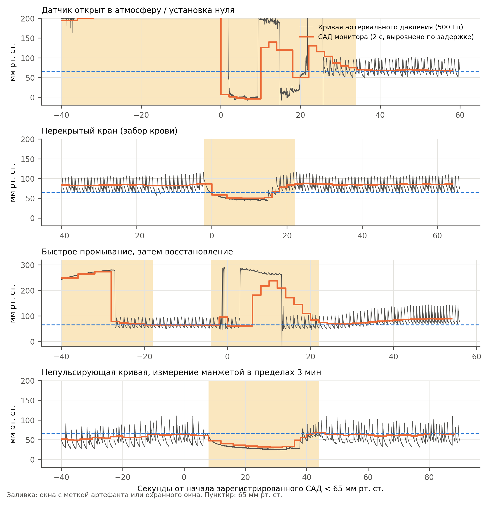
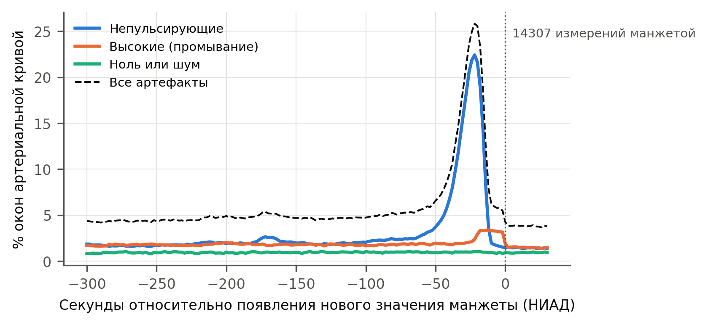
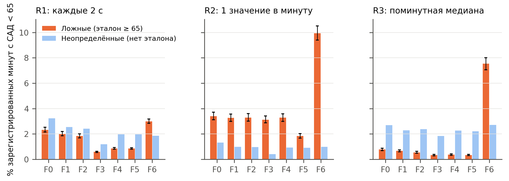
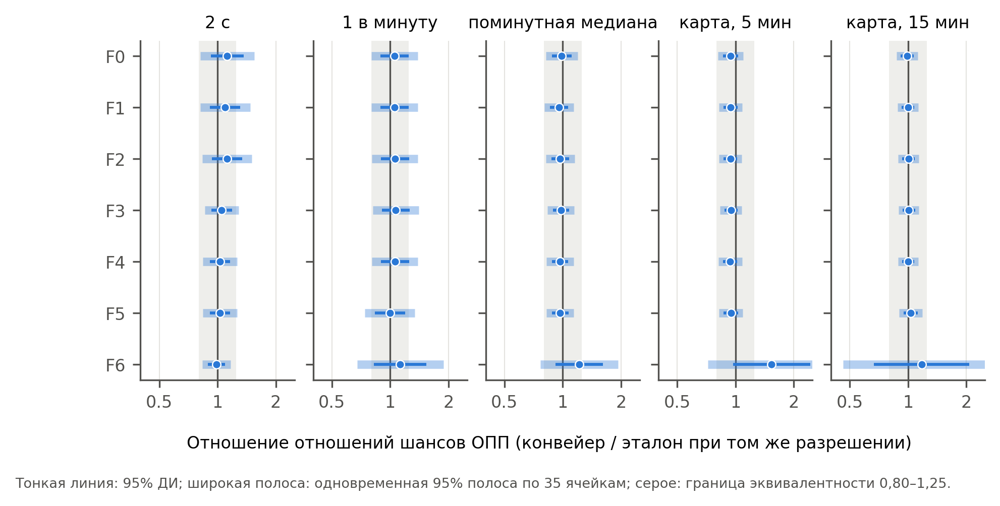

**Краткое название:** Артефакты артериальной линии и интраоперационная гипотензия

**Автор:** Oleg Tropynin (Олег Тропынин)

**Место работы:** Независимый исследователь, Караганда, Казахстан

**Автор для переписки:** Oleg Tropynin, tropininoleg@gmail.com

**Ключевые слова:** интраоперационная гипотензия; мониторинг артериального давления; артефакты; острое
повреждение почек; ошибка измерения; VitalDB

# Ключевые положения

- У 3249 пациентов с непрерывным мониторингом артериального давления 2,3% времени мониторинга
  было помечено по кривой как артефакт. При поминутных медианах и фильтре по диапазону 0,7%
  зарегистрированных минут со средним артериальным давлением (САД) ниже 65 мм рт. ст. были ложными.

- Для экспозиции ≥ 10 мин САД ниже 65 мм рт. ст., которая после поправки не была связана с острым
  повреждением почек (ОПП), обработка артефактов не изменила оценку (отношение отношений шансов 0,96;
  0,86–1,06). Этот вывод опирался на 33 пациентов с расхождением и не устоял бы при двух случаях
  ОПП среди них. Апостериорно (post hoc) для экспозиций, которые были связаны с ОПП, оценки конвейера
  обработки и эталона различались не более чем на несколько процентов.

- Сглаживание скользящей медианой и экспозиции по площади под порогом без фильтрации искажали
  измеренную гипотензию. Более трети нефильтрованной площади ниже 55 мм рт. ст. приходилось на
  артефакт (апостериорно).

- Многие короткие и очень глубокие зарегистрированные падения при ретроспективном анализе были
  помечены по кривой как артефакт (апостериорно). Тем не менее на 10-й секунде каждое пятое падение до 20–39 мм рт. ст.
  не было помечено. Внезапное падение следует считать истинным, пока кривая не покажет обратное.

- Частота артефактов артериальной кривой возрастала в шесть раз во время цикла неинвазивной манжеты,
  в основном в виде непульсирующей кривой. Это отчасти согласуется с окклюзией канюлированной руки.

# Резюме

**Цель.** Данные о связи интраоперационной гипотензии с острым повреждением почек (ОПП) основаны на
цифрах монитора, которые включают артефакты артериальной линии. Мы изучили, какая доля
зарегистрированной гипотензии является артефактом и искажает ли обработка артефактов эту связь.

**Методы.** У 3249 взрослых из открытого набора данных VitalDB каждое 2-секундное значение монитора
было размечено по кривой артериального давления с частотой 500 Гц, что дало эталонный ряд по кривой.
Мы сравнили его с 420 ретроспективными конвейерами обработки (7 фильтров × 5 разрешений × 4 метрики ×
3 порога). Первичной оцениваемой величиной было отношение скорректированных отношений шансов (ROR)
для ОПП по KDIGO при ≥ 10 мин среднего артериального давления ниже 65 мм рт. ст. при сравнении
поминутных медиан с фильтром по диапазону с эталоном. Заранее заданная граница эквивалентности
составляла 0,80–1,25.

**Результаты.** 96,3% времени мониторинга было свободно от артефактов. При поминутных медианах 0,7%
зарегистрированных минут гипотензии были ложными; при одном мгновенном значении в минуту — 3,3%. ОПП
развилось у 91 из 2563 пациентов (3,6%). Скорректированное отношение шансов составило 0,94 (95% ДИ
0,60–1,48) с эталоном и 0,90 (0,57–1,42) с конвейером обработки, что дало ROR 0,96 (0,86–1,06),
т. е. эквивалентно. Экспозиция различалась у 33 пациентов, ни у одного из которых не было ОПП. Ложная
гипотензия не показала выявляемой связи с ОПП. Доля артефактов артериального давления возрастала с 4%
до 26% во время измерения манжетой.

**Заключение.** При поминутных медианах и фильтре по диапазону обработка артефактов не изменила
выявляемым образом связь между гипотензией и ОПП. Это было верно для заранее заданной экспозиции,
которая после поправки не была связана с ОПП, и апостериорно (post hoc) для экспозиций, которые
были с ним связаны. Следует избегать сглаживания скользящей медианой и экспозиций по площади без
фильтрации.

# Введение

Интраоперационная гипотензия связана с острым повреждением почек (ОПП), повреждением миокарда и
смертью [1–4]. Пороговые значения, полученные в этих исследованиях, —
как правило, среднее артериальное давление (САД) ниже 65 мм рт. ст. дольше нескольких минут, — теперь
включены в согласительные документы и показатели качества [5]. Почти все эти данные получены в
ретроспективных анализах цифр, сохранённых анестезиологическими информационными системами. Это одно
значение в минуту или реже, взятое с монитора, а не с кривой, которую видит врач.

Инвазивное артериальное давление служит в этих исследованиях эталонным стандартом. Однако
сохранённые цифры наследуют каждое событие, нарушающее работу артериальной линии:

- промывание;
- забор крови через трёхходовой кран;
- установку нуля;
- перегиб или демпфирование катетера;
- раздувание манжеты на той же конечности [6–9].

Предшествующие работы установили три факта:

- выбор между опубликованными фильтрами артефактов меняет измеренную частоту гипотензии до двух раз,
  но мало менял связь с повреждением миокарда [10];

- более редкая дискретизация завышает измеренную нагрузку гипотензией относительно эталона по кривой,
  хотя её влияние на связь с исходами было лишь экстраполировано [11];

- способ моделирования гипотензии меняет оценки отношений шансов [12].

В недавних исследованиях открытого набора данных VitalDB, связывающих артериальное давление с
повреждением почек, применялось одно правило очистки данных либо оно не описывалось [13–15].

Остаются открытыми четыре вопроса:

1. Если артефакты выявлять по кривой, а не по правилам, применяемым к цифрам, какая доля
   зарегистрированной гипотензии является артефактом?

2. Меняют ли правило обработки артефактов и разрешение данных оценку связи между гипотензией и ОПП,
   если эту связь оценивать непосредственно?

3. Является ли ошибочная классификация артефактов *дифференциальной*? У более тяжёлых пациентов
   артериальную кровь забирают чаще. Если бы артефакт забора крови регистрировался как гипотензия
   преимущественно у пациентов, у которых затем развивается ОПП, эта ошибка смещала бы опубликованные
   связи в сторону от нулевого значения, а не к нему.

4. Какие зарегистрированные эпизоды низкого давления являются артефактом и как быстро это можно
   распознать?

Мы использовали две параллельные записи в VitalDB — кривую с частотой 500 Гц и 2-секундные цифры
монитора, — чтобы построить ряд САД с эталоном по кривой. Мы сравнили его с 420 конвейерами
обработки, которые правдоподобно могло бы использовать ретроспективное исследование, в заранее
заданном анализе мультивселенной [16,17].

# Методы

## Дизайн, данные и представление результатов

Мы провели ретроспективное когортное исследование открытого набора данных VitalDB [18]:

- 6388 случаев некардиальных хирургических вмешательств;
- Сеульская национальная университетская больница, 2016–2017 гг.;
- анестезиологические карты, результаты лабораторных исследований, числовые данные монитора (GE Solar 8000) и
  кривые высокого разрешения.

Сбор данных был одобрен институциональным этическим комитетом. Данные деидентифицированы и
общедоступны, поэтому дополнительного одобрения не требовалось. Представление результатов
соответствует STROBE и RECORD [19,20].

Протокол анализа был написан до расчёта какой-либо связи экспозиции с исходом и пересмотрен после
состязательной методологической рецензии. Он был зафиксирован помеченным коммитом после того, как весь
анализ был полностью выполнен на случайно переставленном исходе. В дополнительном протоколе
перечислены все поправки до фиксации, а также все изменения и апостериорные (post hoc) анализы после
раскрытия исхода, с датами и причинами. Апостериорные анализы везде обозначены как таковые.

Большая языковая модель (Claude, Anthropic) использовалась под руководством автора для написания
кода анализа, состязательной рецензии методов до фиксации, имитации рецензирования черновика и
подготовки текста. Кроме того, как описано ниже, она служила вторым ослеплённым экспертом. Автор
проверил весь код, результаты и текст.

## Участники

Мы включали взрослых под общей анестезией, в записи которых была кривая артериального
давления с частотой 500 Гц (лучевая артерия в 95%) и не менее 30 мин мониторинга, валидного по
эталону. Использовался только первый подходящий случай для каждого пациента.

Для анализа ОПП дополнительно исключали:

- трансплантацию;
- пациентов без исходного креатинина;
- исходную расчётную скорость клубочковой фильтрации (рСКФ, CKD-EPI 2021 [21]) ниже
  15 мл мин^−1^ 1,73 м^−2^;

- пациентов без измерения креатинина в течение 7 суток после анестезии.

## Классификация кривой и эталонный ряд

Монитор сохраняет систолическое, диастолическое и среднее артериальное давление каждые 2 с. Именно
этот поток сохраняют анестезиологические информационные системы и анализируют ретроспективные
исследования. Кривую мы использовали только для того, чтобы решить, *можно ли* доверять каждому
2-секундному значению монитора, и никогда не заменяли им это значение, поэтому различия калибровки
монитора и кривой не могли войти в сравнение.

Каждое 2-секундное окно кривой получало первую подходящую категорию:

- *ноль*: среднее ниже 15 мм рт. ст. и размах между 2-м и 98-м процентилями ниже 10 мм рт. ст.
  (датчик открыт в атмосферу или выполняется установка нуля);

- *высокое*: максимум выше 250 мм рт. ст. или среднее выше 200 мм рт. ст. (быстрое промывание);
- *непульсирующее*: размах ниже 8 мм рт. ст., интердецильный размах ниже 3 мм рт. ст. или отсутствие
  систолического подъёма (рост более чем на 8 мм рт. ст. за 100 мс) в центрированном 6-секундном окне.
  Сюда относятся трёхходовой кран, перекрытый в сторону пациента, и окклюзированная или перегнутая линия;

- *шум*: минимум ниже −10 мм рт. ст. или медиана абсолютной второй разности ≥ 4 мм рт. ст.;
- *валидное*: ничего из перечисленного.

Далее «артефакт» означает значение, помеченное этим классификатором. Поскольку монитор усредняет
давление по нескольким сокращениям, окна от 2 с до и до 8 с после любой
серии артефактов помечались как *охранное окно*. Восемь секунд — 95-й процентиль времени, за которое
монитор после артефакта снова совпадал с кривой.

Пороги устанавливались на данных без исходов. Критерий пульсации, основанный на межударной
автокорреляции, был отброшен до фиксации, поскольку он помечал фибрилляцию предсердий как
артефакт. Примеры представлены на рисунке 1.

**Выравнивание и период мониторинга.**

- *Задержка.* Числовые данные монитора отстают от кривой. Задержку оценивали для каждого случая,
  максимизируя корреляцию между САД монитора и средним значением окна кривой в валидных окнах.
  Она составила 4 с в 62% случаев и 6 с в 35%.

- *Период мониторинга.* Он длился от первых до последних непрерывных 60 с валидной кривой
  в пределах анестезии. Он начинался через 9,9 мин (медиана; МКИ 6,3–15,8) после начала
  анестезии, поэтому значительная часть постиндукционной гипотензии остаётся вне его [22].

**Эталонный ряд.** Эталоном служило выровненное по задержке САД монитора, ограниченное валидными
окнами.

- Пропуски длительностью до 3 мин, ограниченные с обеих сторон не менее чем 30 с валидных данных,
  заполнялись линейной интерполяцией между медианами до и после пропуска. Заполнение предотвращает
  систематическую потерю истинной гипотензии, совпадающей с забором крови.

- Минута считалась валидной, если не менее половины её окон были валидными или заполненными.

## Ретроспективные конвейеры обработки

Конвейер обработки превращает цифры монитора в экспозицию, используя только сами цифры.

*Фильтры* воспроизводили опубликованные правила:

- F0: без фильтра;
- F1: удаление САД ниже 20 или выше 250 мм рт. ст. [13];
- F2: удаление САД ниже 30 или выше 200 мм рт. ст. [23];
- F3: систолическое выше 250, диастолическое ниже 15, САД ниже 35 или выше 150 либо пульсовое давление
  ниже 15 мм рт. ст. [11];

- F4: физиологическая согласованность (САД ниже 20 или выше 200; систолическое ниже 20 или выше 300;
  систолическое ≤ диастолического; пульсовое давление ниже 5; диастолическое ниже 5);

- F5: F4, затем удаление значений, отличающихся от обоих соседних более чем на 30 мм рт. ст. [24];
- F6: F4, затем 7-точечная скользящая медиана [10].

*Разрешения*:

- R1: каждое 2-секундное значение;
- R2: одно мгновенное значение в минуту;
- R3: поминутная медиана;
- R4: значение, вносимое в карту каждые 5 мин и удерживаемое;
- R5: значение, вносимое в карту каждые 15 мин и удерживаемое.

R4 и R5 оценивали при нескольких фазовых сдвигах, и оценки усредняли.

*Экспозиции*, каждая при порогах 55, 60 и 65 мм рт. ст.:

- суммарные минуты ниже порога, на 10 мин, с ограничением 120 мин;
- площадь под порогом, на 100 мм рт. ст.·мин, с ограничением на уровне 99-го процентиля эталона;
- средневзвешенное по времени значение ниже порога, в мм рт. ст.;
- бинарная экспозиция «≥ 10 мин ниже порога».

Эталон обрабатывали при каждом разрешении тем же способом. Каждый конвейер сравнивали с эталоном
при том же разрешении, поэтому контраст выделяет именно очистку по кривой. Всего было 420
спецификаций конвейеров обработки.

## Исходы и ковариаты

Первичным исходом было ОПП по креатининовым критериям KDIGO [25]: повышение на
≥ 0,3 мг дл^−1^ в течение 48 ч или в ≥ 1,5 раза от исходного в течение 7 суток. Исходным значением
считали последний креатинин в течение 30 суток до операции, иначе — предоперационное значение.

Модели корректировали по:

- возрасту и рСКФ в виде ограниченных кубических сплайнов;
- полу, индексу массы тела, физическому статусу по ASA ≥ 3 и экстренности операции;
- артериальной гипертензии и сахарному диабету;
- предоперационному гемоглобину и альбумину;
- отделению и хирургическому доступу;
- логарифму длительности анестезии.

Вазопрессоры, инфузионную терапию и кровопотерю не включали, поскольку они могут лежать на причинном
пути. При 91 событии и 21 параметре приходилось 4,3 события на параметр. Мы
использовали логистическую регрессию со штрафом Фирта и интервалами Вальда [26], и две модели, образующие каждое отношение,
имеют одинаковый набор ковариат.

## Статистический анализ

**Ошибка измерения.** Каждую зарегистрированную минуту с САД ниже 65 мм рт. ст. классифицировали
относительно эталона при том же разрешении:

- *ложная*: эталон ≥ 65 мм рт. ст.;
- *подтверждённая*: эталон < 65 мм рт. ст.;
- *неопределённая*: нет валидного эталона. Неопределённые минуты никогда не считались артефактом.

*Скрытыми* минутами считались минуты эталона ниже 65 мм рт. ст., которые конвейер зарегистрировал как ≥ 65 мм рт. ст.
Для бинарной экспозиции приводим κ и число пациентов, у которых категория различалась.
Для долей приведены ДИ, полученные бутстрепом с кластеризацией по пациентам.

**Первичная оцениваемая величина.** Первичной оцениваемой величиной было отношение отношений шансов (ROR),
ROR = ОШ~конвейер~ / ОШ~эталон~, для ОПП при бинарной экспозиции «≥ 10 мин ниже 65 мм рт. ст.». Сравнивали
F1 × R3 с эталоном при R3, с тем же набором ковариат и на тех же пациентах. ROR в значительной мере
нечувствительно к конфаундингу, общему для обоих рядов.

Мы заранее задали границу эквивалентности 0,80–1,25 — общепринятую границу, симметричную в
логарифмической шкале:

- интервал внутри границы: эквивалентно;
- интервал, исключающий 1, при точечной оценке за пределами границы: существенное изменение;
- всё остальное: неопределённо.

Поскольку две экспозиции различаются лишь у немногих пациентов, процентильный бутстреп-интервал
слишком узок. При 100 перестановках исхода, когда истинное ROR равно 1, он накрывал 1 лишь в
51%. Поэтому правило, записанное до рассмотрения реального исхода, задавало каждый интервал типа ROR как:

  log ROR ± 1,96 × max(SE парного бутстрепа, SD по 200 перестановкам исхода).

Мы проверили этот интервал по его покрытию при независимых перестановках, а также путём моделирования
исходов по скорректированной эталонной модели с дифференциальной ошибкой, заданной на уровне границы
(дополнительные методы).

**Вторичные анализы.**

- То же ROR для всех 35 ячеек «фильтр × разрешение» с одновременными 95% полосами.
- Наклон на 10 мин ниже 65 мм рт. ст.
- Полная кривая спецификаций по метрикам и порогам.
- Влияние разрешения на сам эталон.

**Дифференциальная ошибочная классификация.** Мы построили регрессию ОПП на log(1 + ложные минуты на час
мониторинга) с поправкой на:

- эталонную экспозицию (линейный и сплайновый члены);
- логарифм часов мониторинга;
- набор ковариат.

Мы использовали необработанный 2-секундный поток (F0 × R1), поскольку при F1 × R3 ложные минуты были
ненулевыми у слишком малого числа пациентов (поправка A14, внесённая до фиксации). Негативным контролем
служили ложные гипертензивные минуты: САД конвейера выше 120 мм рт. ст. при эталоне ≤ 100 мм рт. ст.

**Эпизоды.** Каждую серию САД монитора ниже 65 мм рт. ст. классифицировали как:

- *помеченную по кривой как артефакт*: ≥ 50% её окон помечены как артефакт;
- *с преобладанием охранного окна*;
- *физиологическую*.

Мы табулировали вероятность того, что эпизод помечен, по итоговой длительности и надиру.
Протокол предусматривал дерево решений глубины 2 для простого правила; лучшим правилом оказалось
одно разбиение, о котором и сообщается.
Апостериорно мы также табулировали её по прошедшей длительности и надиру на данный момент, т. е. по
тому, что известно по мере развития эпизода.

**Валидация эталона.**

- *Независимые сигналы:*
  - САД по манжете в пределах 60 с от эпизода;
  - частота пульса по ЭКГ и плетизмограмме в непульсирующих окнах и при глубоких эпизодах;
  - доля непульсирующих окон при фибрилляции предсердий.
- *Внесение и обнаружение* синтетических артефактов по Li и соавт. [27], с апостериорным варьированием
  амплитуды и длительности. Внесённые артефакты напоминают собственные правила классификатора, поэтому
  это проверка реализации, а не независимая валидация.

- *Ослеплённая оценка ИИ* 152 фрагментов (дополнительные методы).

**Анализы чувствительности.** В заранее заданных анализах чувствительности варьировали:

- эталон: длину охранного окна, порог пульсового давления, валидность минуты, заполнение пропусков и
  среднее по кривой вместо значения монитора;

- период мониторинга;
- набор ковариат;
- исход: ОПП стадии ≥ 2; отсутствие послеоперационного креатинина, учтённое как отсутствие ОПП (S4);
  включение трансплантации (S6).

S4 и S6 были пропущены по ошибке и выполнены после раскрытия исхода. Апостериорные анализы
перечислены вместе с ними в таблице S5.

Анализы выполнены в Python 3.10 (NumPy, SciPy, pandas). Код классификатора, регрессии Фирта, сплайнов,
бутстрепа и перестановок написан автором и покрыт модульными тестами.

# Результаты

## Участники

Из 3645 случаев с записью кривой артериального давления у 3434 кривую удалось получить, а у 3429 был
определён период мониторинга. Описательная когорта включала 3249 пациентов. Суммарная длительность их
мониторинга составила 11 466 ч, медиана — 193 мин на пациента (МКИ 134–272).

Набор для анализа ОПП включал 2563 пациента, из них ОПП развилось у 91 (3,6%) (рисунок S1;
таблица 1). Включение в набор для анализа ОПП зависело от определения креатинина после операции. Из
пациентов описательной когорты без трансплантации в набор для анализа ОПП вошли:

- 96% пациентов торакальной хирургии;
- 97% урологических пациентов;
- 85% пациентов общей хирургии;
- 28% гинекологических пациентов.

## Какая доля записи артериального давления приходится на артефакты

В пределах периода мониторинга 96,3% 2-секундных окон были валидными. На собственно артефакты
приходилось 2,3%:

- *высокие значения* 1,2%;
- *отсутствие пульсации* 0,7%;
- *шум* 0,2%;
- *ноль* 0,07%.

Ещё 1,4% приходилось на охранные окна. Внутри периода мониторинга кривая артериального давления
никогда не отсутствовала: аналоговый канал ведёт запись непрерывно, а период ограничен валидными
данными.

Эпизоды артефактов были частыми:

| Тип артефакта | Пациенты хотя бы с одним эпизодом | Эпизодов на час мониторинга |
|---|---|---|
| Промывка | 98% | 2,6 |
| Шум | 97% | 2,7 |
| Непульсирующий участок | 90% | 2,0 |
| Обнуление | 33% | 0,2 |

В валидных окнах САД по данным монитора и среднее значение по кривой артериального давления
различались более чем на 10 мм рт. ст. в медиане 0,5% окон на пациента.

**Артефакты вокруг измерений манжетой** (рисунок 2). У 2579 пациентов с измерением как инвазивного
давления, так и давления манжетой 14,0% окон кривой артериального давления за 60 с до появления нового
значения манжеты были помечены как артефакт против 1,8% в остальное время (19 560 измерений). Превышение
достигало пика за 22 с до появления значения, во время осциллометрического цикла. На пике артефактом
были 25,8% окон против 4,3% за 4–5 мин до этого.

Пик почти целиком был обусловлен *непульсирующей* кривой: 22,4% против 1,7% исходно. Доля меток
промывки почти не возросла (2,3% против 1,7%).

Апостериорно (post hoc) превышение:

- наблюдалось как при регулярно повторяющихся измерениях (12,2% окон), которые, вероятно, были
  автоматическими, так и при нерегулярных (17,0%);

- было больше при радиальных катетерах (13,9% против 1,8% в остальное время; 2219 пациентов), чем при
  катетерах в артериях стопы или бедренной артерии, которые манжета на плече не может пережать (9,7%
  против 3,4%; 58 пациентов; критерий Манна–Уитни по пациентам, p < 0,001);

- было больше при катетере в правой, чем в левой лучевой артерии. У 60% пациентов с катетером в
  правой и у 31% с катетером в левой лучевой артерии не менее 10% окон кривой артериального давления
  в минуту перед измерением манжетой были артефактами.

Исходный уровень 4,3% за 4–5 мин до измерения выше 1,8% в остальное время, поскольку включает
предыдущий цикл манжеты. Рука, на которой находилась манжета, в VitalDB не регистрируется.

## Ложная и скрытая гипотензия

При разрешении «медиана за минуту» (R3) с фильтром F1 ложными были 0,66% (95% ДИ 0,58–0,74)
зарегистрированных минут с САД ниже 65 мм рт. ст. (рисунок 3; таблица S1). Доля ложных минут была
выше:

- при одном мгновенном значении в минуту (R2): 3,3% (3,0–3,6), что в 4–10 раз больше значения при R3
  для фильтров F0–F5;

- при исходном 2-секундном потоке (R1): 2,0% (1,9–2,2).

Фильтры F3–F5 устраняли большинство ложных минут при R1 и R3 (0,3–0,9%), но не при R2
(1,8–3,3%). Скользящая медиана по 7 точкам (F6) вела себя иначе, чем все остальные фильтры:

- она создавала ложные минуты: 7,5% при R3 и 9,9% при R2;
- она скрывала от 20% (R3) до 24% (R2) истинных минут гипотензии.

**Бинарная экспозиция.** По сравнению с эталоном при том же разрешении критерий «≥ 10 мин ниже
65 мм рт. ст.» классифицировался с κ 0,95–0,99 всеми фильтрами, кроме F6 при R2–R5 (таблица S2). При
F1 × R3 категорию экспозиции изменили 38 из 3249 пациентов (1,2%; 33 в наборе для анализа ОПП), 32 из
них — в сторону повышения; у 30 из 38 было 5–10 эталонных минут.

Разрешение влияло на распространённость экспозиции сильнее, чем любой фильтр. В самом эталонном ряду
доля пациентов с экспозицией составила 42,4% при R3, 51,2% при R4 и 53,2% при R5.

Медиана по 7 точкам, применённая к данным карты анестезии, устраняла бо́льшую часть экспозиции: κ
составил 0,39 при R4 и 0,20 при R5.

## Какие зарегистрированные эпизоды низкого давления помечены по кривой как артефакт

Из 106 725 зарегистрированных эпизодов САД ниже 65 мм рт. ст. у 3123 пациентов:

- 8471 (7,9%) были помечены по кривой как артефакт;
- в 3909 (3,7%) преобладало охранное окно;
- 94 345 (88,4%) были физиологическими.

На помеченные эпизоды приходилось 4,3% минут гипотензии. Доля помеченных эпизодов резко зависела от
итоговой длительности и надира (таблица 2):

- 65–90% эпизодов длительностью ≤ 60 с с надиром ниже 40 мм рт. ст.;
- 59–65% эпизодов длительностью ≤ 30 с с надиром 40–54 мм рт. ст.;
- ≤ 2,4% эпизодов с надиром 55–64 мм рт. ст.;
- ≤ 2% эпизодов длительностью более 1 мин с надиром ≥ 40 мм рт. ст.

Итоговая длительность эпизода неизвестна, пока он продолжается. Поэтому апостериорно (post hoc) мы также
рассмотрели эпизоды, при которых давление оставалось ниже 65 мм рт. ст. по истечении заданного времени,
в зависимости от достигнутого к этому моменту надира (таблица S3):

| Надир к этому моменту | через 10 с | через 30 с | через 60 с | через 120 с |
|---|---|---|---|---|
| 20–39 мм рт. ст. | 79% помечено | 57% | 8% | 2% |
| ниже 20 мм рт. ст. | 75% | 59% | 44% | 29% |

Единственное правило — снижение более чем на 20 мм рт. ст. от максимума за предшествующие 30 с —
выявляло помеченные эпизоды в валидационной половине пациентов со следующими характеристиками:

- чувствительность 0,89;
- специфичность 0,92;
- прогностическая ценность положительного результата 0,46.

Такая специфичность обеспечивалась тривиальными кратковременными снижениями. Среди всех эпизодов с
надиром ниже 40 мм рт. ст. она составила 0,07.

## Валидация эталона

**Давление, измеренное манжетой.** Заранее заданная проверка использовала САД по манжете в пределах
3 мин от эпизода. САД по манжете было ≥ 70 мм рт. ст.:

- в 84% (95% ДИ 83–85) из 4506 помеченных эпизодов;
- в 46% (45–47) из 10 967 физиологических эпизодов.

При апостериорном (post hoc) ограничении глубокими эпизодами (надир ниже 40 мм рт. ст.) и значением
манжеты в пределах 60 с САД по манжете было ≥ 70 мм рт. ст. в 81% (79–82) из 2081 помеченного эпизода
и в 28% (24–32) из 443 физиологических. Из этого следуют два вывода:

- примерно в одном из пяти помеченных глубоких эпизодов поблизости было низкое давление по манжете, и
  такой эпизод мог быть реальным;

- часть глубоких эпизодов, отнесённых к физиологическим, вероятно, была артефактом, пропущенным
  классификатором.

**Пульс.** В окнах без пульсации:

- ЧСС по ЭКГ составляла 40–150 мин^−1^ в 97,8% из 153 662 окон;
- частота пульса по плетизмографическому сигналу была в этом диапазоне в 92,6%.

Одна лишь ЧСС по ЭКГ не позволяет исключить электрическую активность без пульса.
Плетизмографический пульс присутствовал как в глубоких помеченных, так и в глубоких физиологических
эпизодах (98% и 97,5% окон).

**Фибрилляция предсердий.** Доля окон без пульсации не была выше у 13 пациентов с предоперационной
фибрилляцией предсердий (0,17% против 0,68%).

**Внесение–обнаружение** (таблица S8). Обнаруживались: промывки длительностью ≥ 2 с или
достигающие 250 мм рт. ст., уровни при открытом датчике до 25 мм рт. ст. и забор крови. Редко или
никогда не обнаруживались: короткие промывки до 200 мм рт. ст. включительно, избыточное демпфирование,
частичная окклюзия (кроме выраженной), дрейф и резонансные колебания.

**Слепая оценка ИИ** (вторичный анализ; таблица S9). Согласие составило 97,7% (κ 0,95; n = 131 после
исключения охранных окон и ответов «не уверен»).

## Связь с острым повреждением почек

**Эталонная связь.** Для экспозиции ≥ 10 мин ниже 65 мм рт. ст. отношение шансов ОПП составило:

- нескорректированное: 1,65 (1,09–2,51);
- с поправкой на возраст, рСКФ, ASA и экстренность: 1,46 (0,95–2,25);
- с полной поправкой: 0,94 (0,60–1,48);
- с полной поправкой без длительности анестезии: 1,10 (0,70–1,71).

Поскольку эта экспозиция кумулятивна, поправка на длительность устраняет часть её дисперсии.

Другие показатели экспозиции были связаны с ОПП после полной поправки (таблица S11):

- ≥ 10 мин ниже 60 мм рт. ст.: 1,71 (1,04–2,79);
- площадь ниже 65 мм рт. ст.: 1,24 на 100 мм рт. ст.·мин (1,07–1,45);
- средневзвешенная по времени величина ниже 65 мм рт. ст.: 1,27 на 1 мм рт. ст. (1,00–1,60).

Для ≥ 10 мин ниже 55 мм рт. ст. ОШ составило 1,95 (0,89–4,27), а на каждые 10 мин ниже
65 мм рт. ст. — 1,08 (0,99–1,17).

**Основная оцениваемая величина.** При F1 × R3 ОШ с полной поправкой составило 0,90 (0,57–1,42). ROR
составило 0,96 (95% ДИ 0,86–1,06; перестановочный p = 0,42), и заранее заданное заключение было
«эквивалентно».

Контраст определялся 33 пациентами из набора для анализа ОПП, у которых категория экспозиции
различалась: 28 перешли в более высокую категорию, 5 — в более низкую. Ни у одного из них ОПП не
развилось, тогда как по скорректированной эталонной модели ожидалось 1,6 случая. Заключение зависит от
того, у скольких из 28 пациентов, перешедших в более высокую категорию, развилось ОПП (апостериорно
(post hoc); таблица S7):

| Случаи ОПП среди 28 | ROR (95% ДИ) | Заключение |
|---|---|---|
| 0 (наблюдаемое) | 0,96 (0,86–1,07) | эквивалентно |
| 1 | 1,01 (0,90–1,14) | эквивалентно |
| 2 | 1,07 (0,90–1,27) | неопределённо |
| 3 | 1,13 (0,94–1,36) | неопределённо |

Согласно эталонной модели, вероятность двух и более случаев составляла 0,36. Поэтому заключение об
эквивалентности неустойчиво.

В симуляциях по скорректированной эталонной модели правило на основе интервала признавало
эквивалентность:

- в 82% наборов данных без дифференциальной ошибки;
- в 5% наборов данных, в которых дифференциальная ошибка смещала медиану ROR до 1,24.

**Там, где эталонная связь присутствовала** (апостериорно (post hoc)). Оценки по конвейеру обработки и
по эталону были близки:

| Экспозиция | ROR (95% ДИ) |
|---|---|
| ≥ 10 мин ниже 60 мм рт. ст. | 0,98 (0,85–1,15) |
| Площадь ниже 65 мм рт. ст. | 1,00 (0,97–1,03) |
| Средневзвешенная по времени величина ниже 65 мм рт. ст. | 1,01 (0,95–1,06) |

При 55 мм рт. ст. бинарное ROR было неточным: 1,28 (0,81–2,02) с F1 и 1,10 (0,84–1,45) с
F3. ОШ по конвейеру обработки, 2,49 (1,22–5,08), достигало номинальной значимости, тогда как эталонное,
1,95 (0,89–4,27), — нет.

На каждые 10 мин ниже 65 мм рт. ст. наклон по конвейеру обработки составил 1,09 (1,00–1,18) против
1,08 (0,99–1,17) для эталона. Разность логарифмов шансов составила 0,007 (от −0,005 до 0,019).

**Все 35 ячеек «фильтр × разрешение»** (таблица 3; рисунок 4). Ни один 95% интервал и ни одна
одновременная полоса не исключали 1. Двадцать пять ячеек были эквивалентны поточечно и 19 — по
одновременным полосам. Десять ячеек с неопределённым заключением:

- F0–F2 при R1;
- F2, F3, F4 и F6 при R2;
- F6 при R3–R5.

Четыре ячейки при R2 лежали в пределах 0,002 от верхней границы, по две с каждой стороны. Без учёта F6
точечные оценки находились в диапазоне от 0,94 до 1,12. Более грубое разрешение самого эталона не
изменяло ОШ заметным образом: относительно R3 оно составляло 0,93–1,10 с интервалами от 0,76
до 1,42.

**Метрика экспозиции** (рисунки S2–S4; таблица S4). По 420 спецификациям медиана ROR составила 0,99
(МКИ 0,95–1,01). Экспозиции, основанные на минутах, были нечувствительны к обработке (ROR 0,92–1,02).
Экспозиции, основанные на площади ниже 55 мм рт. ст., чувствительными были:

- без фильтра 37% общей площади ниже 55 мм рт. ст. составляли артефакты, причём половина из них
  приходилась на 1% пациентов;

- с F1 эта доля составляла 13%, с F3 — ноль;
- соответствующие ROR были большими, но неточными (апостериорно (post hoc); средневзвешенная по
  времени величина, F0: 0,30, 0,06–1,53).

Интервал для ОШ исключал 1 в 181 из 420 спецификаций конвейера обработки и в 33 из 105 эталонных
спецификаций. В 90 спецификациях, преимущественно основанных на площади, конвейер обработки и эталон
различались по статистической значимости.

**Анализы чувствительности** (таблица S5). Из 16 анализов чувствительности с интервалом 14 дали
заключение «эквивалентно» (ROR 0,94–0,97, интервалы в пределах 0,83–1,10). К ним относились заранее
заданные S4 и S6, исключение гинекологических пациентов и шкала риска заболевания.

Два анализа дали заключение «неопределённо»:

- эталон на основе среднего по кривой артериального давления (заранее заданный), 0,74 (0,48–1,16). Он
  изменяет калибровку, а не только очистку, поэтому не изолирует обработку артефактов, и мы не можем
  исключить реальное различие;

- период мониторинга, определённый по числовым данным монитора, 0,91 (0,75–1,11).

Поправка на кровопотерю и на число измерений креатинина, а также ОПП стадии ≥ 2
дали точечные оценки 0,95–0,97 без интервалов. Число измерений креатинина является следствием операции, и
этот анализ носит поисковый характер.

**Дифференциальная ошибка классификации** (таблица S6). Ложная гипотензия в исходном потоке не была
связана с частотой забора артериальной крови (ρ Спирмена 0,005, p = 0,81) и слабо обратно
коррелировала с классом ASA (ρ −0,06, p = 0,006).

С поправкой на эталонную экспозицию ОШ ОПП составило:

- 0,93 (0,74–1,16) на одно SD ложных минут;
- 0,59 (0,12–2,86) на единицу log(1 + минуты в час).

Заранее заданный отрицательный контроль, включённый в ту же модель, дал 1,17 (0,96–1,43) на одно SD;
в отдельной модели — 1,16 (0,95–1,42). Эти оценки неточны. Они не свидетельствуют о дифференциальной
ошибке, но не позволяют исключить её умеренную величину.

# Обсуждение

## Основные результаты

У 3249 пациентов с кривой артериального давления высокого разрешения артефакты были частыми событиями,
но составляли малую часть зарегистрированной гипотензии. При медиане за минуту и фильтре по диапазону
ложными были менее 1% минут гипотензии, а категория экспозиции изменилась у 1,2%
пациентов.

Для заранее заданной экспозиции, ≥ 10 мин ниже 65 мм рт. ст., скорректированная связь с ОПП была
нулевой (ОШ 0,94), поэтому недифференциальной ошибке почти не на что было воздействовать. Следовательно,
эквивалентность конвейера обработки и эталона (ROR 0,96) проверяет главным образом *дифференциальную*
ошибку. Это сценарий, при котором артефакты, регистрируемые преимущественно у пациентов, у которых
впоследствии разовьётся ОПП, создавали бы ложную связь.

Мы не нашли этому подтверждений:

- ни у одного из 33 пациентов, у которых изменилась категория, ОПП не развилось;
- ложная гипотензия не была связана с забором крови и не показала заметной связи
  с ОПП.

Однако это заключение неустойчиво. Два случая ОПП среди 28 пациентов, перешедших в более высокую
категорию, сделали бы его неопределённым, и согласно эталонной модели вероятность такого исхода
составляла около одной трети.

Устойчивость экспозиций, основанных на длительности, подтверждают ещё два наблюдения:

- *Там, где эталон показал связь* (≥ 10 мин ниже 60 мм рт. ст.; площадь и средневзвешенная по времени
  величина ниже 65 мм рт. ст.), оценки по конвейеру обработки отличались от эталонных на несколько
  процентов (апостериорно (post hoc)).

- *При 55 мм рт. ст.* оценка по конвейеру обработки была выше эталонной, но неточной.

Три решения в обработке данных имели большее значение, чем фильтр:

- **Скользящая медиана по 7 точкам.** Она создавала ложную гипотензию и скрывала пятую часть истинной
  гипотензии.

- **Экспозиции на основе площади ниже 55 мм рт. ст. без фильтрации.** Их завышали нулевые значения и
  значения промывки у небольшого числа пациентов: более трети площади составляли артефакты.

- **Разрешение.** Оно изменяло долю пациентов с экспозицией на пятую часть без заметного
  изменения ОШ.

## Сравнение с предшествующими работами

Pasma и соавт. обнаружили, что выбор одного из восьми фильтров изменял частоту гипотензии
до двух раз, но мало влиял на связь с повреждением миокарда [10].
Jacobsson и соавт. показали на эталоне по кривой артериального давления, что редкая выборка значений
завышает измеряемую гипотензию [11]. Оба сравнения проводились между конвейерами обработки или
экстраполировались на исходы.

Наше исследование добавляет:

- внешний эталон сравнения, основанный на кривой артериального давления, при каждом разрешении;
- прямую, заранее заданную оценку влияния на исход;
- проверку на дифференциальную ошибку.

В отношении экспозиций, основанных на длительности, наши результаты согласуются с обеими работами. В
отличие от Pasma и соавт., мы обнаружили, что медиана по 7 точкам существенно искажает экспозицию,
даже когда отношение отношений шансов остаётся
близким к 1. Исследование AWAKE показало, что метод мониторинга изменяет измеряемую и леченую гипотензию
при индукции [28]. Наши результаты по разрешению являются его ретроспективным аналогом.

Wax и соавт [29]. и недавний препринт по когорте MOVER [30] рассматривали расхождение между
давлением по манжете и инвазивным артериальным давлением как клиническую информацию. Частота артефактов
кривой артериального давления возрастала в шесть раз во время цикла манжеты, в основном в виде
непульсирующей кривой. Это измерительный механизм, порождающий такое расхождение. Картина отчасти
соответствует пережатию руки с катетером, поскольку превышение:

- было больше при радиальных катетерах, чем при катетерах в артериях нижних конечностей;
- было больше справа, чем слева;
- наблюдалось при регулярно повторяющихся измерениях;
- в основном не было связано с промывкой.

Меньшее превышение при катетерах в артериях стопы и бедренной артерии показывает, что это не полное
объяснение. В исследованиях расхождений следует исключать значения артериального давления, полученные
во время цикла манжеты, или показывать, что результаты сохраняются после такого исключения.

В более ранних работах алгоритмы выявления артефактов сравнивали с разметкой сохранённых
значений человеком [7, 31], а в обзорном исследовании не было найдено общепринятого
эталонного стандарта для артефактов артериального давления [32]. Наш подход использует кривую
артериального давления только для того, чтобы решить, можно ли доверять значению монитора. Его можно
воспроизвести на любом наборе данных, в котором хранится и то и другое.

## Практическое значение

**Для исследователей:**

- Используйте медиану за минуту с фильтром по диапазону или правило типа F3 и указывайте разрешение
  так же тщательно, как пороговое значение.

- Не используйте сглаживание скользящей медианой для оценки экспозиции.
- Не вычисляйте экспозиции на основе площади или средневзвешенные по времени экспозиции ниже
  55 мм рт. ст. по нефильтрованным данным.

- В парных мультиверсных сравнениях проверяйте операционные характеристики интервалов до
  раскрытия — при нулевой гипотезе и на границах принятия решения. Перестановки сами по себе проверяют
  только нулевую гипотезу. В наших данных процентильные интервалы накрывали истинное значение в половине
  нулевых наборов данных.

**Для разработки тревожных сигналов и ретроспективной очистки данных:**

- Эти вероятности ретроспективны и описывают популяцию. Их нельзя использовать для того, чтобы
  откладывать лечение, и внезапное снижение следует считать реальным, пока кривая артериального давления
  не покажет обратного.

- Через 10 с одно из пяти снижений до 20–39 мм рт. ст. не было помечено. В одном из пяти помеченных
  глубоких эпизодов в пределах минуты регистрировалось низкое давление по манжете.

- Многие очень кратковременные и очень глубокие зарегистрированные снижения ретроспективно были помечены
  по кривой как артефакт (апостериорно (post hoc)). Снижение ниже 20 мм рт. ст. через 2 мин всё ещё было
  помечено более чем в четверти случаев.

- Автоматизированная система могла бы использовать такие вероятности для *аннотирования* вероятного
  артефакта, но никогда — для *подавления* тревожного сигнала. Простое правило по величине снижения не
  разделяет глубокие артефакты и глубокие реальные события: ниже 40 мм рт. ст. его специфичность
  составила 0,07.

- По возможности манжету следует накладывать на конечность, противоположную артериальной линии [9].
  Манжета остаётся необходимым средством перекрёстной проверки артериальной линии.

## Сильные стороны и ограничения

Эталон получен по кривой артериального давления, записанной параллельно с числовыми данными, и никогда
не заменяет значения монитора. Протокол был зафиксирован после пробного прогона с перестановками, и
все последующие изменения задокументированы. Эталон проверен по независимым сигналам, а все данные и
код находятся в открытом доступе.

Ограничения:

- **Заключение об эквивалентности основано на небольшом числе пациентов.** Оно основано на 33
  пациентах с расхождением и не выдержало бы двух случаев ОПП среди них. Оно может не переноситься на
  когорты с бо́льшим числом артефактов или более сильной связью.

- **Эталон не проверялся экспертом-человеком.** ИИ-оценщик относится к тому же семейству моделей, что и
  разработчик классификатора, и видит только кривую артериального давления. Набор из 400 фрагментов со
  скрытым ключом опубликован для оценки экспертами; в нём следует показывать и значение монитора.

- **Эталон *проверен по кривой*, но не свободен от ошибок.** Классификатор не видит:
  - ошибок установки уровня датчика и дрейфа нуля, около 7 мм рт. ст. на 10 см, которые важны в
    положении на боку и при наклонах стола;

  - большей части случаев избыточного демпфирования;
  - частичной окклюзии;
  - очень коротких промывок.

  Он также пропускает часть артефактов: в 28% глубоких «физиологических» эпизодов поблизости было САД
  по манжете ≥ 70 мм рт. ст.

- **Нет данных об углекислом газе в конце выдоха (EtCO₂) и вазопрессорах.** Мы не анализировали их
  вокруг глубоких эпизодов.

- **Значительная часть постиндукционной гипотензии была пропущена.** Мониторинг начинался в медиане
  через 10 мин после начала анестезии [22].

- **Один центр, мало событий.** Данные получены в одном центре в 2016–2017 гг., преимущественно в
  общей и торакальной хирургии, с частотой ОПП 3,6% только по креатинину. Определение креатинина после
  операции различалось между отделениями.

- **Поправка.** Скорректированные ОШ зависят от поправки на длительность анестезии,
  которая частично устраняет кумулятивную экспозицию.

- **Симуляция карты анестезии.** Разрешения карты анестезии были смоделированы, а не взяты из реальных
  записей [6].

- **Частоты зависят от практики.** Частота артефактов зависит от местной практики. Механизмы, а также
  направление эффектов разрешения и сглаживания должны переноситься на другие условия.

## Выводы

Артефакты артериальной линии были частыми событиями, но составляли малую часть зарегистрированной
гипотензии. При поминутных медианах и фильтре по диапазону обработка артефактов не изменила
выявляемым образом связь между гипотензией и ОПП. Мы не нашли данных о том, что артефакт
регистрировался преимущественно у пациентов, у которых развилось ОПП, хотя вывод об эквивалентности
опирался на небольшое число пациентов с расхождением.

Сглаживание скользящей медианой и экспозиции по площади без фильтрации искажают измеренную
гипотензию. Короткие и очень глубокие зарегистрированные падения при ретроспективном анализе часто
оказываются артефактом, но внезапное падение должно побуждать взглянуть на кривую и никогда — откладывать лечение.

# Декларации

**Этика.** Это вторичный анализ деидентифицированного общедоступного набора данных VitalDB. Сбор
данных был одобрен институциональным этическим комитетом Сеульской национальной университетской
больницы, как описано в публикации с описанием данных [18]. Дополнительного одобрения или
согласия не требовалось.

**Финансирование.** Нет.

**Конфликт интересов.** Не заявлен.

**Доступность данных и кода.** VitalDB находится в открытом доступе по адресу https://vitaldb.net.
Код анализа, зафиксированный протокол со всеми поправками, прогон на переставленном исходе, сводные
результаты и набор из 400 фрагментов для экспертной оценки доступны по адресу [REPOSITORY URL]. Ключ
экспертной оценки предоставляется автором по запросу, чтобы сохранить ослепление будущих экспертов.

**Использование искусственного интеллекта.** Автор использовал систему ИИ (Claude, Anthropic) для
существенной части этой работы под руководством автора:

- написание кода анализа;
- состязательная рецензия методов до фиксации протокола;
- три имитированных рецензирования черновика (статистическое, клиническое, по обработке сигналов),
  которые привели к изменениям после раскрытия исхода, перечисленным в дополнительном протоколе;

- подготовка рукописи.

Экземпляр той же системы ИИ использовался также как второй ослеплённый эксперт при оценке фрагментов
кривой, как описано в разделе «Методы». Автор проверил код, результаты и текст и несёт полную
ответственность за содержание. Система ИИ не является автором.

**Вклад автора.** O.T. разработал концепцию и дизайн исследования, выполнил анализ,
интерпретировал результаты и написал рукопись.

**Благодарности.** Автор благодарит команду VitalDB Сеульской национальной университетской
больницы за открытый доступ к набору данных.

# Подписи к рисункам

**Рисунок 1.** Зарегистрированная гипотензия, помеченная по кривой как артефакт. На каждой панели
показаны кривая артериального давления с частотой 500 Гц (серая) и выровненное по задержке 2-секундное
САД монитора (оранжевое) вокруг начала зарегистрированного САД ниже 65 мм рт. ст. (время 0).
Затенённые окна помечены как артефакт или охранное окно. Сверху вниз:

- датчик открыт в атмосферу (установка нуля);
- трёхходовой кран перекрыт в сторону пациента во время забора крови;
- быстрое промывание с последующим восстановлением;
- непульсирующая кривая с показанием манжеты в пределах 3 мин.

**Рисунок 2.** Артефакты артериального давления вокруг измерений неинвазивной манжетой, по типу
артефакта. На графике показан процент 2-секундных окон артериального давления с каждой меткой в
зависимости от времени относительно момента появления нового значения манжеты (14 307 измерений
с полным окном от −300 до +30 с).

**Рисунок 3.** Ложные минуты среди зарегистрированных минут с САД ниже 65 мм рт. ст. по фильтру и
разрешению: R1 — 2-секундный поток; R2 — одно значение в минуту; R3 — медиана за 1 мин. Оранжевый:
ложные (эталон ≥ 65 мм рт. ст.), с 95% ДИ, полученным бутстрепом с кластеризацией по пациентам.
Синий: неопределённые (нет валидного эталона), никогда не учитывались как артефакт.

**Рисунок 4.** Отношение отношений шансов (ROR) для ОПП (≥ 10 мин ниже 65 мм рт. ст.) для каждой
комбинации «фильтр × разрешение», каждая относительно эталона при том же разрешении.

- Точки: отношение отношений шансов.
- Тонкие линии: 95% ДИ, log ROR ± 1,96 × max(SE бутстрепа, SD нулевого распределения перестановок).
- Широкие полосы: одновременные 95% полосы по 35 ячейкам.
- Серый: граница эквивалентности 0,80–1,25.

**Рисунок S1.** Поток пациентов.

**Рисунок S2.** Кривая спецификаций: отношения отношений шансов для всех 420 спецификаций
конвейеров обработки, отсортированные. На нижней панели отмечены фильтр, разрешение и порог.

**Рисунок S3.** Вероятность того, что зарегистрированный эпизод помечен по кривой как артефакт,
по итоговой длительности и надиру (данные таблицы 2).

**Рисунок S4.** Отношение отношений шансов при разрешении «медиана за 1 мин» по фильтру, метрике
экспозиции и порогу (апостериорное представление). Оранжевый: ROR < 1; синий: ROR > 1.

# Литература

1. Walsh M, Devereaux PJ, Garg AX, Kurz A, Turan A, Rodseth RN, et al. Relationship between intraoperative mean arterial pressure and clinical outcomes after noncardiac surgery: toward an empirical definition of hypotension. Anesthesiology. 2013;119(3):507-15. doi:10.1097/ALN.0b013e3182a10e26
2. Salmasi V, Maheshwari K, Yang D, Mascha EJ, Singh A, Sessler DI, et al. Relationship between intraoperative hypotension, defined by either reduction from baseline or absolute thresholds, and acute kidney and myocardial injury after noncardiac surgery. Anesthesiology. 2017;126(1):47-65. doi:10.1097/ALN.0000000000001432
3. Sun LY, Wijeysundera DN, Tait GA, Beattie WS. Association of intraoperative hypotension with acute kidney injury after elective noncardiac surgery. Anesthesiology. 2015;123(3):515-23. doi:10.1097/ALN.0000000000000765
4. Wesselink EM, Kappen TH, Torn HM, Slooter AJC, van Klei WA. Intraoperative hypotension and the risk of postoperative adverse outcomes: a systematic review. Br J Anaesth. 2018;121(4):706-21. doi:10.1016/j.bja.2018.04.036
5. Sessler DI, Bloomstone JA, Aronson S, Berry C, Gan TJ, Kellum JA, et al. Perioperative Quality Initiative consensus statement on intraoperative blood pressure, risk and outcomes for elective surgery. Br J Anaesth. 2019;122(5):563-74. doi:10.1016/j.bja.2019.01.013
6. Kool NP, van Waes JAR, Bijker JB, Peelen LM, van Wolfswinkel L, de Graaff JC, et al. Artifacts in research data obtained from an anesthesia information and management system. Can J Anaesth. 2012;59(9):833-41. doi:10.1007/s12630-012-9754-0
7. Pasma W, Wesselink EM, van Buuren S, de Graaff JC, van Klei WA. Artifacts annotations in anesthesia blood pressure data by man and machine. J Clin Monit Comput. 2021;35(2):259-67. doi:10.1007/s10877-020-00574-z
8. Gardner RM. Direct blood pressure measurement—dynamic response requirements. Anesthesiology. 1981;54(3):227-36. doi:10.1097/00000542-198103000-00010
9. Saugel B, Kouz K, Meidert AS, Schulte-Uentrop L, Romagnoli S. How to measure blood pressure using an arterial catheter: a systematic 5-step approach. Crit Care. 2020;24(1):172. doi:10.1186/s13054-020-02859-w
10. Pasma W, Peelen LM, van Buuren S, van Klei WA, de Graaff JC. Artifact processing methods influence on intraoperative hypotension quantification and outcome effect estimates. Anesthesiology. 2020;132(4):723-37. doi:10.1097/ALN.0000000000003131
11. Jacobsson M, Valadkhani A, Winski G, Bell M. Accuracy of quantifying hypotension during surgery using physiological sensor data. IEEE J Transl Eng Health Med. 2026;14:265-73. doi:10.1109/JTEHM.2026.3698197
12. Vernooij LM, van Klei WA, Machina M, Pasma W, Beattie WS, Peelen LM. Different methods of modelling intraoperative hypotension and their association with postoperative complications in patients undergoing non-cardiac surgery. Br J Anaesth. 2018;120(5):1080-9. doi:10.1016/j.bja.2018.01.033
13. Lee SB. Causal effect and personalization of intraoperative hypotension burden on postoperative acute kidney injury: a doubly robust analysis of the VitalDB cohort. J Pers Med. 2026;16(7):371. doi:10.3390/jpm16070371
14. Ensarioğlu M, Yıldırım AK. Intraoperative arterial waveform morphology trajectories and prediction of postoperative acute kidney injury: a latent-class analysis of the VitalDB registry. J Clin Med. 2026;15(17):6871. doi:10.3390/jcm15176871
15. Folks R, Tsang S, Brown DE, Blanks ZD, Moradinasab N, Mazzeffi M, et al. Intraoperative short-term blood pressure variability and postoperative acute kidney injury: a single-center retrospective cohort study using sample entropy analysis. BMC Anesthesiol. 2024;24(1):395. doi:10.1186/s12871-024-02784-3
16. Steegen S, Tuerlinckx F, Gelman A, Vanpaemel W. Increasing transparency through a multiverse analysis. Perspect Psychol Sci. 2016;11(5):702-12. doi:10.1177/1745691616658637
17. Simonsohn U, Simmons JP, Nelson LD. Specification curve analysis. Nat Hum Behav. 2020;4(11):1208-14. doi:10.1038/s41562-020-0912-z
18. Lee HC, Park Y, Yoon SB, Yang SM, Park D, Jung CW. VitalDB, a high-fidelity multi-parameter vital signs database in surgical patients. Sci Data. 2022;9(1):279. doi:10.1038/s41597-022-01411-5
19. von Elm E, Altman DG, Egger M, Pocock SJ, Gøtzsche PC, Vandenbroucke JP. The Strengthening the Reporting of Observational Studies in Epidemiology (STROBE) statement: guidelines for reporting observational studies. Lancet. 2007;370(9596):1453-7. doi:10.1016/S0140-6736(07)61602-X
20. Benchimol EI, Smeeth L, Guttmann A, Harron K, Moher D, Petersen I, et al. The REporting of studies Conducted using Observational Routinely-collected health Data (RECORD) statement. PLoS Med. 2015;12(10):e1001885. doi:10.1371/journal.pmed.1001885
21. Inker LA, Eneanya ND, Coresh J, Tighiouart H, Wang D, Sang Y, et al. New creatinine- and cystatin C-based equations to estimate GFR without race. N Engl J Med. 2021;385(19):1737-49. doi:10.1056/NEJMoa2102953
22. Südfeld S, Brechnitz S, Wagner JY, Reese PC, Pinnschmidt HO, Reuter DA, et al. Post-induction hypotension and early intraoperative hypotension associated with general anaesthesia. Br J Anaesth. 2017;119(1):57-64. doi:10.1093/bja/aex127
23. Khan JM, Maslove DM, Boyd JG. Optimized arterial line artifact identification algorithm cleans high-frequency arterial line data with high accuracy in critically ill patients. Crit Care Explor. 2022;4(12):e0814. doi:10.1097/CCE.0000000000000814
24. Du CH, Glick D, Tung A. Error-checking intraoperative arterial line blood pressures. J Clin Monit Comput. 2019;33(3):407-12. doi:10.1007/s10877-018-0167-7
25. Kidney Disease: Improving Global Outcomes (KDIGO) Acute Kidney Injury Work Group. KDIGO clinical practice guideline for acute kidney injury. Kidney Int Suppl. 2012;2(1):1-138.
26. Firth D. Bias reduction of maximum likelihood estimates. Biometrika. 1993;80(1):27-38. doi:10.1093/biomet/80.1.27
27. Li Q, Mark RG, Clifford GD. Artificial arterial blood pressure artifact models and an evaluation of a robust blood pressure and heart rate estimator. Biomed Eng Online. 2009;8:13. doi:10.1186/1475-925X-8-13
28. Kouz K, Wegge M, Flick M, Bergholz A, Moll-Khosrawi P, Nitzschke R, et al. Continuous intra-arterial versus intermittent oscillometric arterial pressure monitoring and hypotension during induction of anaesthesia: the AWAKE randomised trial. Br J Anaesth. 2022;129(4):478-86. doi:10.1016/j.bja.2022.06.027
29. Wax DB, Lin HM, Leibowitz AB. Invasive and concomitant noninvasive intraoperative blood pressure monitoring: observed differences in measurements and associated therapeutic interventions. Anesthesiology. 2011;115(5):973-8. doi:10.1097/ALN.0b013e3182330286
30. Liu Z, Zhuang Z, Wang S, Xu X, Wu E, Ma F, et al. Intraoperative cuff–arterial pressure discordance and postoperative creatinine doubling: a retrospective MOVER cohort study [Preprint]. Research Square. 2026. doi:10.21203/rs.3.rs-11148992/v1
31. Maleczek M, Laxar D, Kapral L, Kuhrn M, Abulesz YT, Dibiasi C, et al. A comparison of five algorithmic methods and machine learning pattern recognition for artifact detection in electronic records of five different vital signs: a retrospective analysis. Anesthesiology. 2024;141(1):32-43. doi:10.1097/ALN.0000000000004971
32. Bergmann T, Vakitbilir N, Nemoga-Stout X, Sainbhi AS, Stein KY, Silvaggio N, et al. Artifact management methodologies for arterial blood pressure signals: a systematic scoping review of human and animal literature. Physiol Rep. 2025;13(19):e70533. doi:10.14814/phy2.70533

## Таблица 1. Характеристика пациентов

| Характеристика | Описательная когорта | Набор для анализа ОПП: без ОПП | Набор для анализа ОПП: ОПП |
|---|---|---|---|
| n | 3249 | 2472 | 91 |
| Возраст, лет | 61 (51–69) | 62 (54–70) | 63 (56–72) |
| Женский пол | 1444 (44,4) | 1053 (42,6) | 19 (20,9) |
| ИМТ, кг м^−2^ | 23,0 (20,8–25,2) | 23,1 (20,9–25,2) | 22,6 (20,4–26,0) |
| Физический статус по ASA ≥ 3 | 492 (15,1) | 283 (11,4) | 28 (30,8) |
| Экстренная операция | 413 (12,7) | 266 (10,8) | 19 (20,9) |
| Артериальная гипертензия | 1085 (33,4) | 835 (33,8) | 42 (46,2) |
| Сахарный диабет | 398 (12,2) | 318 (12,9) | 18 (19,8) |
| Исходная рСКФ, мл мин^−1^ 1,73 м^−2^ | 95 (82–104) | 95 (83–103) | 94 (74–104) |
| Предоперационный гемоглобин, г дл^−1^ | 13,0 (11,6–14,2) | 13,1 (11,8–14,3) | 11,7 (10,4–13,6) |
| Общая хирургия | 2017 (62,1) | 1430 (57,8) | 67 (73,6) |
| Торакальная хирургия | 1001 (30,8) | 943 (38,1) | 17 (18,7) |
| Гинекология / урология | 231 (7,1) | 99 (4,0) | 7 (7,7) |
| Открытый доступ | 1318 (40,6) | 908 (36,7) | 61 (67,0) |
| Длительность анестезии, ч | 3,8 (2,8–5,2) | 3,8 (2,8–4,9) | 4,3 (3,2–6,3) |
| Время мониторинга, мин | 193 (134–272) | 188 (135–258) | 223 (157–346) |
| Эталонные минуты с САД < 65 мм рт. ст. | 7 (1–19) | 7 (1–18) | 11 (4–39) |
| Эталон: ≥ 10 мин с САД < 65 мм рт. ст. | 1377 (42,4) | 1021 (41,3) | 49 (53,8) |

Данные представлены как медиана (МКИ) или n (%). Эталон — САД монитора, верифицированное по кривой артериального давления, медиана за 1 мин.

## Таблица 2. Вероятность того, что зарегистрированный эпизод низкого САД помечен по кривой как артефакт

| Надир \ длительность | <=10 с | 11-30 с | 31-60 с | 1-2 мин | 2-5 мин | >5 мин |
|---|---|---|---|---|---|---|
| <20 мм рт. ст. | 79 (77–81) [1569] | 77 (74–80) [905] | 65 (58–71) [201] | 43 (34–52) [122] | 23 (16–31) [150] | 11 (4–21) [116] |
| 20-39 мм рт. ст. | 67 (64–70) [755] | 90 (89–92) [1813] | 75 (70–80) [386] | 12 (6–18) [125] | 1 (0–3) [232] | 4 (1–6) [248] |
| 40-54 мм рт. ст. | 59 (56–63) [1391] | 65 (61–69) [1508] | 13 (10–16) [661] | 2 (1–4) [903] | 1 (0–1) [1578] | 1 (0–2) [1177] |
| 55-64 мм рт. ст. | 2 (2–3) [66981] | 1 (1–2) [13525] | 1 (0–2) [5286] | 1 (0–2) [3346] | 0 (0–1) [2867] | 1 (0–1) [880] |

Эпизод: непрерывный участок САД монитора < 65 мм рт. ст. Ячейки: % помеченных (95% ДИ по кластерному бутстрепу по пациентам) [число эпизодов].

## Таблица 3. Все сочетания «фильтр × разрешение»: ошибка измерения и её влияние на связь с ОПП

| F | R | Ложные, % | Скрытые, % | Экспозиция, % К / Э | κ | ROR (95% ДИ) | Одновр. полоса |
|---|---|---|---|---|---|---|---|
| F0 | R1 | 2,3 | 1,0 | 44,1 / 42,3 | 0,96 | 1,12 (0,92–1,36) | 0,82–1,54 |
| F0 | R2 | 3,4 | 1,8 | 46,5 / 44,5 | 0,95 | 1,06 (0,89–1,25) | 0,80–1,39 |
| F0 | R3 | 0,8 | 1,3 | 43,4 / 42,4 | 0,97 | 0,99 (0,88–1,11) | 0,82–1,20 |
| F0 | R4 | – | – | 53,1 / 51,2 | 0,95 | 0,94 (0,86–1,04) | 0,81–1,10 |
| F0 | R5 | – | – | 54,4 / 53,2 | 0,96 | 0,99 (0,92–1,07) | 0,87–1,12 |
| F1 | R1 | 2,0 | 0,8 | 43,7 / 42,3 | 0,96 | 1,09 (0,91–1,31) | 0,81–1,47 |
| F1 | R2 | 3,3 | 1,8 | 46,3 / 44,5 | 0,96 | 1,06 (0,89–1,25) | 0,80–1,39 |
| F1 | R3 | 0,7 | 1,1 | 43,2 / 42,4 | 0,98 | 0,96 (0,86–1,06) | 0,80–1,14 |
| F1 | R4 | – | – | 52,9 / 51,2 | 0,95 | 0,95 (0,87–1,03) | 0,82–1,09 |
| F1 | R5 | – | – | 54,2 / 53,2 | 0,97 | 1,00 (0,93–1,08) | 0,88–1,13 |
| F2 | R1 | 1,8 | 0,6 | 43,5 / 42,3 | 0,97 | 1,12 (0,94–1,34) | 0,83–1,50 |
| F2 | R2 | 3,3 | 1,7 | 46,3 / 44,5 | 0,96 | 1,06 (0,90–1,25) | 0,81–1,39 |
| F2 | R3 | 0,5 | 0,9 | 43,0 / 42,4 | 0,98 | 0,97 (0,87–1,08) | 0,82–1,15 |
| F2 | R4 | – | – | 53,0 / 51,2 | 0,95 | 0,94 (0,87–1,02) | 0,82–1,08 |
| F2 | R5 | – | – | 54,3 / 53,2 | 0,97 | 1,01 (0,93–1,08) | 0,89–1,13 |
| F3 | R1 | 0,6 | 0,4 | 42,5 / 42,3 | 0,98 | 1,05 (0,93–1,19) | 0,86–1,28 |
| F3 | R2 | 3,1 | 1,6 | 46,1 / 44,5 | 0,96 | 1,07 (0,91–1,26) | 0,81–1,40 |
| F3 | R3 | 0,3 | 0,8 | 42,9 / 42,4 | 0,98 | 0,98 (0,89–1,08) | 0,83–1,15 |
| F3 | R4 | – | – | 53,1 / 51,2 | 0,95 | 0,95 (0,88–1,03) | 0,83–1,08 |
| F3 | R5 | – | – | 54,3 / 53,2 | 0,97 | 1,01 (0,94–1,09) | 0,90–1,14 |
| F4 | R1 | 0,9 | 0,6 | 42,8 / 42,3 | 0,98 | 1,03 (0,91–1,16) | 0,84–1,26 |
| F4 | R2 | 3,3 | 1,7 | 46,4 / 44,5 | 0,96 | 1,06 (0,89–1,25) | 0,80–1,39 |
| F4 | R3 | 0,4 | 0,9 | 42,9 / 42,4 | 0,98 | 0,97 (0,88–1,07) | 0,82–1,14 |
| F4 | R4 | – | – | 53,3 / 51,2 | 0,95 | 0,94 (0,86–1,02) | 0,82–1,08 |
| F4 | R5 | – | – | 54,4 / 53,2 | 0,97 | 1,00 (0,93–1,08) | 0,89–1,13 |
| F5 | R1 | 0,9 | 0,6 | 42,8 / 42,3 | 0,98 | 1,03 (0,91–1,16) | 0,84–1,26 |
| F5 | R2 | 1,8 | 0,8 | 45,5 / 44,5 | 0,97 | 1,00 (0,83–1,20) | 0,74–1,34 |
| F5 | R3 | 0,3 | 0,7 | 42,8 / 42,4 | 0,98 | 0,97 (0,88–1,07) | 0,82–1,14 |
| F5 | R4 | – | – | 51,8 / 51,2 | 0,96 | 0,95 (0,87–1,03) | 0,82–1,09 |
| F5 | R5 | – | – | 52,1 / 53,2 | 0,95 | 1,03 (0,95–1,12) | 0,90–1,19 |
| F6 | R1 | 3,0 | 3,5 | 42,4 / 42,3 | 0,98 | 0,99 (0,89–1,09) | 0,84–1,17 |
| F6 | R2 | 9,9 | 24,0 | 36,1 / 44,5 | 0,82 | 1,13 (0,83–1,54) | 0,68–1,88 |
| F6 | R3 | 7,5 | 19,9 | 36,2 / 42,4 | 0,86 | 1,22 (0,92–1,61) | 0,77–1,92 |
| F6 | R4 | – | – | 20,3 / 51,2 | 0,39 | 1,54 (0,97–2,44) | 0,72–3,28 |
| F6 | R5 | – | – | 11,0 / 53,2 | 0,20 | 1,18 (0,67–2,07) | 0,46–2,99 |

F, фильтр: F0 — нет; F1 — САД 20–250; F2 — САД 30–200; F3 — правило Jacobsson; F4 — физиологическая согласованность; F5 — F4 + правило соседних значений; F6 — F4 + скользящая медиана по 7 точкам. R, разрешение: R1 — 2-секундный поток; R2 — одно мгновенное значение в минуту; R3 — медиана за 1 мин; R4 — карта анестезии с шагом 5 мин; R5 — карта анестезии с шагом 15 мин. К / Э — конвейер обработки / эталон. Ложные: минута конвейера обработки < 65 мм рт. ст. при эталоне ≥ 65. Скрытые: доля эталонных минут < 65, которые конвейер обработки регистрирует как ≥ 65; ни один из этих показателей не определён для разрешений карты анестезии. Экспозиция: ≥ 10 мин с САД < 65 мм рт. ст.; распространённость экспозиции и κ — по описательной когорте (разрешения карты анестезии при фазовом сдвиге 0). ROR (отношение отношений шансов, конвейер обработки / эталон при соответствующем разрешении) — по набору для анализа ОПП; 95% ДИ = log ROR ± 1,96 × max(SE парного бутстрепа, SD перестановочного нулевого распределения); одновременная полоса: критическое значение бутстреп-максимума |z| по всем 35 ячейкам, применённое к той же SE.

# Рисунки

{width=100%}

{width=100%}

{width=100%}

{width=100%}
