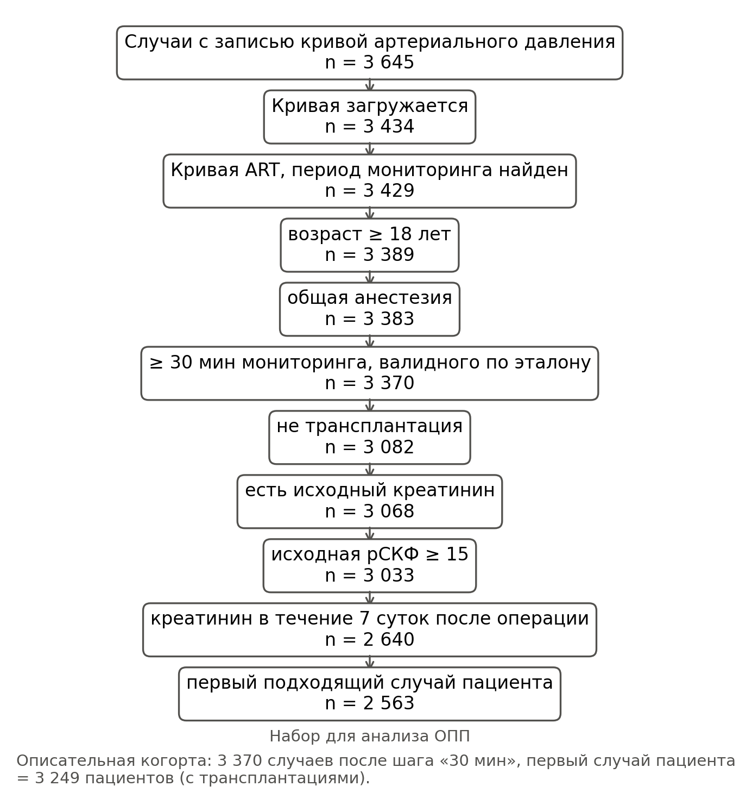
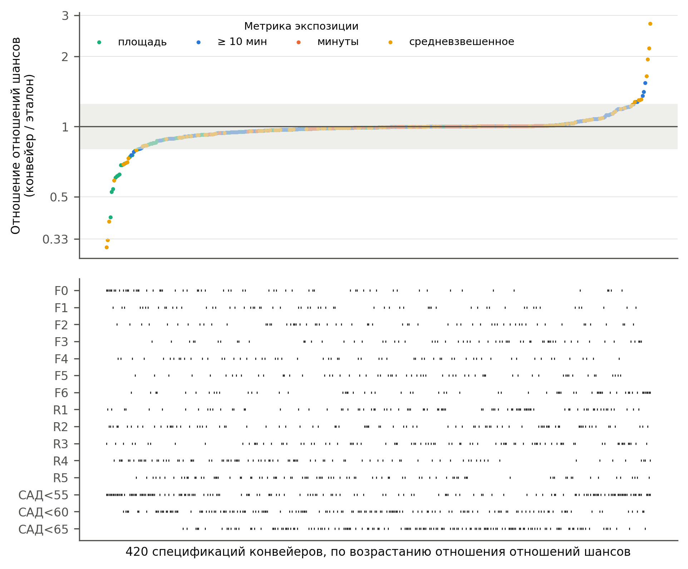
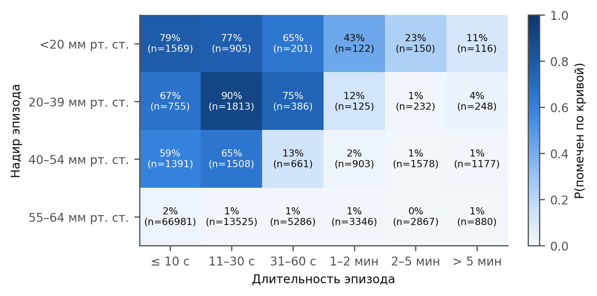
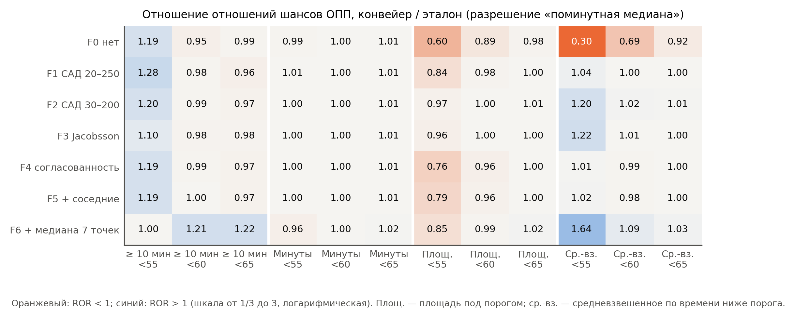

# Дополнительные методы

## S1. Признаки кривой артериального давления и классификатор

**Признаки.** Для каждого 2-секундного окна кривой с частотой 500 Гц мы вычисляли:
- долю конечных отсчётов;
- среднее, минимум, максимум, 2-й, 10-й, 90-й и 98-й центили;
- медиану абсолютной второй разности;
- число систолических подъёмов в окне и в центрированном 6-секундном окне.

Систолический подъём — это повышение более чем на 8 мм рт. ст. в пределах 100 мс после сглаживания
по 20 мс; последовательные подъёмы отстоят друг от друга не менее чем на 250 мс.

**Метки.** Метки, пороговые значения и охранные окна приведены в разделе «Методы».

**Случаи без кривой артериального давления.** Из 3645 случаев с указанной записью кривой для 211
кривая не была получена через API VitalDB 26 октября 2026 г. Их идентификаторы опубликованы вместе с
кодом.

**Настройка пороговых значений.** Порог шума, правило систолического подъёма и длительность охранного
окна были установлены при просмотре описательных данных без исходов менее чем по 600 случаям в ходе
разработки. Правило, отброшенное до фиксации протокола (автокорреляция с лагом в один удар), помечало
12% окон как непульсирующие у пациентов с фибрилляцией предсердий против 1% при синусовом ритме при
пульсовом давлении 56–83 мм рт. ст.

## S2. Интервал для отношения отношений шансов (поправка A15)

**Почему бутстреп не сработал.** Категории экспозиции при F1 × R3 и по эталону различались у
33 из 2563 пациентов. Бутстреп-выборки изменяют состав лишь немногих из этих пациентов, поэтому бутстреп-распределение
log ROR имеет пиковую форму, а его центральные 95% узки. В 100 перестановках исхода, при которых истинное
ROR равно ровно 1, процентильный интервал накрывал 1 в 51% наборов данных для F1 × R3, в 79% для
F0 × R1, в 89% для F3 × R2 и в 91% для F6 × R3.

**Правило.** До анализа реального исхода письменно зафиксированное правило задало каждый интервал
типа ROR как log ROR ± z × max(SE бутстрепа, SD перестановочного нулевого распределения). SD
перестановочного нулевого распределения получали по 200 перестановкам анализируемого исхода. Та же SE
использовалась для одновременных полос, критическое значение которых — бутстреп-максимум |z| по 35
ячейкам (3,22).

**Проверка покрытия.** SD оценивали по 200 перестановкам в пробном прогоне независимо от
100 калибровочных наборов данных. С этим SD интервал накрывал 1 в 100%, 99%, 100% и 97%
калибровочных наборов данных для четырёх пар.

**Операционные характеристики на границе.** Исходы моделировали по эталонной модели с полной
поправкой, добавляя сдвиг логарифма шансов γ у пациентов, переведённых конвейером обработки в более
высокую категорию. Мы выбрали γ = 1,91, чтобы медиана смоделированного ROR составила 1,24. В 200 наборах
данных, каждый из которых анализировали по полному правилу (200 бутстреп-выборок и 200 перестановок),
эквивалентность признавалась в 5%. Без дифференциальной ошибки (γ = 0) она признавалась в 82%, а
интервал накрывал 1 в 97%.

Для достижения нижней границы необходимо, чтобы ОПП развилось почти у всех пяти пациентов, перешедших в
более низкую категорию. SD log ROR при смоделированной альтернативе (0,098) превышало SD при нулевой
гипотезе (0,062). В этом случае в правиле преобладает SE бутстрепа, которая растёт с числом случаев
среди пациентов с расхождением.

## S3. Слепая оценка ИИ

Набор для экспертной оценки из 400 фрагментов включает пять страт:
- 100 окон с низким САД, помеченных как артефакт;
- 50 окон с низким САД, помеченных только как охранное окно;
- 100 окон с низким САД, помеченных как валидные;
- 100 случайных валидных окон;
- 50 помеченных окон с САД ≥ 65 мм рт. ст.

На одного пациента приходится не более двух фрагментов. Подмножество из 152 фрагментов было показано в
виде 26 сеток по шесть 40-секундных панелей кривой артериального давления двум независимым экземплярам
ИИ-модели (Claude, Anthropic). Сетки находились в папке, не содержавшей ключа, кода или меток. Оценщики
могли читать файлы, получили инструкцию открывать только перечисленные изображения и видели только
кривую артериального давления.

Промпт опубликован вместе с кодом. Подмножество обогащено артефактами (43% против 3,7%
в данных), что завышает κ.

## S4. Внесение–обнаружение

Для проверки реализации использовали 296 чистых 2-минутных сегментов из 100 случаев. Синтетические
артефакты промывки, обнуления, забора крови, демпфирования, шума и смещения, по Li и соавт., вносили в
средние 20 с.

В апостериорном (post hoc) переборе использовали 119 сегментов из 60 случаев. Варьировали:
- амплитуду (120–300 мм рт. ст.) и длительность (0,5–4 с) промывки;
- уровень при открытом датчике (0–25 мм рт. ст.);
- частоту среза демпфирования (1,5–10 Гц);
- частичную окклюзию (пульсовое давление, умноженное на 0,5–0,15);
- линейный дрейф (10–40 мм рт. ст. за 20 с);
- резонансные колебания 18 Гц (5–20 мм рт. ст.);
- забор крови без завершающей промывки.

При обнаружении учитывали только метки артефактов, но не охранного окна. Чистые сегменты отбирались как
валидные классификатором, поэтому отсутствие ложных меток в сегментах без внесения выполняется по
построению.

## S5. Таблица эпизодов в реальном времени

Для каждого эпизода и каждого прошедшего времени t (10, 30, 60 и 120 с) надиром к этому моменту
считали наименьшее САД монитора за первые t секунд. Эпизоды короче t при t не учитывали. Поэтому
таблица даёт вероятность того, что эпизод помечен, при условии, что он длился не менее t секунд и
достиг заданного надира.

# Дополнительные таблицы

## Таблица S1. Зарегистрированные минуты с САД < 65 мм рт. ст., классифицированные по сравнению с эталоном (описательная когорта)

| Разрешение | Фильтр | Минуты < 65 | Доля ложных | ДИ н. | ДИ в. | Доля подтв. | Доля заполн. низких | Доля неопр. | Пациентов с ложными минутами |
|-----------|-------|-------|-------|------|------|-------|--------|-------|----------|
| R1 | F0 | 61 600 | 0.023 | 0.021 | 0.025 | 0.932 | 0.012 | 0.032 | 2196 |
| R1 | F1 | 60 900 | 0.020 | 0.019 | 0.022 | 0.943 | 0.012 | 0.025 | 2104 |
| R1 | F2 | 60 600 | 0.018 | 0.017 | 0.020 | 0.947 | 0.011 | 0.024 | 2060 |
| R1 | F3 | 58 400 | 0.006 | 0.005 | 0.006 | 0.974 | 0.008 | 0.012 | 1921 |
| R1 | F4 | 59 600 | 0.009 | 0.008 | 0.009 | 0.963 | 0.009 | 0.020 | 2041 |
| R1 | F5 | 59 600 | 0.009 | 0.008 | 0.009 | 0.963 | 0.009 | 0.020 | 2029 |
| R1 | F6 | 59 100 | 0.030 | 0.028 | 0.032 | 0.942 | 0.010 | 0.019 | 2683 |
| R2 | F0 | 62 200 | 0.034 | 0.031 | 0.037 | 0.934 | 0.019 | 0.013 | 1108 |
| R2 | F1 | 61 900 | 0.033 | 0.030 | 0.036 | 0.938 | 0.019 | 0.010 | 1065 |
| R2 | F2 | 62 000 | 0.033 | 0.030 | 0.036 | 0.938 | 0.020 | 0.010 | 1081 |
| R2 | F3 | 61 300 | 0.031 | 0.029 | 0.034 | 0.946 | 0.019 | 0.004 | 1079 |
| R2 | F4 | 62 000 | 0.033 | 0.030 | 0.036 | 0.938 | 0.020 | 0.009 | 1098 |
| R2 | F5 | 60 900 | 0.018 | 0.017 | 0.020 | 0.953 | 0.019 | 0.009 | 754 |
| R2 | F6 | 51 500 | 0.099 | 0.094 | 0.105 | 0.868 | 0.023 | 0.010 | 1338 |
| R3 | F0 | 59 600 | 0.008 | 0.007 | 0.009 | 0.960 | 0.006 | 0.027 | 363 |
| R3 | F1 | 59 300 | 0.007 | 0.006 | 0.007 | 0.964 | 0.006 | 0.023 | 311 |
| R3 | F2 | 59 400 | 0.005 | 0.005 | 0.006 | 0.963 | 0.008 | 0.024 | 271 |
| R3 | F3 | 58 800 | 0.003 | 0.003 | 0.004 | 0.970 | 0.009 | 0.018 | 170 |
| R3 | F4 | 59 200 | 0.004 | 0.003 | 0.004 | 0.966 | 0.008 | 0.023 | 195 |
| R3 | F5 | 59 200 | 0.003 | 0.003 | 0.004 | 0.967 | 0.008 | 0.022 | 177 |
| R3 | F6 | 51 900 | 0.075 | 0.071 | 0.080 | 0.887 | 0.011 | 0.027 | 1105 |

«Минуты < 65» — минуты конвейера обработки с САД < 65; все доли рассчитаны от них. ДИ н./ДИ в. — 95% ДИ доли ложных минут (кластерный бутстреп по пациентам). Подтв. — подтверждённые; заполн. низкие — эталон < 65 при < 50% наблюдаемых окон; неопр. — эталона нет.

## Таблица S2. Согласие бинарной экспозиции (≥ 10 мин с САД < 65) с эталоном (описательная когорта)

| Фильтр | Разрешение | Эксп., эталон | Эксп., конвейер | Чувств. | Специф. | κ | Расх. | Вверх | Вниз | Ср. разн. | ГС н. | ГС в. |
|-------|-----------|-------|---------|--------|--------|------|------|------|------|------|------|------|
| F0 | R1 | 0.423 | 0.441 | 0.999 | 0.967 | 0.960 | 64 | 62 | 2 | 0.9 | -6.3 | 8.0 |
| F0 | R2 | 0.445 | 0.465 | 0.997 | 0.962 | 0.955 | 73 | 69 | 4 | 0.6 | -5.9 | 7.1 |
| F0 | R3 | 0.424 | 0.434 | 0.995 | 0.979 | 0.971 | 46 | 39 | 7 | 0.4 | -6.8 | 7.6 |
| F0 | R4 | 0.512 | 0.531 | 0.993 | 0.955 | 0.949 | 83 | 72 | 11 | 0.5 | -7.3 | 8.3 |
| F0 | R5 | 0.532 | 0.544 | 0.994 | 0.968 | 0.963 | 59 | 49 | 10 | 0.5 | -10.5 | 11.6 |
| F1 | R1 | 0.423 | 0.437 | 0.996 | 0.973 | 0.965 | 56 | 51 | 5 | 0.6 | -5.8 | 7.1 |
| F1 | R2 | 0.445 | 0.463 | 0.997 | 0.965 | 0.958 | 67 | 63 | 4 | 0.5 | -5.4 | 6.4 |
| F1 | R3 | 0.424 | 0.432 | 0.996 | 0.983 | 0.976 | 38 | 32 | 6 | 0.3 | -6.3 | 7.0 |
| F1 | R4 | 0.512 | 0.529 | 0.994 | 0.959 | 0.954 | 75 | 65 | 10 | 0.4 | -7.0 | 7.9 |
| F1 | R5 | 0.532 | 0.542 | 0.994 | 0.970 | 0.966 | 55 | 45 | 10 | 0.5 | -10.3 | 11.3 |
| F2 | R1 | 0.423 | 0.435 | 0.996 | 0.976 | 0.968 | 51 | 45 | 6 | 0.6 | -5.8 | 6.9 |
| F2 | R2 | 0.445 | 0.463 | 0.997 | 0.966 | 0.959 | 66 | 62 | 4 | 0.5 | -5.4 | 6.4 |
| F2 | R3 | 0.424 | 0.430 | 0.995 | 0.986 | 0.979 | 34 | 27 | 7 | 0.4 | -6.3 | 7.0 |
| F2 | R4 | 0.512 | 0.530 | 0.995 | 0.959 | 0.954 | 74 | 65 | 9 | 0.5 | -7.0 | 7.9 |
| F2 | R5 | 0.532 | 0.543 | 0.995 | 0.970 | 0.966 | 55 | 46 | 9 | 0.5 | -10.2 | 11.2 |
| F3 | R1 | 0.423 | 0.425 | 0.993 | 0.992 | 0.985 | 24 | 15 | 9 | -0.1 | -4.0 | 3.8 |
| F3 | R2 | 0.445 | 0.461 | 0.997 | 0.968 | 0.962 | 61 | 57 | 4 | 0.3 | -3.7 | 4.3 |
| F3 | R3 | 0.424 | 0.429 | 0.996 | 0.987 | 0.981 | 30 | 24 | 6 | 0.2 | -2.6 | 3.0 |
| F3 | R4 | 0.512 | 0.531 | 0.995 | 0.958 | 0.954 | 75 | 67 | 8 | 0.4 | -5.9 | 6.7 |
| F3 | R5 | 0.532 | 0.543 | 0.995 | 0.970 | 0.967 | 54 | 45 | 9 | 0.4 | -9.4 | 10.3 |
| F4 | R1 | 0.423 | 0.428 | 0.996 | 0.989 | 0.983 | 27 | 21 | 6 | 0.2 | -4.6 | 5.1 |
| F4 | R2 | 0.445 | 0.464 | 0.997 | 0.965 | 0.958 | 68 | 64 | 4 | 0.5 | -5.1 | 6.1 |
| F4 | R3 | 0.424 | 0.429 | 0.995 | 0.988 | 0.981 | 30 | 23 | 7 | 0.3 | -5.8 | 6.5 |
| F4 | R4 | 0.512 | 0.533 | 0.995 | 0.953 | 0.949 | 82 | 74 | 8 | 0.5 | -6.9 | 7.8 |
| F4 | R5 | 0.532 | 0.544 | 0.995 | 0.969 | 0.966 | 55 | 47 | 8 | 0.5 | -9.9 | 10.9 |
| F5 | R1 | 0.423 | 0.428 | 0.996 | 0.989 | 0.983 | 27 | 21 | 6 | 0.2 | -4.6 | 5.1 |
| F5 | R2 | 0.445 | 0.455 | 0.996 | 0.979 | 0.973 | 43 | 37 | 6 | 0.2 | -5.1 | 5.4 |
| F5 | R3 | 0.424 | 0.428 | 0.995 | 0.988 | 0.982 | 29 | 22 | 7 | 0.3 | -5.8 | 6.4 |
| F5 | R4 | 0.512 | 0.518 | 0.986 | 0.973 | 0.959 | 66 | 42 | 24 | -0.1 | -6.6 | 6.5 |
| F5 | R5 | 0.532 | 0.521 | 0.966 | 0.985 | 0.950 | 81 | 23 | 58 | -0.3 | -10.2 | 9.6 |
| F6 | R1 | 0.423 | 0.424 | 0.991 | 0.991 | 0.981 | 30 | 17 | 13 | 0.1 | -4.8 | 5.0 |
| F6 | R2 | 0.445 | 0.361 | 0.806 | 0.996 | 0.818 | 287 | 7 | 280 | -2.7 | -12.5 | 7.1 |
| F6 | R3 | 0.424 | 0.362 | 0.846 | 0.995 | 0.857 | 222 | 10 | 212 | -1.9 | -11.8 | 8.0 |
| F6 | R4 | 0.512 | 0.203 | 0.395 | 0.999 | 0.388 | 1009 | 2 | 1007 | -8.7 | -32.4 | 15.0 |
| F6 | R5 | 0.532 | 0.110 | 0.207 | 0.999 | 0.195 | 1372 | 2 | 1370 | -12.0 | -47.9 | 24.0 |

Эксп. — доля пациентов с экспозицией по эталону и по конвейеру; чувств./специф. — чувствительность и специфичность конвейера относительно эталона. Расх. — пациенты с различающейся категорией (вверх: экспозиция только по конвейеру обработки; вниз: только по эталону). R4/R5 при фазовом сдвиге 0. Ср. разн. — средняя разность, ГС н./ГС в. — нижняя и верхняя границы согласия Бланда–Альтмана, в минутах ниже 65 мм рт. ст.

## Таблица S3. АПОСТЕРИОРНО (POST HOC): вероятность того, что эпизод помечен по кривой как артефакт, в зависимости от прошедшего времени и надира к этому моменту

| всё ещё < 65 мм рт. ст. через (с) | Надир к этому моменту | Эпизодов | Доля помеченных |
|------|--------|---------|-----------|
| 10 | <20 | 1406 | 0.747 |
| 10 | 20-39 | 2046 | 0.792 |
| 10 | 40-54 | 3301 | 0.478 |
| 10 | 55-64 | 33017 | 0.016 |
| 30 | <20 | 384 | 0.594 |
| 30 | 20-39 | 704 | 0.574 |
| 30 | 40-54 | 2057 | 0.070 |
| 30 | 55-64 | 15900 | 0.009 |
| 60 | <20 | 224 | 0.442 |
| 60 | 20-39 | 300 | 0.080 |
| 60 | 40-54 | 2018 | 0.017 |
| 60 | 55-64 | 9413 | 0.007 |
| 120 | <20 | 159 | 0.289 |
| 120 | 20-39 | 248 | 0.024 |
| 120 | 40-54 | 1993 | 0.010 |
| 120 | 55-64 | 4911 | 0.006 |

Среди эпизодов, длившихся не менее указанного времени; надир к этому моменту — наименьшее САД монитора до этого момента.

## Таблица S4. АПОСТЕРИОРНО (POST HOC): экспозиции, взвешенные по глубине, и более низкие пороговые значения (разрешение «медиана за 1 мин»)

| Метрика | Порог | Фильтр | Разрешение | ОШ эталона | ОШ конвейера | ROR | ДИ н. | ДИ в. | p (перестановки) |
|--------|------|-------|-----------|--------|----------|------|------|------|---------------|
| TWA | 55 | F0 | R3 | 3.893 | 1.186 | 0.305 | 0.061 | 1.531 | 0.105 |
| TWA | 55 | F1 | R3 | 3.893 | 4.065 | 1.044 | 0.401 | 2.715 | 0.880 |
| TWA | 55 | F3 | R3 | 3.893 | 4.767 | 1.224 | 0.546 | 2.744 | 0.470 |
| TWA | 65 | F0 | R3 | 1.266 | 1.169 | 0.923 | 0.788 | 1.083 | 0.235 |
| TWA | 65 | F1 | R3 | 1.266 | 1.273 | 1.005 | 0.953 | 1.060 | 0.780 |
| TWA | 65 | F3 | R3 | 1.266 | 1.269 | 1.002 | 0.958 | 1.048 | 0.870 |
| AUC | 55 | F0 | R3 | 3.990 | 2.413 | 0.605 | 0.197 | 1.853 | 0.335 |
| AUC | 55 | F1 | R3 | 3.990 | 3.339 | 0.837 | 0.406 | 1.726 | 0.565 |
| AUC | 55 | F3 | R3 | 3.990 | 3.812 | 0.955 | 0.653 | 1.398 | 0.730 |
| AUC | 65 | F0 | R3 | 1.242 | 1.217 | 0.980 | 0.911 | 1.054 | 0.605 |
| AUC | 65 | F1 | R3 | 1.242 | 1.242 | 1 | 0.968 | 1.033 | 0.995 |
| AUC | 65 | F3 | R3 | 1.242 | 1.247 | 1.004 | 0.981 | 1.028 | 0.705 |

| Показатель | Значение |
|-----------------------------------------|---------------------|
| AUC < 55, F0 × R3: отношение суммарных площадей, конвейер / эталон | 1.593 |
| AUC < 55, F0 × R3: доля избытка | 0.372 |
| AUC < 55, F0 × R3: доля избытка у 1% пациентов | 0.563 |
| AUC < 55, F1 × R3: отношение суммарных площадей, конвейер / эталон | 1.147 |
| AUC < 55, F1 × R3: доля избытка | 0.129 |
| AUC < 55, F1 × R3: доля избытка у 1% пациентов | 0.554 |
| AUC < 55, F3 × R3: отношение суммарных площадей, конвейер / эталон | 0.991 |
| AUC < 55, F3 × R3: доля избытка | -0.009 |
| AUC < 55, F3 × R3: доля избытка у 1% пациентов | -2.051 |
| AUC < 65, F0 × R3: отношение суммарных площадей, конвейер / эталон | 1.125 |
| AUC < 65, F0 × R3: доля избытка | 0.111 |
| AUC < 65, F0 × R3: доля избытка у 1% пациентов | 0.519 |
| AUC < 65, F1 × R3: отношение суммарных площадей, конвейер / эталон | 1.049 |
| AUC < 65, F1 × R3: доля избытка | 0.046 |
| AUC < 65, F1 × R3: доля избытка у 1% пациентов | 0.525 |
| AUC < 65, F3 × R3: отношение суммарных площадей, конвейер / эталон | 1.010 |
| AUC < 65, F3 × R3: доля избытка | 0.010 |
| AUC < 65, F3 × R3: доля избытка у 1% пациентов | 0.761 |
| ≥ 10 мин < 55, F0 × R3: ROR | ROR 1.19 (0.66–2.15) |
| ≥ 10 мин < 55, F1 × R3: ROR | ROR 1.28 (0.81–2.02) |
| ≥ 10 мин < 55, F3 × R3: ROR | ROR 1.10 (0.84–1.45) |
| ≥ 10 мин < 60, F0 × R3: ROR | ROR 0.95 (0.79–1.14) |
| ≥ 10 мин < 60, F1 × R3: ROR | ROR 0.98 (0.85–1.15) |
| ≥ 10 мин < 60, F3 × R3: ROR | ROR 0.98 (0.84–1.13) |

TWA — на 1 мм рт. ст.; AUC (площадь ниже порога) — на 100 мм рт. ст.·мин, с ограничением на уровне 99-го центиля эталона. Доля избытка — доля общей площади по конвейеру обработки, превышающая общую эталонную площадь; доля избытка у 1% пациентов — часть этого превышения, приходящаяся на 1% пациентов с наибольшим превышением (при отрицательном избытке, как у F3, показатель не интерпретируется). p (перестановки) — перестановочное p для ROR = 1. Интервалы — как в A15.

## Таблица S5. Анализы чувствительности основного ROR (F1 × R3)

| Анализ | ROR | ДИ н. | ДИ в. | ОШ конвейера | ОШ эталона | Случаев ОПП |
|-----------------------------------------|------|------|------|----------|--------|--------|
| эталон без заполнения пропусков | 0.938 | 0.834 | 1.055 |  |  |  |
| охранное окно 0 с | 0.968 | 0.880 | 1.065 |  |  |  |
| охранное окно 6 с до / 30 с после | 0.962 | 0.838 | 1.103 |  |  |  |
| порог пульсового давления 5 мм рт. ст. | 0.961 | 0.861 | 1.072 |  |  |  |
| порог пульсового давления 12 мм рт. ст. | 0.954 | 0.851 | 1.070 |  |  |  |
| порог валидности минуты 25% | 0.969 | 0.865 | 1.086 |  |  |  |
| порог валидности минуты 75% | 0.944 | 0.834 | 1.069 |  |  |  |
| S8: эталон по среднему кривой | 0.743 | 0.476 | 1.159 |  |  |  |
| S10: период мониторинга по цифрам монитора | 0.910 | 0.747 | 1.107 |  |  |  |
| S5: + кровопотеря | 0.961 |  |  | 0.904 | 0.941 |  |
| S11: + число послеоперационных измерений креатинина | 0.949 |  |  | 0.845 | 0.890 |  |
| S7: ОПП стадии ≥ 2 (сокращённый набор) | 0.968 |  |  | 2.143 | 2.215 | 24 |
| S4: нет послеоперационного креатинина = нет ОПП (заранее задан) | 0.963 | 0.865 | 1.071 |  |  | 91 |
| S6: с трансплантацией (заранее задан) | 0.958 | 0.866 | 1.060 |  |  | 122 |
| без гинекологии (креатинин измеряли редко) | 0.959 | 0.857 | 1.073 |  |  | 89 |
| шкала риска заболевания (disease risk score), 2 ст. св. | 0.958 | 0.852 | 1.077 |  |  | 91 |
| эталон без окон с расхождением монитора и кривой > 10 мм рт. ст. | 0.963 | 0.854 | 1.087 |  |  | 91 |
| порог валидности 25% (только наблюдаемые окна) | 0.949 | 0.850 | 1.060 |  |  | 91 |
| порог валидности 75% (только наблюдаемые окна) | 0.952 | 0.832 | 1.090 |  |  | 91 |

Сначала приведены строки зафиксированного прогона, затем S4, S6 (заранее заданные, выполненные после раскрытия) и апостериорные (post hoc) строки. Строки без ДИ — точечные оценки.

## Таблица S6. Дифференциальная ошибка классификации: ОПП в зависимости от числа ложных минут в час с поправкой на эталонную экспозицию

| Конвейер | Модель | Член | Ненул. | ОШ на 1 SD | ДИ н. | ДИ в. | ОШ на ед. log(1 + мин/ч) | ДИ н. (ед.) | ДИ в. (ед.) |
|-----------------------|-----------------------|------|----------|------|------|------|-------|------|--------|
| F1 × R3 | b: ноль/высокие (g1) | 0 | 19 | 1.022 | 0.829 | 1.259 | 1.892 | 0.004 | 966.903 |
| F1 × R3 | b: непульсирующие/шум (g2) | 0 | 168 | 0.895 | 0.695 | 1.153 | 0.266 | 0.013 | 5.480 |
| F1 × R3 | b: все ложные минуты | 0 | 241 | 0.831 | 0.626 | 1.102 | 0.159 | 0.010 | 2.614 |
| F1 × R3 | c: негативный контроль | 0 | 241 | 0.832 | 0.628 | 1.103 | 0.161 | 0.010 | 2.641 |
| F1 × R3 | c: негативный контроль | 1 | 688 | 1.135 | 0.936 | 1.376 | 2.039 | 0.690 | 6.027 |
| F1 × R3 | d: модель механизма | 0 | 241 | 0.837 | 0.632 | 1.107 | 0.170 | 0.011 | 2.740 |
| F1 × R3 | d: модель механизма | 1 | 2 490 | 0.978 | 0.772 | 1.239 | 0.940 | 0.492 | 1.797 |
| F1 × R3 | d: модель механизма | 2 | 2 560 | 1.188 | 0.938 | 1.504 | 1.197 | 0.936 | 1.530 |
| F1 × R3 | d: модель механизма | 3 | 190 | 1.025 | 0.927 | 1.134 | 1.001 | 0.996 | 1.007 |
| F0 × R1 | b: ноль/высокие (g1) | 0 | 789 | 1.105 | 0.938 | 1.300 | 17.314 | 0.162 | 1 850 |
| F0 × R1 | b: непульсирующие/шум (g2) | 0 | 1 400 | 0.878 | 0.695 | 1.110 | 0.288 | 0.031 | 2.710 |
| F0 × R1 | b: все ложные минуты | 0 | 1 730 | 0.928 | 0.741 | 1.161 | 0.589 | 0.122 | 2.855 |
| F0 × R1 | c: негативный контроль | 0 | 1 730 | 0.916 | 0.731 | 1.148 | 0.539 | 0.110 | 2.636 |
| F0 × R1 | c: негативный контроль | 1 | 1 940 | 1.171 | 0.957 | 1.433 | 2.095 | 0.815 | 5.383 |
| F0 × R1 | d: модель механизма | 0 | 1 730 | 0.922 | 0.737 | 1.153 | 0.563 | 0.116 | 2.722 |
| F0 × R1 | d: модель механизма | 1 | 2 490 | 0.971 | 0.766 | 1.231 | 0.923 | 0.482 | 1.768 |
| F0 × R1 | d: модель механизма | 2 | 2 560 | 1.199 | 0.947 | 1.517 | 1.208 | 0.945 | 1.544 |
| F0 × R1 | d: модель механизма | 3 | 190 | 1.026 | 0.928 | 1.135 | 1.001 | 0.996 | 1.007 |
| F0 × R1 (отдельная модель) | ложная гипотензия | 0 |  | 0.928 | 0.741 | 1.161 | 0.589 | 0.122 | 2.855 |
| F0 × R1 (отдельная модель) | ложная гипертензия (негативный контроль) | 0 |  | 1.164 | 0.952 | 1.424 | 2.038 | 0.793 | 5.236 |

Член 0: log(1 + ложные мин/ч) (или его вариант для отдельной группы); «c: негативный контроль», член 1: ложные минуты гипертензии в час; «d: модель механизма», члены 1–3: анализы газов крови в час, логарифм кровопотери, единицы эритроцитсодержащих компонентов. Ненул. — число пациентов с ненулевым значением члена. ДИ н./ДИ в. — для ОШ на одно SD; ДИ н./ДИ в. (ед.) — на единицу log(1 + мин/ч).

## Таблица S7. Пациенты с расхождением, операционные характеристики решения об эквивалентности и покрытие интервалов

| Конвейер | Вверх | ОПП среди «вверх» | Вниз | ОПП среди «вниз» |
|---------|------|--------|------|-------|
| F1 × R3 | 28 | 0 | 5 | 0 |
| F0 × R1 | 55 | 4 | 1 | 0 |
| F3 × R2 | 50 | 3 | 4 | 0 |
| F6 × R3 | 8 | 0 | 178 | 3 |

F1 × R3: ожидаемое число случаев ОПП среди 33 пациентов с расхождением 1,57; вероятность отсутствия случаев 0,19.

| k | ROR | ДИ н. | ДИ в. | n | Случаев ОПП | Вывод |
|------|------|------|------|------|--------|--------------|
| 0 | 0.956 | 0.856 | 1.068 | 2563 | 91 | эквивалентно |
| 1 | 1.013 | 0.901 | 1.138 | 2563 | 91 | эквивалентно |
| 2 | 1.070 | 0.900 | 1.272 | 2563 | 91 | неопределённо |
| 3 | 1.129 | 0.938 | 1.358 | 2563 | 91 | неопределённо |
| 4 | 1.195 | 0.957 | 1.492 | 2563 | 91 | неопределённо |
| 5 | 1.269 | 0.982 | 1.641 | 2563 | 91 | неопределённо |

ROR и интервал A15 при условии, что ОПП развилось бы у k из 28 пациентов, перешедших в более высокую категорию (исходы обменены с k случаями из числа пациентов без расхождения; 400 бутстреп-выборок, 200 перестановок). Согласно эталонной модели, P(k = 0) = 0,26, P(k = 1) = 0,38, P(k ≥ 2) = 0,36.

| Сценарий | γ (вверх) | Медиана ROR | Доля «эквивалентно» | Покрытие 1 | SD log ROR | n |
|-------------------|--------|--------|---------------|---------|------|------|
| нулевой | 0 | 1.004 | 0.820 | 0.970 | 0.062 | 200 |
| на верхней границе | 1.912 | 1.239 | 0.050 | 0.510 | 0.098 | 200 |

Исходы смоделированы по эталонной модели с полной поправкой; дифференциальная ошибка добавлена как сдвиг логарифма шансов γ у пациентов, перешедших в более высокую категорию. Каждый набор данных анализировали по правилу A15 (200 бутстреп-выборок, 200 перестановок). Медиана ROR в зависимости от γ: вверх 0: 0,99; вверх 1: 1,08; вверх 2: 1,27; вверх 3: 1,52; вверх 4: 1,89; вниз 2: 0,95; вниз 4: 0,86; вниз 8: 0,78. Покрытие 1 при независимых перестановках (SD из пробного прогона, 100 калибровочных наборов данных): F1 × R3 1,00, F0 × R1 0,99, F3 × R2 1,00, F6 × R3 0,97.

## Таблица S8. Перебор параметров внесения–обнаружения (апостериорно (post hoc))

| Тип артефакта | Параметр | Помечено хотя бы одно окно | Доля помеченных окон |
|---------------------------|-----------|---------|-----------|
| промывание | (120, 0.5) | 0 | 0 |
| промывание | (120, 1) | 0 | 0 |
| промывание | (120, 2) | 1 | 0.100 |
| промывание | (120, 4) | 1 | 0.200 |
| промывание | (150, 0.5) | 0 | 0 |
| промывание | (150, 1) | 0 | 0 |
| промывание | (150, 2) | 1 | 0.100 |
| промывание | (150, 4) | 1 | 0.200 |
| промывание | (200, 0.5) | 0 | 0 |
| промывание | (200, 1) | 0 | 0 |
| промывание | (200, 2) | 1 | 0.100 |
| промывание | (200, 4) | 1 | 0.200 |
| промывание | (250, 0.5) | 1 | 0.100 |
| промывание | (250, 1) | 1 | 0.100 |
| промывание | (250, 2) | 1 | 0.100 |
| промывание | (250, 4) | 1 | 0.200 |
| промывание | (300, 0.5) | 1 | 0.100 |
| промывание | (300, 1) | 1 | 0.100 |
| промывание | (300, 2) | 1 | 0.100 |
| промывание | (300, 4) | 1 | 0.200 |
| установка нуля | 0 | 1 | 0.500 |
| установка нуля | 5 | 1 | 0.500 |
| установка нуля | 10 | 1 | 0.500 |
| установка нуля | 15 | 1 | 0.500 |
| установка нуля | 20 | 1 | 0.500 |
| установка нуля | 25 | 1 | 0.500 |
| демпфирование | 1.5 | 0.118 | 0.079 |
| демпфирование | 2 | 0.008 | 0.001 |
| демпфирование | 3 | 0 | 0 |
| демпфирование | 5 | 0 | 0 |
| демпфирование | 10 | 0 | 0 |
| частичная окклюзия | 0.5 | 0 | 0 |
| частичная окклюзия | 0.3 | 0.025 | 0.010 |
| частичная окклюзия | 0.15 | 0.613 | 0.520 |
| дрейф | 10 | 0.008 | 0.001 |
| дрейф | 20 | 0.008 | 0.001 |
| дрейф | 40 | 0.008 | 0.006 |
| резонанс («звон») | 5 | 0 | 0 |
| резонанс («звон») | 10 | 0 | 0 |
| резонанс («звон») | 20 | 0.008 | 0.001 |
| забор крови без промывания | среднее | 1 | 0.700 |
| забор крови без промывания | 20 | 1 | 0.700 |

Параметры: промывание — (амплитуда, мм рт. ст.; длительность, с); установка нуля — уровень плато 10 с, мм рт. ст.; демпфирование — частота среза фильтра нижних частот, Гц; частичная окклюзия — оставшаяся доля пульсовой амплитуды (среднее снижено на 10 × (1 − доля) мм рт. ст.); дрейф — линейный сдвиг за 20 с, мм рт. ст.; резонанс — амплитуда синусоиды 18 Гц, мм рт. ст.; забор крови без промывания — плато 15 с на уровне среднего давления или 20 мм рт. ст. «Помечено хотя бы одно окно» — доля внесений, при которых хотя бы одно окно во внесённых 20 с помечено как артефакт (ноль/высокие значения/отсутствие пульсации/шум; охранное окно не учитывалось); 119 чистых 2-минутных сегментов из 60 случаев.

## Таблица S9. Слепая оценка ИИ 152 фрагментов (вторичный анализ)

| Показатель | Значение |
|-----------------------------------------|---------|
| оценено фрагментов | 152 |
| в анализе согласия (без «не уверен» и охранных окон) | 131 |
| доля согласия | 0.977 |
| κ | 0.954 |
| доля артефактов по классификатору | 0.435 |
| артефакт по классификатору -> артефакт по ИИ | 1 |
| валидное по классификатору -> артефакт по ИИ | 0.041 |
| валидных по классификатору | 74 |
| из них в страте «низкое САД, валидное» | 36 |
| только охранное окно | 19 |
| охранное окно -> артефакт по ИИ | 0.684 |
| «не уверен» | 2 |

## Таблица S10. Внутрибольничная летальность (поисковый анализ, сокращённый набор поправочных переменных)

n = 2962, умерших = 26; ОШ по эталону 1,50 (0,69–3,27); ОШ F1 × R3 1,47 (0,68–3,20); ROR 0,98.

## Таблица S11. ОШ ОПП в зависимости от уровня поправки (набор для анализа ОПП, медиана за 1 мин)

| Ряд | Экспозиция | Поправка | ОШ | ДИ н. | ДИ в. |
|--------|------------------------|------------------------------|------|------|------|
| эталон | ≥ 10 мин < 65 | без поправки | 1.655 | 1.090 | 2.513 |
| эталон | ≥ 10 мин < 65 | сокращённый набор | 1.463 | 0.952 | 2.248 |
| эталон | ≥ 10 мин < 65 | полный набор | 0.940 | 0.596 | 1.483 |
| эталон | ≥ 10 мин < 65 | полный набор без длительности | 1.097 | 0.704 | 1.709 |
| эталон | ≥ 10 мин < 55 | без поправки | 3.813 | 1.865 | 7.794 |
| эталон | ≥ 10 мин < 55 | сокращённый набор | 3.362 | 1.575 | 7.180 |
| эталон | ≥ 10 мин < 55 | полный набор | 1.954 | 0.894 | 4.270 |
| эталон | минуты < 65 (на 10 мин) | без поправки | 1.215 | 1.136 | 1.300 |
| эталон | минуты < 65 (на 10 мин) | сокращённый набор | 1.195 | 1.112 | 1.283 |
| эталон | минуты < 65 (на 10 мин) | полный набор | 1.079 | 0.994 | 1.172 |
| F1 × R3 | ≥ 10 мин < 65 | без поправки | 1.593 | 1.049 | 2.419 |
| F1 × R3 | ≥ 10 мин < 65 | сокращённый набор | 1.414 | 0.921 | 2.170 |
| F1 × R3 | ≥ 10 мин < 65 | полный набор | 0.899 | 0.571 | 1.417 |
| F1 × R3 | ≥ 10 мин < 55 | без поправки | 4.673 | 2.465 | 8.857 |
| F1 × R3 | ≥ 10 мин < 55 | сокращённый набор | 4.106 | 2.068 | 8.151 |
| F1 × R3 | ≥ 10 мин < 55 | полный набор | 2.494 | 1.224 | 5.080 |
| F1 × R3 | минуты < 65 (на 10 мин) | без поправки | 1.221 | 1.142 | 1.305 |
| F1 × R3 | минуты < 65 (на 10 мин) | сокращённый набор | 1.200 | 1.119 | 1.288 |
| F1 × R3 | минуты < 65 (на 10 мин) | полный набор | 1.087 | 1.002 | 1.179 |

Сокращённый набор: сплайны возраста и рСКФ, ASA ≥ 3, экстренность. Интервалы Вальда по моделям с поправкой Фёрта. Включение в набор для анализа ОПП по отделениям: общая хирургия 85% из 1749, гинекология 28% из 172, торакальная хирургия 96% из 996, урология 97% из 59.

# Дополнительные рисунки

{width=90%}

{width=90%}

{width=90%}

{width=90%}

# Дополнительный протокол

## Протокол анализа (зафиксирован до любого анализа исходов)

*Перевод на русский язык. Имеющей силу версией остаётся английский файл `docs/protocol.md` в
коммите с тегом `protocol-freeze` и последующие записи в нём; при расхождении действует
английский текст. Имена файлов, переменных и меток кода оставлены без перевода.*

**Рабочее название.** Какая доля зарегистрированной интраоперационной гипотензии — артефакт и
насколько это важно? Мультивселенный анализ артефактов артериальной линии, разрешения данных и
связи гипотензии с острым повреждением почек в VitalDB с эталоном по кривой давления.

**Состояние на момент фиксации.** Признаки окон извлечены из кривой артериального давления
500 Гц; классификатор артефактов визуально проверен на 20 фрагментах, описательная частота
артефактов рассчитана не более чем на 600 случаях. **Ни одна связь какой-либо экспозиции с
каким-либо исходом не рассчитывалась.** Фиксацией считается коммит git, содержащий этот файл;
любое последующее изменение записывается в раздел «Поправки» с датой и причиной.

Представление результатов: STROBE и RECORD. Дизайн: ретроспективная когорта, вторичный анализ
деидентифицированного открытого набора данных.

### 1. Цели

| № | Цель | Тип |
|---|---|---|
| O1 | Частота артефактов интраоперационной артериальной линии по типам артефактов | описательная |
| O2 | Доля *зарегистрированных* минут гипотензии, являющихся артефактом, для каждого конвейера обработки | описательная (первичная конечная точка измерения) |
| O3 | Ошибочная классификация экспозиции гипотензии у каждого пациента по сравнению с эталоном | описательная |
| O4 | Как скорректированная связь гипотензии с ОПП меняется между конвейерами (мультивселенная / кривая спецификаций) | **первичная, выводная** |
| O5 | Дифференциальная ошибочная классификация: связана ли «гипотензия», обусловленная артефактом, с забором газов крови, тяжестью состояния и ОПП? | вторичная, по гипотезе |
| O6 | Вероятность того, что эпизод низкого САД монитора — артефакт, в зависимости от длительности и надира; простое прикроватное правило, выведенное и проверенное на разных пациентах | вторичная, клиническая |

### 2. Данные и когорта

VitalDB (Сеульская национальная университетская больница, 2016–2017; Lee HC и соавт., Sci Data
2022). Открытые деидентифицированные данные; первоначальный сбор одобрен этическим комитетом
SNUH. Нового этического одобрения не требуется (сверить с условиями использования данных VitalDB
и указать в статье).

Включение: есть кривая `SNUADC/ART`; возраст ≥ 18 лет; общая анестезия; период мониторинга
≥ 30 мин (определение в §3).
Исключения для анализа ОПП: нет исходного креатинина; исходная рСКФ < 15 (замена терминальной
почечной недостаточности); нет креатинина в течение 7 суток после окончания анестезии;
трансплантации (`optype == 'Transplantation'`; включены в анализ чувствительности S6).

### 3. Эталонный ряд (с учётом кривой)

- 2-секундные окна кривой 500 Гц получают метки `valid` (валидное), `missing` (нет данных),
  `zero` (ноль), `high` (высокое), `nonpulsatile` (непульсирующее), `noise` (шум) (правила в
  `src/artifact.py`, зафиксированы в этом коммите), а также `guard` (охранное окно): окна в
  пределах 10 с от любого невалидного окна.
- 2-секундные значения ART_MBP монитора выравниваются с кривой по задержке, своей для каждого
  случая (1–4 отсчёта, максимум корреляции в валидных окнах).
- **Эталонное минутное САД** = медиана выровненных значений САД монитора в окнах `valid` этой
  минуты, если валидны ≥ 50% окон минуты; иначе значение отсутствует.
- Обоснование: эталон отличается от потока монитора только удалением артефактов,
  обнаруженных по кривой, поэтому различия калибровки монитора и АЦП не входят в сравнение.
- **Период мониторинга** = от первой до последней серии валидных окон длительностью ≥ 60 с в
  пределах анестезии (anestart–aneend). Все конвейеры используют один и тот же период.

### 4. Конвейеры обработки (мультивселенная)

Конвейеры используют **только цифры монитора** (САД, систолическое, диастолическое), как это
сделало бы ретроспективное исследование.

**Фильтр** (применяется к 2-секундным значениям; F5 и F6 — после выборки, см. A8):

| Код | Правило | Источник |
|---|---|---|
| F0 | нет | — |
| F1 | удалить САД < 20 или > 250 | Lee 2026 (ОПП в VitalDB) |
| F2 | удалить САД < 30 или > 200 | Khan 2022 |
| F3 | удалить систолическое > 250, диастолическое < 15, САД < 35 или > 150, систолическое − диастолическое < 15 | Jacobsson 2026 |
| F4 | удалить САД < 20 или > 200, систолическое > 300 или < 20, систолическое ≤ диастолического, систолическое − диастолическое < 5, диастолическое < 5 | физиологическая согласованность |
| F5 | F4 + удалить значения, отличающиеся от обоих соседних более чем на 30 мм рт. ст. | сравнение с соседними (в духе Du 2019) |
| F6 | F4 + 7-точечная скользящая медиана на минутной сетке | медианный фильтр (Pasma 2020) |

**Разрешение:** R1 — 2 с (все значения; минуты = число × 2 с / 60); R2 — мгновенное значение раз
в минуту (значение на отметке минуты); R3 — поминутная медиана; R4 — мгновенное значение раз в
5 мин, удерживаемое; R5 — мгновенное значение раз в 15 мин, удерживаемое.

**Метрика:** суммарные минуты < T; площадь под T (мм рт. ст.·мин); средневзвешенное по времени
значение ниже T (площадь / минуты мониторинга); бинарная «≥ 10 суммарных минут < T».
**Порог:** T из {55, 60, 65} мм рт. ст.

7 × 5 × 4 × 3 = **420 спецификаций конвейеров**, каждая сравнивается с эталоном, рассчитанным с
той же метрикой и порогом (12 эталонных спецификаций).

### 5. Исходы и ковариаты

- **Первичный:** ОПП по креатининовым критериям KDIGO в течение 7 суток (≥ 0,3 мг/дл за 48 ч или
  ≥ 1,5 × исходного за 7 суток). Исходный креатинин = последний в течение 30 суток до индукции,
  иначе `preop_cr`. Диурез после операции недоступен.
- **Вторичные:** ОПП стадии ≥ 2; внутрибольничная смерть.
- **Набор поправочных переменных (фиксированный):** возраст, пол, ИМТ, ASA ≥ 3, экстренность,
  исходная рСКФ (CKD-EPI 2021), артериальная гипертензия, сахарный диабет, предоперационный
  гемоглобин, предоперационный альбумин, отделение, хирургический доступ, логарифм
  длительности анестезии. Пропуски ковариат: заполнение медианой (непрерывные) или модой
  (категориальные) с индикатором пропуска, если пропущено > 5%.
  Интраоперационные вазопрессоры, инфузия и кровопотеря в поправку не входят (возможные
  медиаторы); анализ чувствительности S5 добавляет кровопотерю.

### 6. Статистический анализ

- **O2.** Среди зарегистрированных конвейером минут с САД < 65: доля минут, у которых эталонная
  минута отсутствует из-за артефакта или ≥ 65. Приводится для каждого конвейера с 95% ДИ по
  бутстрепу с кластеризацией по пациентам (1 000 выборок).
- **O3.** Для бинарной экспозиции — чувствительность, специфичность и κ Коэна по сравнению с
  эталоном. Для минут < 65 — медиана разности у пациента и границы Бланда–Альтмана.
- **O4.**
  - Для каждой из 432 спецификаций — логистическая регрессия ОПП на экспозицию и набор
    поправочных переменных.
  - Единицы:
    - бинарная: ОШ;
    - минуты: на 10 мин, с ограничением 120 мин;
    - площадь: на 100 мм рт. ст.·мин, с ограничением на уровне 99-го процентиля эталонного
      распределения;
    - средневзвешенное по времени: на 1 мм рт. ст.
  - **Первичная оцениваемая величина:** отношение отношений шансов (ROR = ОШ_конвейер /
    ОШ_эталон) для бинарной экспозиции «≥ 10 мин с САД < 65» с 95% ДИ по парному бутстрепу на
    уровне пациентов (1 000 выборок, одна и та же выборка для обеих моделей).
  - Парный бутстреп для всех 35 спецификаций «фильтр × разрешение» первичной метрики.
    Остальные спецификации приводятся точечными оценками на кривой спецификаций.
  - Показатели хрупкости: размах и МКИ ОШ; доля спецификаций, у которых 95% ДИ исключает 1;
    число спецификаций, меняющих качественный вывод.
- **O5.**
  - Минуты, обусловленные артефактом = минуты < 65 (F1, R3) − эталонные минуты < 65.
  - (a) Корреляция Спирмена с числом интраоперационных анализов газов артериальной крови
    (лабораторные данные VitalDB с результатом pH во время анестезии) и с ASA.
  - (b) Логистическая регрессия ОПП на минуты, обусловленные артефактом, с поправкой на
    эталонные минуты и набор поправочных переменных. Любая связь указывает на
    дифференциальную ошибочную классификацию.
- **O6.**
  - Эпизоды — непрерывные серии выровненных 2-секундных значений САД монитора < 65 в пределах
    периода мониторинга.
  - Эпизод **артефактный**, если ≥ 50% его окон невалидны (любая метка, кроме `valid`, включая
    `guard`).
  - P(артефакт) табулируется по длительности (≤ 10 с, 10–30 с, 30–60 с, 1–2 мин, 2–5 мин,
    > 5 мин) × надиру (< 20, 20–39, 40–54, 55–64) с ДИ Уилсона.
  - Простое правило выводится на 50% пациентов (разбиение по хэшу caseid) и проверяется на
    остальных 50%. Правило использует только признаки, видимые у постели больного:
    длительность, надир и максимальное САД за предшествующие 30 с.
- **Летальность** (мало событий, около 40): логистическая регрессия со штрафом Фирта с поправкой
  на возраст, ASA ≥ 3, экстренность и рСКФ. Приводится описательно, только с разбросом по
  спецификациям.

### 7. Валидация эталона

- **V1, внесение–обнаружение:**
  - Чистые 2-минутные сегменты из 100 случайно выбранных случаев.
  - Внесение синтетических артефактов (типы по Li, Mark и Clifford 2009): прямоугольная волна
    промывания до 300 мм рт. ст., установка нуля (0 мм рт. ст.), забор крови (плато на уровне
    давления в линии, затем промывание), избыточное демпфирование (фильтр нижних частот),
    высокочастотный шум и смещение датчика на 15 мм рт. ст.
  - Приводится чувствительность обнаружения по типам. Специфичность измеряется на чистых
    сегментах без внесения.
  - Смещение датчика по замыслу не должно обнаруживаться (ограничение).
- **V2, слепая экспертная оценка:** 150 стратифицированных случайных 40-секундных фрагментов
  выводятся без меток и оцениваются независимым агентом-рецензентом ИИ как валидные или
  артефакт. Приводится κ. Оценщик не является экспертом-человеком, и это раскрывается.
- **V3, физиологическая согласованность:** |артериальное − НИАД| в моменты измерения манжетой
  для валидных и невалидных окон; согласие ЧСС по кривой с ЧСС по ЭКГ монитора.

### 8. Анализы чувствительности

| Код | Изменение |
|---|---|
| S1 | охранное окно 0 с и 30 с |
| S2 | порог пульсового давления для непульсирующих окон 5 и 12 мм рт. ст. |
| S3 | порог валидности эталонной минуты 25% и 75% |
| S4 | отсутствие послеоперационного креатинина считается отсутствием ОПП (когорта без требования креатинина за 7 суток) |
| S5 | добавить интраоперационную кровопотерю в набор поправочных переменных |
| S6 | включить трансплантации |
| S7 | ОПП стадии ≥ 2 |
| S8 | эталон построен по среднему кривой вместо цифр монитора |

### 9. Чего это исследование показать не может

- Оно не может обнаружить артефакты, оставляющие кривую нормальной на вид, например ошибку
  высоты датчика. Эталон — улучшенный ряд, а не истина.
- Оно не может установить клинический ответ на артефакты: VitalDB записывает только
  суммарные болюсы вазопрессоров.
- Данные получены в одном центре в 2016–2017 гг.
- Связи наблюдательные.

### Поправки (2026-10-26, до фиксации, после состязательной методологической рецензии; данные исходов не рассматривались)

Если поправка противоречит тексту выше, действует поправка.

**A1 (адаптирована) — валидация без экспертов-людей.** Двух ослеплённых экспертов-анестезиологов
для этой версии нет. Поэтому валидация эталона опирается на (i) физиологическую согласованность
с независимыми датчиками (V3, теперь первичная), (ii) внесение–обнаружение (V1) и (iii) слепого
оценщика ИИ (V2, явно вторичный и нерешающий). Во всей статье минуты называются **«помеченными
по кривой»**, а не «артефактом», если более сильный термин не подтверждён независимыми
данными. Создаётся и публикуется с пустыми бланками стратифицированный набор из 400 фрагментов
для экспертной оценки (страты A–D рецензии: 150 — САД монитора < 65 и невалидное окно, включая
50 только с охранным окном; 100 — САД < 65 и валидное; 100 — случайные валидные; 50 — случайные
невалидные при САД ≥ 65; не более двух на пациента, отбор по хэшу subjectid), чтобы позднее
можно было добавить оценку людьми.

**A2 — фиксация.** Фиксация — тег git `protocol-freeze` на коммите, код которого реализует §4–§6 с
этими поправками, проходит `tests/test_pipelines.py` и выполнил сквозной прогон, в котором
векторы ОПП и смерти заменены перестановкой с заданным зерном (результаты сохранены в
`out/results_permuted/`). SHA-256 файлов `src/*.py` записывается в сообщение тега. Внешний реестр
(OSF) был недоступен; записью служит локальная история git. Описательная статистика артефактов
до фиксации использовала не более 600 случаев.

**A3 — первичная оцениваемая величина.** ROR = ОШ_P / ОШ_эталон для «≥ 10 суммарных минут с САД
< 65», P = F1 × R3 (фильтр диапазона САД 20–250, поминутная медиана), эталон — эталон с
заполнением пропусков при R3. Парный бутстреп, 2 000 выборок пациентов, процентильный 95% ДИ.
Правило решения с границей эквивалентности 0,80–1,25: ДИ целиком внутри -> «обработка артефактов
существенно не меняет связь»; ДИ исключает 1, а точечная оценка за пределами границы ->
«существенное изменение»; иначе — «неопределённо». При недифференциальной ошибочной
классификации правдоподобного размера ожидается ROR около 0,90–0,97, поэтому эта величина
обнаруживает дифференциальное смещение, достаточно большое, чтобы иметь значение. Ключевые
вторичные: (a) F0 × R1 против эталона при R1; (b) log ОШ на 10 мин для суммарных минут < 65,
F1 × R3 против эталона при R3, разность с бутстреп-ДИ и коэффициент ослабления β_P/β_эталон.

**A4 — заполнение пропусков.** Серии невалидных окон ≤ 3 мин, ограниченные с обеих сторон ≥ 30 с
валидных окон, заполняются линейно между медианами валидного САД за 30 с до и после.
Эталон без заполнения — анализ чувствительности. Каждая зарегистрированная конвейером минута
< 65 бывает *ложной* (эталон ≥ 65), *подтверждённой* (эталон < 65, наблюдаемых окон ≥ 50%),
*заполненной низкой* (эталон < 65, наблюдаемых окон < 50%) или *неопределённой* (эталона нет).
Первичная величина O2 = ложные / все зарегистрированные минуты < 65, приводится вместе с
неопределёнными / всеми; неопределённые минуты никогда не считаются артефактом.

**A5 — отсутствие кривой.** `missing` не является артефактом и не создаёт охранного окна. Минуты,
в которых > 50% окон `missing`, исключаются из всех конвейеров и эталона (общий носитель).

**A6 — пациенты.** Единица анализа — пациент (`subjectid`); первый подходящий случай пациента
(наименьший caseid). Бутстреп и разбиение для O6 выполняются по пациентам.

**A7 — O5.** (a) Корреляция Спирмена ложных минут на час мониторинга с анализами газов
артериальной крови в час и с ASA. (b) Логистическая регрессия Фирта ОПП на log1p(ложные
минуты/ч) с поправкой на эталонные минуты < 65 (линейный член + ограниченный кубический
сплайн), логарифм часов мониторинга и набор §5; отдельно для минут с преобладанием меток
«ноль/высокое» (g1) и «непульсирующее/шум» (g2). (c) Негативный контроль экспозиции: ложные
минуты гипертензии (САД конвейера > 120 при эталоне ≤ 100) в той же модели. (d) Модель
механизма с добавлением анализов газов крови в час, log1p(кровопотеря) и доз эритроцитов.

**A8 — разрешение.** Эталон выбирается при каждом разрешении, и каждый конвейер сравнивается с
эталоном при R; влияние разрешения = ОШ(эталон при R)/ОШ(эталон при R3). R4 использует все 5
фазовых сдвигов, R5 — сдвиги 0, 3, 6, 9, 12 мин; log ОШ усредняются по сдвигам внутри каждой
бутстреп-выборки. Внесённое в карту значение — первое непропущенное 2-секундное значение в его
интервале. F5 и F6 применяются после выборки на собственной сетке конвейера (F6 = 7-точечная
скользящая медиана). S10: каждый конвейер использует период мониторинга, определённый по цифрам
монитора (от первой до последней 60-секундной серии САД монитора 40–150 в пределах
анестезии), как это сделало бы ретроспективное исследование.

**A9 — калибровка классификатора (только описательные данные).** Шум = минимум кривой
< −10 мм рт. ст. или медиана |второй разности| ≥ 4 мм рт. ст. (правило крутизны одиночного
выброса отброшено). Охранное окно асимметрично: 2 с до и 8 с после каждой серии артефактов
(95-й процентиль времени восстановления монитора после серий «ноль/высокое/непульсирующее» =
8 с; 99-й = 16 с). Анализ чувствительности S1 использует 0/0 с и 6/30 с.

**A10 — физиологические проверки (V3, теперь первичная валидация).** (i) Для эпизодов САД
монитора < 65 с измерением НИАД в пределах ±3 мин: доля с САД по манжете ≥ 70, по классам
эпизодов; (ii) для непульсирующих окон: доля с одновременной ЧСС по ЭКГ 40–150 и ЧСС по
плетизмограмме 40–150; (iii) доля непульсирующих окон у пациентов с предоперационной
фибрилляцией предсердий против синусового ритма. Специфичность V1 приводится как частота
пометок вне участка внесения.

**A11 — O6.** Вероятность того, что эпизод низкого САД по цифрам монитора помечен по кривой, —
для ретроспективной очистки и автоматических систем (не для использования у постели). Классы
эпизодов: *помеченный* (≥ 50% меток артефакта), *с преобладанием охранного окна* (артефакт +
охранное окно ≥ 50%, артефакт < 50%), *физиологический* (остальные). ДИ — бутстреп с
кластеризацией по пациентам. Правило: дерево глубины ≤ 2 по длительности, надиру и
максимальному САД за предшествующие 30 с, выведенное на 50% пациентов (разбиение по хэшу);
листья называются «помеченными» только при специфичности ≥ 90%; проверка на другой половине
(чувствительность, специфичность, ППЦ с кластерными ДИ).

**A12 — модели.** Возраст и рСКФ — ограниченные кубические сплайны (3 узла). Штрафованное
правдоподобие Фирта для всех моделей; сбои подсчитываются. Одновременные 95% полосы (бутстреп
max-|z|) для 35 ROR «F × R». Один набор для анализа для всех спецификаций. S7 и летальность
используют сокращённый набор (сплайны возраста и рСКФ, ASA ≥ 3, экстренность). Летальность:
одна заранее заданная спецификация (первичный P против эталона) в описательной когорте,
поисковый анализ, без кривой спецификаций. S11 добавляет число послеоперационных измерений
креатинина. Проверка точности до раскрытия моделированием с заданными (не оценёнными)
эффектами ковариат и ОШ_эталон = 1,5: если ожидаемая полуширина 95% ДИ log ROR превышает 0,22,
вывод об эквивалентности заранее объявляется недостижимым.

**Когорты.** *Описательная когорта* (O1–O3, O6, V3, летальность): взрослые, общая анестезия,
≥ 30 мин мониторинга, валидного по эталону, первый случай пациента. *Набор для анализа ОПП*
(O4, O5, анализы S): дополнительно исключаются трансплантации, отсутствие исходного
креатинина, рСКФ < 15 и отсутствие креатинина в течение 7 суток.

**A13 — классификатор v2 (до фиксации; данные исходов не рассматривались).** Критерий пульсации
по автокорреляции с межударной задержкой отброшен: в описательных данных он помечал как
непульсирующие 12% окон у пациентов с предоперационной фибрилляцией предсердий (1% при
синусовом ритме), а пульсовое давление в этих окнах было 56–83 мм рт. ст.; он также срабатывал
при бигеминии и редком пульсе. Его заменили на: пульсовое давление < 8 мм рт. ст., ИЛИ
интердецильный размах < 3 мм рт. ст., ИЛИ отсутствие систолического подъёма (рост > 8 мм рт. ст.
за 100 мс) в центрированном 6-секундном окне. Правило шума стало: минимум < −10 мм рт. ст. ИЛИ
медиана абсолютной второй разности ≥ 4 мм рт. ст. (прежнее правило срабатывало на одиночные
выбросы). Охранное окно асимметрично: 2 с до и 8 с после серии артефактов (95-й процентиль
восстановления монитора). Все 3 645 случаев с кривой извлечены заново с этими признаками; у 211
кривая значилась в списке, но не загружалась, и они исключены как «кривая недоступна».

**A14 — мощность O5 и итерации Фирта (до фиксации; рассматривался только переставленный
исход).** В пробном прогоне с перестановкой ложные минуты при F1 × R3 были ненулевыми у 241 из
2 563 пациентов (с преобладанием нуля/промывания — у 19), чего недостаточно для проверки
дифференциальной ошибочной классификации. Поэтому O5 выполняется дважды: при F1 × R3, как
задано заранее, и при F0 × R1 (необработанный 2-секундный поток; ненулевые у 1 728 пациентов),
с отношениями шансов также на одно стандартное отклонение экспозиции. Интерпретируется
вариант F0 × R1. Предел итераций Фирта поднят с 50 до 200: в пробном прогоне 1,7% бутстреп-
подгонок остановились на 50 итерациях, не достигнув допуска 1e−7, а их повторная подгонка
изменила оценку лишь в восьмом знаке после запятой.

**A15 — нулевая калибровка интервала ROR (написана до того, как был виден результат калибровки;
реальный исход не рассматривался).** В пробном прогоне у нескольких ROR процентильные интервалы
исключали 1, хотя при переставленном исходе истинное ROR равно ровно 1, потому что контраст
опирается на несколько десятков пациентов, у которых категория экспозиции различается.
`src/null_calibration.py` 100 раз заново переставляет исход и для F1 × R3, F0 × R1, F3 × R2 и
F6 × R3 записывает, как часто 95% интервал парного бутстрепа (B = 200) накрывает 1, а также
отношение средней бутстреп-SE к SD log ROR по перестановкам. Правило решения, зафиксированное
сейчас:
- если покрытие для F1 × R3 ≥ 0,90, первичным остаётся процентильный бутстреп-интервал;
- иначе каждый интервал ROR (и одновременная полоса) рассчитывается как
  log ROR ± z × max(бутстреп-SE, SD этой ячейки при нулевых перестановках), где нулевое SD
  оценивается по 200 перестановкам на ячейку, а процентильный интервал приводится как
  вторичный. Вывод об эквивалентности использует первичный интервал.

*Результат A15 (100 перестановок, B = 200).* Покрытие 1 процентильным интервалом: F1 × R3 0,51,
F0 × R1 0,79, F3 × R2 0,89, F6 × R3 0,91. Бутстреп-распределение log ROR пиковое — большинство
выборок мало меняет состав пациентов, определяющих контраст, — поэтому его центральные 95%
узки даже там, где SD не мало (средняя бутстреп-SE / нулевое SD = 0,80 для F1 × R3). Поэтому
применяется заранее заданное правило: первичные интервалы — log ROR ± z × max(бутстреп-SE, SD
при нулевых перестановках), 200 перестановок на ячейку. При тех же 100 нулевых перестановках
этот интервал накрывал 1 в 0,99, 0,99, 1,00 и 0,97 случаев соответственно (консервативно).
Правило применяется ко всем контрастам типа ROR: 35 ячейкам «F × R» и их одновременным полосам,
влиянию разрешения, разностям наклонов доза–эффект и анализам чувствительности вариантов
эталона.

### Записи после раскрытия

**Хэш кода.** Сообщение тега `protocol-freeze` содержит SHA-256, выведенный последним пробным
прогоном с перестановкой (12375fea…). Между этим прогоном и коммитом фиксации редактировались
только `src/figures.py` и `src/tables.py` (построение рисунков и оформление таблиц), поэтому
хэш `src/*.py` в помеченном коммите равен 871bd97e…; именно этот хэш записан реальным анализом
(`out/results_real/summary.json`). Для реального прогона `git diff protocol-freeze --
src/analysis.py src/models.py src/pipelines.py src/artifact.py` пуст.

**Апостериорно (не задано заранее).** `src/posthoc_depth.py` добавляет интервалы по A15 для ROR
экспозиций, взвешенных по глубине (площадь и средневзвешенное ниже 55 и 65 мм рт. ст., F0/F1/F3
при R3), по поводу их точечных оценок на кривой спецификаций. Приводятся как апостериорные.
Тепловая карта метрик глубины (рисунок 3; в статье — рисунок S4) и лесной график (рисунок 6; в статье — рисунок 4) добавлены после раскрытия.

**Апостериорно (не задано заранее).** `src/posthoc_cuff_site.py` сравнивает избыток артефактов
вокруг измерения манжетой между лучевыми и тыльными стопы/бедренными катетерами (манжета на
плече не может окклюзировать последние) и между правыми и левыми лучевыми катетерами — по
поводу результата C3.

**Изменения после первого раунда рецензирования (2026-10-26, после раскрытия).** Три рецензента
ИИ (статистика, клиническая анестезиология, обработка сигналов/воспроизводимость;
`docs/reviews/`) привели к следующему:
- *Исправлено время манжеты.* `n_NIBP_MBP` сдвигалось на задержку артериальных цифр
  (pipelines.py, figures.py). Значения манжеты не задерживаются так, как артериальные цифры,
  поэтому сдвиг убран. Это касается только C3, V3 и рисунка 2 (без исходов). Первичный эталон
  перепроверен после повторного запуска `run_all.py`: ОШ_эталон и ОШ_конвейер для F1 × R3
  совпадают с зафиксированным прогоном (0,9403 и 0,8992).
- *Добавлены варианты эталона (только чувствительность; первичный не изменён).* `valid25_obs` и
  `valid75_obs` применяют правило валидности минуты только к наблюдаемым валидным окнам
  (первичный эталон по устройству заполнения считает заполненные значения валидными, поэтому
  исходные valid25/valid75 почти не проверяли правило). `concord` дополнительно удаляет
  валидные окна, где САД монитора и среднее кривой расходятся более чем на 10 мм рт. ст.
- *Заранее заданные S4 и S6 не были выполнены.* Они по ошибке были пропущены в `analysis.py` и
  теперь выполнены в `src/posthoc_stats.py` с интервалом A15.
- *Апостериорные анализы* в `src/posthoc_review.py`, `src/posthoc_models.py`,
  `src/posthoc_stats.py` и `src/validate_v1_sweep.py`: таблица пациентов с расхождением,
  операционные характеристики TOST по моделированию, покрытие интервалов на разделённой
  выборке, ограничение по отделениям, поправка по шкале риска заболевания, ступени ОШ от
  нескорректированного к скорректированному, таблица эпизодов в реальном времени,
  пульсоксиметрия при глубоких эпизодах, подтипы/регулярность/положение манжеты,
  характеристики правила по надиру, перебор параметров внесения.

**Изменения после второго раунда рецензирования (2026-10-26).** Исправлена ошибка кода в
апостериорной модели «без длительности» (`posthoc_models.py` фиксировал `ane_dur_h` вместо
столбца `log_dur`, который использует модель); исправленная оценка 1,10 (0,70–1,71). Правило A11
приводится как одно разбиение, выбранное поиском по дереву. «Артефакт» в тексте означает
значения, помеченные по кривой (A1). Хрупкость первичного вывода к случаям ОПП среди
пациентов с расхождением оценена апостериорно (`src/posthoc_k.py`).
