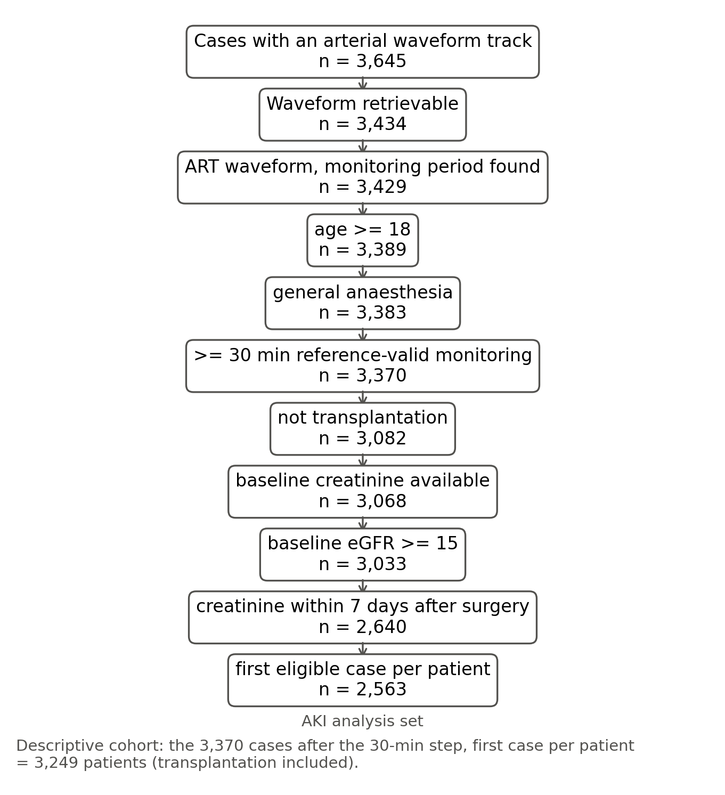
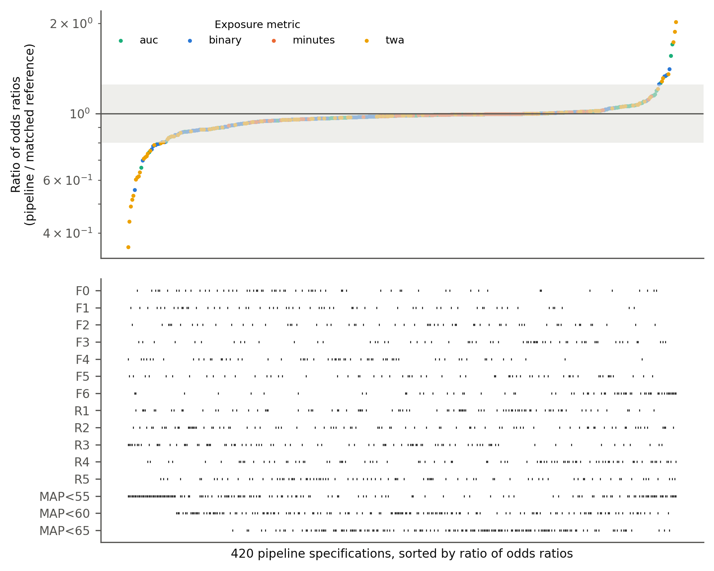
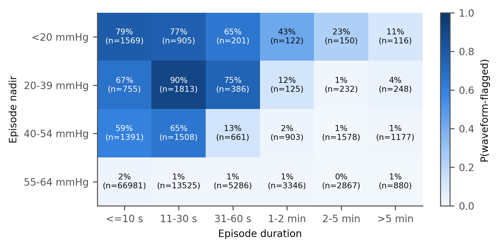
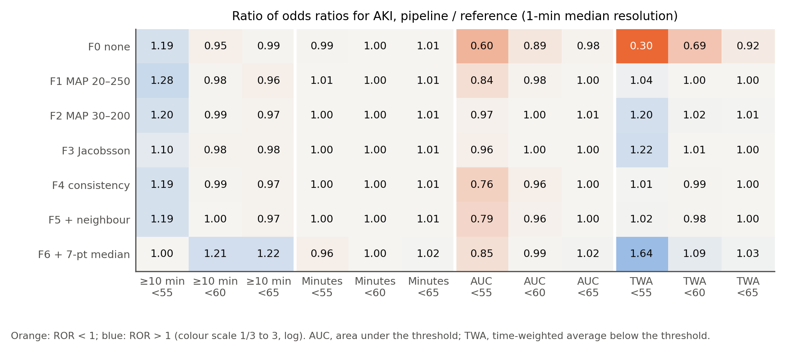

# Дополнительные методы

## S1. Признаки кривой артериального давления и классификатор

**Признаки.** Для каждого 2-секундного окна кривой с частотой 500 Гц мы вычисляли:
- долю конечных отсчётов;
- среднее, минимум, максимум, 2-й, 10-й, 90-й и 98-й центили;
- медиану абсолютной второй разности;
- число систолических подъёмов в окне и в центрированном 6-секундном окне.

Систолический подъём — это повышение более чем на 8 мм рт. ст. в пределах 100 мс после сглаживания
по 20 мс; последовательные подъёмы отстоят друг от друга не менее чем на 250 мс.

**Метки.** Метки, пороговые значения и охранные окна приведены в разделе «Методы».

**Случаи без кривой артериального давления.** Из 3645 случаев с указанной записью кривой для 211
кривая не была получена через API VitalDB 26 октября 2026 г. Их идентификаторы опубликованы вместе с
кодом.

**Настройка пороговых значений.** Порог шума, правило систолического подъёма и длительность охранного
окна были установлены при просмотре описательных данных без исходов менее чем по 600 случаям в ходе
разработки. Правило, отброшенное до фиксации протокола (автокорреляция с лагом в один удар), помечало
12% окон как непульсирующие у пациентов с фибрилляцией предсердий против 1% при синусовом ритме при
пульсовом давлении 56–83 мм рт. ст.

## S2. Интервал для отношения отношений шансов (поправка A15)

**Почему бутстреп не сработал.** Категории экспозиции при F1 × R3 и по эталону различались у
33 из 2563 пациентов. Бутстреп-выборки изменяют состав лишь немногих из этих пациентов, поэтому бутстреп-распределение
log ROR имеет пиковую форму, а его центральные 95% узки. В 100 перестановках исхода, при которых истинное
ROR равно ровно 1, процентильный интервал накрывал 1 в 51% наборов данных для F1 × R3, в 79% для
F0 × R1, в 89% для F3 × R2 и в 91% для F6 × R3.

**Правило.** До анализа реального исхода письменно зафиксированное правило задало каждый интервал
типа ROR как log ROR ± z × max(SE бутстрепа, SD перестановочного нулевого распределения). SD
перестановочного нулевого распределения получали по 200 перестановкам анализируемого исхода. Та же SE
использовалась для одновременных полос, критическое значение которых — бутстреп-максимум |z| по 35
ячейкам (3,22).

**Проверка покрытия.** SD оценивали по 200 перестановкам в пробном прогоне независимо от
100 калибровочных наборов данных. С этим SD интервал накрывал 1 в 100%, 99%, 100% и 97%
калибровочных наборов данных для четырёх пар.

**Операционные характеристики на границе.** Исходы моделировали по эталонной модели с полной
поправкой, добавляя сдвиг логарифма шансов γ у пациентов, переведённых конвейером обработки в более
высокую категорию. Мы выбрали γ = 1,91, чтобы медиана смоделированного ROR составила 1,24. В 200 наборах
данных, каждый из которых анализировали по полному правилу (200 бутстреп-выборок и 200 перестановок),
эквивалентность признавалась в 5%. Без дифференциальной ошибки (γ = 0) она признавалась в 82%, а
интервал накрывал 1 в 97%.

Для достижения нижней границы необходимо, чтобы ОПП развилось почти у всех пяти пациентов, перешедших в
более низкую категорию. SD log ROR при смоделированной альтернативе (0,098) превышало SD при нулевой
гипотезе (0,062). В этом случае в правиле преобладает SE бутстрепа, которая растёт с числом случаев
среди пациентов с расхождением.

## S3. Слепая оценка ИИ

Набор для экспертной оценки из 400 фрагментов включает пять страт:
- 100 окон с низким САД, помеченных как артефакт;
- 50 окон с низким САД, помеченных только как охранное окно;
- 100 окон с низким САД, помеченных как валидные;
- 100 случайных валидных окон;
- 50 помеченных окон с САД ≥ 65 мм рт. ст.

На одного пациента приходится не более двух фрагментов. Подмножество из 152 фрагментов было показано в
виде 26 сеток по шесть 40-секундных панелей кривой артериального давления двум независимым экземплярам
ИИ-модели (Claude, Anthropic). Сетки находились в папке, не содержавшей ключа, кода или меток. Оценщики
могли читать файлы, получили инструкцию открывать только перечисленные изображения и видели только
кривую артериального давления.

Промпт опубликован вместе с кодом. Подмножество обогащено артефактами (43% против 3,7%
в данных), что завышает κ.

## S4. Внесение–обнаружение

Для проверки реализации использовали 296 чистых 2-минутных сегментов из 100 случаев. Синтетические
артефакты промывки, обнуления, забора крови, демпфирования, шума и смещения, по Li и соавт., вносили в
средние 20 с.

В апостериорном (post hoc) переборе использовали 119 сегментов из 60 случаев. Варьировали:
- амплитуду (120–300 мм рт. ст.) и длительность (0,5–4 с) промывки;
- уровень при открытом датчике (0–25 мм рт. ст.);
- частоту среза демпфирования (1,5–10 Гц);
- частичную окклюзию (пульсовое давление, умноженное на 0,5–0,15);
- линейный дрейф (10–40 мм рт. ст. за 20 с);
- резонансные колебания 18 Гц (5–20 мм рт. ст.);
- забор крови без завершающей промывки.

При обнаружении учитывали только метки артефактов, но не охранного окна. Чистые сегменты отбирались как
валидные классификатором, поэтому отсутствие ложных меток в сегментах без внесения выполняется по
построению.

## S5. Таблица эпизодов в реальном времени

Для каждого эпизода и каждого прошедшего времени t (10, 30, 60 и 120 с) надиром к этому моменту
считали наименьшее САД монитора за первые t секунд. Эпизоды короче t при t не учитывали. Поэтому
таблица даёт вероятность того, что эпизод помечен, при условии, что он длился не менее t секунд и
достиг заданного надира.

# Дополнительные таблицы

## Таблица S1. Зарегистрированные минуты с САД < 65 мм рт. ст., классифицированные по сравнению с эталоном (описательная когорта)

| res | filter | low_min | spurious_frac | lo | hi | confirmed_frac | bridged_low_frac | indeterminate_frac | patients_with_spurious |
|---|---|---|---|---|---|---|---|---|---|
| R1 | F0 | 6.16e+04 | 0.023 | 0.021 | 0.025 | 0.932 | 0.012 | 0.032 | 2196 |
| R1 | F1 | 6.09e+04 | 0.020 | 0.019 | 0.022 | 0.943 | 0.012 | 0.025 | 2104 |
| R1 | F2 | 6.06e+04 | 0.018 | 0.017 | 0.020 | 0.947 | 0.011 | 0.024 | 2060 |
| R1 | F3 | 5.84e+04 | 0.006 | 0.005 | 0.006 | 0.974 | 0.008 | 0.012 | 1921 |
| R1 | F4 | 5.96e+04 | 0.009 | 0.008 | 0.009 | 0.963 | 0.009 | 0.020 | 2041 |
| R1 | F5 | 5.96e+04 | 0.009 | 0.008 | 0.009 | 0.963 | 0.009 | 0.020 | 2029 |
| R1 | F6 | 5.91e+04 | 0.030 | 0.028 | 0.032 | 0.942 | 0.010 | 0.019 | 2683 |
| R2 | F0 | 6.22e+04 | 0.034 | 0.031 | 0.037 | 0.934 | 0.019 | 0.013 | 1108 |
| R2 | F1 | 6.19e+04 | 0.033 | 0.030 | 0.036 | 0.938 | 0.019 | 0.010 | 1065 |
| R2 | F2 | 6.2e+04 | 0.033 | 0.030 | 0.036 | 0.938 | 0.020 | 0.010 | 1081 |
| R2 | F3 | 6.13e+04 | 0.031 | 0.029 | 0.034 | 0.946 | 0.019 | 0.004 | 1079 |
| R2 | F4 | 6.2e+04 | 0.033 | 0.030 | 0.036 | 0.938 | 0.020 | 0.009 | 1098 |
| R2 | F5 | 6.09e+04 | 0.018 | 0.017 | 0.020 | 0.953 | 0.019 | 0.009 | 754 |
| R2 | F6 | 5.15e+04 | 0.099 | 0.094 | 0.105 | 0.868 | 0.023 | 0.010 | 1338 |
| R3 | F0 | 5.96e+04 | 0.008 | 0.007 | 0.009 | 0.960 | 0.006 | 0.027 | 363 |
| R3 | F1 | 5.93e+04 | 0.007 | 0.006 | 0.007 | 0.964 | 0.006 | 0.023 | 311 |
| R3 | F2 | 5.94e+04 | 0.005 | 0.005 | 0.006 | 0.963 | 0.008 | 0.024 | 271 |
| R3 | F3 | 5.88e+04 | 0.003 | 0.003 | 0.004 | 0.970 | 0.009 | 0.018 | 170 |
| R3 | F4 | 5.92e+04 | 0.004 | 0.003 | 0.004 | 0.966 | 0.008 | 0.023 | 195 |
| R3 | F5 | 5.92e+04 | 0.003 | 0.003 | 0.004 | 0.967 | 0.008 | 0.022 | 177 |
| R3 | F6 | 5.19e+04 | 0.075 | 0.071 | 0.080 | 0.887 | 0.011 | 0.027 | 1105 |

low_min: минуты конвейера обработки < 65; доли рассчитаны от low_min; lo/hi: 95% ДИ доли ложных минут по кластерному бутстрепу по пациентам.

## Таблица S2. Согласие бинарной экспозиции (≥ 10 мин с САД < 65) с эталоном (описательная когорта)

| filter | res | prev_ref | prev_pipe | sens | spec | kappa | flips | up | down | mean_diff | loa_lo | loa_hi |
|---|---|---|---|---|---|---|---|---|---|---|---|---|
| F0 | R1 | 0.423 | 0.441 | 0.999 | 0.967 | 0.960 | 64 | 62 | 2 | 0.859 | -6.257 | 7.975 |
| F0 | R2 | 0.445 | 0.465 | 0.997 | 0.962 | 0.955 | 73 | 69 | 4 | 0.568 | -5.920 | 7.056 |
| F0 | R3 | 0.424 | 0.434 | 0.995 | 0.979 | 0.971 | 46 | 39 | 7 | 0.406 | -6.755 | 7.567 |
| F0 | R4 | 0.512 | 0.531 | 0.993 | 0.955 | 0.949 | 83 | 72 | 11 | 0.505 | -7.270 | 8.280 |
| F0 | R5 | 0.532 | 0.544 | 0.994 | 0.968 | 0.963 | 59 | 49 | 10 | 0.548 | -10.472 | 11.567 |
| F1 | R1 | 0.423 | 0.437 | 0.996 | 0.973 | 0.965 | 56 | 51 | 5 | 0.643 | -5.850 | 7.135 |
| F1 | R2 | 0.445 | 0.463 | 0.997 | 0.965 | 0.958 | 67 | 63 | 4 | 0.472 | -5.447 | 6.392 |
| F1 | R3 | 0.424 | 0.432 | 0.996 | 0.983 | 0.976 | 38 | 32 | 6 | 0.330 | -6.309 | 6.969 |
| F1 | R4 | 0.512 | 0.529 | 0.994 | 0.959 | 0.954 | 75 | 65 | 10 | 0.440 | -7.039 | 7.919 |
| F1 | R5 | 0.532 | 0.542 | 0.994 | 0.970 | 0.966 | 55 | 45 | 10 | 0.489 | -10.309 | 11.288 |
| F2 | R1 | 0.423 | 0.435 | 0.996 | 0.976 | 0.968 | 51 | 45 | 6 | 0.554 | -5.764 | 6.872 |
| F2 | R2 | 0.445 | 0.463 | 0.997 | 0.966 | 0.959 | 66 | 62 | 4 | 0.481 | -5.389 | 6.352 |
| F2 | R3 | 0.424 | 0.430 | 0.995 | 0.986 | 0.979 | 34 | 27 | 7 | 0.361 | -6.270 | 6.992 |
| F2 | R4 | 0.512 | 0.530 | 0.995 | 0.959 | 0.954 | 74 | 65 | 9 | 0.468 | -7.003 | 7.939 |
| F2 | R5 | 0.532 | 0.543 | 0.995 | 0.970 | 0.966 | 55 | 46 | 9 | 0.522 | -10.193 | 11.236 |
| F3 | R1 | 0.423 | 0.425 | 0.993 | 0.992 | 0.985 | 24 | 15 | 9 | -0.119 | -4.023 | 3.786 |
| F3 | R2 | 0.445 | 0.461 | 0.997 | 0.968 | 0.962 | 61 | 57 | 4 | 0.291 | -3.688 | 4.270 |
| F3 | R3 | 0.424 | 0.429 | 0.996 | 0.987 | 0.981 | 30 | 24 | 6 | 0.184 | -2.590 | 2.958 |
| F3 | R4 | 0.512 | 0.531 | 0.995 | 0.958 | 0.954 | 75 | 67 | 8 | 0.373 | -5.929 | 6.674 |
| F3 | R5 | 0.532 | 0.543 | 0.995 | 0.970 | 0.967 | 54 | 45 | 9 | 0.413 | -9.428 | 10.253 |
| F4 | R1 | 0.423 | 0.428 | 0.996 | 0.989 | 0.983 | 27 | 21 | 6 | 0.249 | -4.599 | 5.098 |
| F4 | R2 | 0.445 | 0.464 | 0.997 | 0.965 | 0.958 | 68 | 64 | 4 | 0.478 | -5.146 | 6.102 |
| F4 | R3 | 0.424 | 0.429 | 0.995 | 0.988 | 0.981 | 30 | 23 | 7 | 0.305 | -5.850 | 6.460 |
| F4 | R4 | 0.512 | 0.533 | 0.995 | 0.953 | 0.949 | 82 | 74 | 8 | 0.471 | -6.860 | 7.802 |
| F4 | R5 | 0.532 | 0.544 | 0.995 | 0.969 | 0.966 | 55 | 47 | 8 | 0.505 | -9.917 | 10.927 |
| F5 | R1 | 0.423 | 0.428 | 0.996 | 0.989 | 0.983 | 27 | 21 | 6 | 0.248 | -4.601 | 5.096 |
| F5 | R2 | 0.445 | 0.455 | 0.996 | 0.979 | 0.973 | 43 | 37 | 6 | 0.152 | -5.131 | 5.436 |
| F5 | R3 | 0.424 | 0.428 | 0.995 | 0.988 | 0.982 | 29 | 22 | 7 | 0.290 | -5.847 | 6.427 |
| F5 | R4 | 0.512 | 0.518 | 0.986 | 0.973 | 0.959 | 66 | 42 | 24 | -0.051 | -6.648 | 6.546 |
| F5 | R5 | 0.532 | 0.521 | 0.966 | 0.985 | 0.950 | 81 | 23 | 58 | -0.322 | -10.248 | 9.605 |
| F6 | R1 | 0.423 | 0.424 | 0.991 | 0.991 | 0.981 | 30 | 17 | 13 | 0.095 | -4.794 | 4.984 |
| F6 | R2 | 0.445 | 0.361 | 0.806 | 0.996 | 0.818 | 287 | 7 | 280 | -2.736 | -12.533 | 7.062 |
| F6 | R3 | 0.424 | 0.362 | 0.846 | 0.995 | 0.857 | 222 | 10 | 212 | -1.934 | -11.830 | 7.961 |
| F6 | R4 | 0.512 | 0.203 | 0.395 | 0.999 | 0.388 | 1009 | 2 | 1007 | -8.671 | -32.380 | 15.038 |
| F6 | R5 | 0.532 | 0.110 | 0.207 | 0.999 | 0.195 | 1372 | 2 | 1370 | -11.952 | -47.877 | 23.973 |

flips: пациенты с различающейся категорией (up: экспозиция только по конвейеру обработки). R4/R5 при фазовом сдвиге 0. mean_diff и границы согласия — в минутах ниже 65 мм рт. ст.

## Таблица S3. АПОСТЕРИОРНО (POST HOC): вероятность того, что эпизод помечен по кривой как артефакт, в зависимости от прошедшего времени и надира к этому моменту

| всё ещё < 65 мм рт. ст. через (с) | nadir_so_far | episodes | p_flagged |
|---|---|---|---|
| 10 | <20 | 1406 | 0.747 |
| 10 | 20-39 | 2046 | 0.792 |
| 10 | 40-54 | 3301 | 0.478 |
| 10 | 55-64 | 33017 | 0.016 |
| 30 | <20 | 384 | 0.594 |
| 30 | 20-39 | 704 | 0.574 |
| 30 | 40-54 | 2057 | 0.070 |
| 30 | 55-64 | 15900 | 0.009 |
| 60 | <20 | 224 | 0.442 |
| 60 | 20-39 | 300 | 0.080 |
| 60 | 40-54 | 2018 | 0.017 |
| 60 | 55-64 | 9413 | 0.007 |
| 120 | <20 | 159 | 0.289 |
| 120 | 20-39 | 248 | 0.024 |
| 120 | 40-54 | 1993 | 0.010 |
| 120 | 55-64 | 4911 | 0.006 |

Среди эпизодов, длившихся не менее указанного времени; надир к этому моменту — наименьшее САД монитора до этого момента.

## Таблица S4. АПОСТЕРИОРНО (POST HOC): экспозиции, взвешенные по глубине, и более низкие пороговые значения (разрешение «медиана за 1 мин»)

| metric | thr | filter | res | or_ref | or_pipe | ror | lo | hi | p_perm |
|---|---|---|---|---|---|---|---|---|---|
| twa | 55 | F0 | R3 | 3.893 | 1.186 | 0.305 | 0.061 | 1.531 | 0.105 |
| twa | 55 | F1 | R3 | 3.893 | 4.065 | 1.044 | 0.401 | 2.715 | 0.880 |
| twa | 55 | F3 | R3 | 3.893 | 4.767 | 1.224 | 0.546 | 2.744 | 0.470 |
| twa | 65 | F0 | R3 | 1.266 | 1.169 | 0.923 | 0.788 | 1.083 | 0.235 |
| twa | 65 | F1 | R3 | 1.266 | 1.273 | 1.005 | 0.953 | 1.060 | 0.780 |
| twa | 65 | F3 | R3 | 1.266 | 1.269 | 1.002 | 0.958 | 1.048 | 0.870 |
| auc | 55 | F0 | R3 | 3.990 | 2.413 | 0.605 | 0.197 | 1.853 | 0.335 |
| auc | 55 | F1 | R3 | 3.990 | 3.339 | 0.837 | 0.406 | 1.726 | 0.565 |
| auc | 55 | F3 | R3 | 3.990 | 3.812 | 0.955 | 0.653 | 1.398 | 0.730 |
| auc | 65 | F0 | R3 | 1.242 | 1.217 | 0.980 | 0.911 | 1.054 | 0.605 |
| auc | 65 | F1 | R3 | 1.242 | 1.242 | 1.000 | 0.968 | 1.033 | 0.995 |
| auc | 65 | F3 | R3 | 1.242 | 1.247 | 1.004 | 0.981 | 1.028 | 0.705 |

| item | value |
|---|---|
| auc55_F0xR3_total_ratio | 1.5926511038398004 |
| auc55_F0xR3_excess_share | 0.3721160914722307 |
| auc55_F0xR3_top1pct_share_of_excess | 0.5633518466768042 |
| auc55_F1xR3_total_ratio | 1.1474727971391918 |
| auc55_F1xR3_excess_share | 0.12851964552611783 |
| auc55_F1xR3_top1pct_share_of_excess | 0.5537390027342186 |
| auc55_F3xR3_total_ratio | 0.9909324504685909 |
| auc55_F3xR3_excess_share | -0.009150522346019763 |
| auc55_F3xR3_top1pct_share_of_excess | -2.0514721232838955 |
| auc65_F0xR3_total_ratio | 1.1250310833187709 |
| auc65_F0xR3_excess_share | 0.11113567009183167 |
| auc65_F0xR3_top1pct_share_of_excess | 0.5190926964251571 |
| auc65_F1xR3_total_ratio | 1.0485801543205124 |
| auc65_F1xR3_excess_share | 0.04632946191127629 |
| auc65_F1xR3_top1pct_share_of_excess | 0.5245433707005375 |
| auc65_F3xR3_total_ratio | 1.0101195139055774 |
| auc65_F3xR3_excess_share | 0.01001813524664108 |
| auc65_F3xR3_top1pct_share_of_excess | 0.7610090577627407 |
| binary55_F0xR3 | ROR 1.19 (0.66–2.15) |
| binary55_F1xR3 | ROR 1.28 (0.81–2.02) |
| binary55_F3xR3 | ROR 1.10 (0.84–1.45) |
| binary60_F0xR3 | ROR 0.95 (0.79–1.14) |
| binary60_F1xR3 | ROR 0.98 (0.85–1.15) |
| binary60_F3xR3 | ROR 0.98 (0.84–1.13) |

TWA — на 1 мм рт. ст.; AUC (площадь ниже порога) — на 100 мм рт. ст.·мин, с ограничением на уровне 99-го центиля эталона. excess_share: доля общей площади по конвейеру обработки, превышающая общую эталонную площадь; top1pct_share: доля этого превышения, приходящаяся на 1% пациентов с наибольшим превышением. Интервалы — как в A15.

## Таблица S5. Анализы чувствительности основного ROR (F1 × R3)

| analysis | ror | lo | hi | or_pipe | or_ref | events |
|---|---|---|---|---|---|---|
| reference=unbridged | 0.938 | 0.834 | 1.055 |  |  |  |
| reference=guard0 | 0.968 | 0.880 | 1.065 |  |  |  |
| reference=guard30 | 0.962 | 0.838 | 1.103 |  |  |  |
| reference=pp5 | 0.961 | 0.861 | 1.072 |  |  |  |
| reference=pp12 | 0.954 | 0.851 | 1.070 |  |  |  |
| reference=valid25 | 0.969 | 0.865 | 1.086 |  |  |  |
| reference=valid75 | 0.944 | 0.834 | 1.069 |  |  |  |
| reference=wavemean | 0.743 | 0.476 | 1.159 |  |  |  |
| S10 numerics-defined period | 0.910 | 0.747 | 1.107 |  |  |  |
| S5 + blood loss | 0.961 |  |  | 0.904 | 0.941 |  |
| S11 + number of postoperative creatinines | 0.949 |  |  | 0.845 | 0.890 |  |
| S7 AKI stage >= 2 (reduced set) | 0.968 |  |  | 2.143 | 2.215 | 24.000 |
| S4 missing postoperative creatinine = no AKI (pre-specified) | 0.963 | 0.865 | 1.071 |  |  | 91.000 |
| S6 transplantation included (pre-specified) | 0.958 | 0.866 | 1.060 |  |  | 122.000 |
| without gynaecology (low creatinine testing) | 0.959 | 0.857 | 1.073 |  |  | 89.000 |
| disease risk score, 2 df | 0.958 | 0.852 | 1.077 |  |  | 91.000 |
| reference=concord | 0.963 | 0.854 | 1.087 |  |  | 91.000 |
| reference=valid25_obs | 0.949 | 0.850 | 1.060 |  |  | 91.000 |
| reference=valid75_obs | 0.952 | 0.832 | 1.090 |  |  | 91.000 |

Сначала приведены строки зафиксированного прогона, затем S4, S6 (заранее заданные, выполненные после раскрытия) и апостериорные (post hoc) строки. Строки без lo/hi — точечные оценки.

## Таблица S6. Дифференциальная ошибка классификации: ОПП в зависимости от числа ложных минут в час с поправкой на эталонную экспозицию

| pipeline | model | term | nonzero | or_per_sd | lo | hi | or_per_log1p | lo_u | hi_u |
|---|---|---|---|---|---|---|---|---|---|
| F1xR3 | b_g1_zero_high | 0 | 19.000 | 1.022 | 0.829 | 1.259 | 1.892 | 0.004 | 966.903 |
| F1xR3 | b_g2_nonpuls_noise | 0 | 168.000 | 0.895 | 0.695 | 1.153 | 0.266 | 0.013 | 5.480 |
| F1xR3 | b_all | 0 | 241.000 | 0.831 | 0.626 | 1.102 | 0.159 | 0.010 | 2.614 |
| F1xR3 | c_negative_control | 0 | 241.000 | 0.832 | 0.628 | 1.103 | 0.161 | 0.010 | 2.641 |
| F1xR3 | c_negative_control | 1 | 688.000 | 1.135 | 0.936 | 1.376 | 2.039 | 0.690 | 6.027 |
| F1xR3 | d_mechanism | 0 | 241.000 | 0.837 | 0.632 | 1.107 | 0.170 | 0.011 | 2.740 |
| F1xR3 | d_mechanism | 1 | 2.49e+03 | 0.978 | 0.772 | 1.239 | 0.940 | 0.492 | 1.797 |
| F1xR3 | d_mechanism | 2 | 2.56e+03 | 1.188 | 0.938 | 1.504 | 1.197 | 0.936 | 1.530 |
| F1xR3 | d_mechanism | 3 | 190.000 | 1.025 | 0.927 | 1.134 | 1.001 | 0.996 | 1.007 |
| F0xR1 | b_g1_zero_high | 0 | 789.000 | 1.105 | 0.938 | 1.300 | 17.314 | 0.162 | 1.85e+03 |
| F0xR1 | b_g2_nonpuls_noise | 0 | 1.4e+03 | 0.878 | 0.695 | 1.110 | 0.288 | 0.031 | 2.710 |
| F0xR1 | b_all | 0 | 1.73e+03 | 0.928 | 0.741 | 1.161 | 0.589 | 0.122 | 2.855 |
| F0xR1 | c_negative_control | 0 | 1.73e+03 | 0.916 | 0.731 | 1.148 | 0.539 | 0.110 | 2.636 |
| F0xR1 | c_negative_control | 1 | 1.94e+03 | 1.171 | 0.957 | 1.433 | 2.095 | 0.815 | 5.383 |
| F0xR1 | d_mechanism | 0 | 1.73e+03 | 0.922 | 0.737 | 1.153 | 0.563 | 0.116 | 2.722 |
| F0xR1 | d_mechanism | 1 | 2.49e+03 | 0.971 | 0.766 | 1.231 | 0.923 | 0.482 | 1.768 |
| F0xR1 | d_mechanism | 2 | 2.56e+03 | 1.199 | 0.947 | 1.517 | 1.208 | 0.945 | 1.544 |
| F0xR1 | d_mechanism | 3 | 190.000 | 1.026 | 0.928 | 1.135 | 1.001 | 0.996 | 1.007 |
| F0xR1 (separate model) | spurious_hypo | 0 |  | 0.928 | 0.741 | 1.161 | 0.589 | 0.122 | 2.855 |
| F0xR1 (separate model) | spurious_hyper_negative_control | 0 |  | 1.164 | 0.952 | 1.424 | 2.038 | 0.793 | 5.236 |

term 0: log(1 + ложные мин/ч) (или его вариант для отдельной группы); c_negative_control, term 1: ложные минуты гипертензии в час; d_mechanism, terms 1–3: анализы газов крови в час, логарифм кровопотери, единицы эритроцитсодержащих компонентов. lo/hi — на одно SD; lo_u/hi_u — на единицу log(1 + мин/ч).

## Таблица S7. Пациенты с расхождением, операционные характеристики решения об эквивалентности и покрытие интервалов

| pipeline | up | aki_up | down | aki_down |
|---|---|---|---|---|
| F1xR3 | 28 | 0 | 5 | 0 |
| F0xR1 | 55 | 4 | 1 | 0 |
| F3xR2 | 50 | 3 | 4 | 0 |
| F6xR3 | 8 | 0 | 178 | 3 |

F1 × R3: ожидаемое число случаев ОПП среди 33 пациентов с расхождением 1,57; вероятность отсутствия случаев 0,19.

| k | ror | lo | hi | n | events | verdict |
|---|---|---|---|---|---|---|
| 0 | 0.956 | 0.856 | 1.068 | 2563 | 91 | equivalent |
| 1 | 1.013 | 0.901 | 1.138 | 2563 | 91 | equivalent |
| 2 | 1.070 | 0.900 | 1.272 | 2563 | 91 | inconclusive |
| 3 | 1.129 | 0.938 | 1.358 | 2563 | 91 | inconclusive |
| 4 | 1.195 | 0.957 | 1.492 | 2563 | 91 | inconclusive |
| 5 | 1.269 | 0.982 | 1.641 | 2563 | 91 | inconclusive |

ROR и интервал A15 при условии, что ОПП развилось бы у k из 28 пациентов, перешедших в более высокую категорию (исходы обменены с k случаями из числа пациентов без расхождения; 400 бутстреп-выборок, 200 перестановок). Согласно эталонной модели, P(k = 0) = 0,26, P(k = 1) = 0,38, P(k ≥ 2) = 0,36.

| scenario | gamma_up | median_ror | p_equivalent | coverage_of_1 | sd_lror | n |
|---|---|---|---|---|---|---|
| null | 0.000 | 1.004 | 0.820 | 0.970 | 0.062 | 200 |
| upper_margin | 1.912 | 1.239 | 0.050 | 0.510 | 0.098 | 200 |

Исходы смоделированы по эталонной модели с полной поправкой; дифференциальная ошибка добавлена как сдвиг логарифма шансов γ у пациентов, перешедших в более высокую категорию. Каждый набор данных анализировали по правилу A15 (200 бутстреп-выборок, 200 перестановок). Медиана ROR в зависимости от γ: up0.0: 0,99, up1.0: 1,08, up2.0: 1,27, up3.0: 1,52, up4.0: 1,89, down2.0: 0,95, down4.0: 0,86, down8.0: 0,78. Покрытие 1 при независимых перестановках (SD из пробного прогона, 100 калибровочных наборов данных): F1xR3 1,00, F0xR1 0,99, F3xR2 1,00, F6xR3 0,97.

## Таблица S8. Перебор параметров внесения–обнаружения (апостериорно (post hoc))

| kind | param | any_artefact | frac_artefact |
|---|---|---|---|
| flush | (120, 0.5) | 0.000 | 0.000 |
| flush | (120, 1) | 0.000 | 0.000 |
| flush | (120, 2) | 1.000 | 0.100 |
| flush | (120, 4) | 1.000 | 0.200 |
| flush | (150, 0.5) | 0.000 | 0.000 |
| flush | (150, 1) | 0.000 | 0.000 |
| flush | (150, 2) | 1.000 | 0.100 |
| flush | (150, 4) | 1.000 | 0.200 |
| flush | (200, 0.5) | 0.000 | 0.000 |
| flush | (200, 1) | 0.000 | 0.000 |
| flush | (200, 2) | 1.000 | 0.100 |
| flush | (200, 4) | 1.000 | 0.200 |
| flush | (250, 0.5) | 1.000 | 0.100 |
| flush | (250, 1) | 1.000 | 0.100 |
| flush | (250, 2) | 1.000 | 0.100 |
| flush | (250, 4) | 1.000 | 0.200 |
| flush | (300, 0.5) | 1.000 | 0.100 |
| flush | (300, 1) | 1.000 | 0.100 |
| flush | (300, 2) | 1.000 | 0.100 |
| flush | (300, 4) | 1.000 | 0.200 |
| zero_level | 0 | 1.000 | 0.500 |
| zero_level | 5 | 1.000 | 0.500 |
| zero_level | 10 | 1.000 | 0.500 |
| zero_level | 15 | 1.000 | 0.500 |
| zero_level | 20 | 1.000 | 0.500 |
| zero_level | 25 | 1.000 | 0.500 |
| damping_hz | 1.5 | 0.118 | 0.079 |
| damping_hz | 2 | 0.008 | 0.001 |
| damping_hz | 3 | 0.000 | 0.000 |
| damping_hz | 5 | 0.000 | 0.000 |
| damping_hz | 10 | 0.000 | 0.000 |
| partial_occlusion | 0.5 | 0.000 | 0.000 |
| partial_occlusion | 0.3 | 0.025 | 0.010 |
| partial_occlusion | 0.15 | 0.613 | 0.520 |
| drift_mmhg | 10 | 0.008 | 0.001 |
| drift_mmhg | 20 | 0.008 | 0.001 |
| drift_mmhg | 40 | 0.008 | 0.006 |
| ringing_mmhg | 5 | 0.000 | 0.000 |
| ringing_mmhg | 10 | 0.000 | 0.000 |
| ringing_mmhg | 20 | 0.008 | 0.001 |
| sampling_no_flush | mean | 1.000 | 0.700 |
| sampling_no_flush | 20 | 1.000 | 0.700 |

any_artefact: доля внесений, при которых хотя бы одно окно во внесённых 20 с помечено как артефакт (ноль/высокие значения/отсутствие пульсации/шум; охранное окно не учитывалось); 119 чистых 2-минутных сегментов из 60 случаев.

## Таблица S9. Слепая оценка ИИ 152 фрагментов (вторичный анализ)

| item | value |
|---|---|
| n_rated | 152.000 |
| n | 131.000 |
| agree | 0.977 |
| kappa | 0.954 |
| artefact_share_in_subset | 0.435 |
| alg_artefact_rated_artefact | 1.000 |
| alg_valid_rated_artefact | 0.041 |
| alg_valid_n | 74.000 |
| alg_valid_low_strata_n | 36.000 |
| guard_n | 19.000 |
| guard_rated_artefact | 0.684 |
| unsure | 2.000 |

## Таблица S10. Внутрибольничная летальность (поисковый анализ, сокращённый набор поправочных переменных)

n = 2962, умерших = 26; ОШ по эталону 1,50 (0,69–3,27); ОШ F1 × R3 1,47 (0,68–3,20); ROR 0,98.

## Таблица S11. ОШ ОПП в зависимости от уровня поправки (набор для анализа ОПП, медиана за 1 мин)

| series | exposure | adjustment | odds_ratio | lo | hi |
|---|---|---|---|---|---|
| reference | binary65 | crude | 1.655 | 1.090 | 2.513 |
| reference | binary65 | reduced_set | 1.463 | 0.952 | 2.248 |
| reference | binary65 | full_set | 0.940 | 0.596 | 1.483 |
| reference | binary65 | full_set_without_duration | 1.097 | 0.704 | 1.709 |
| reference | binary55 | crude | 3.813 | 1.865 | 7.794 |
| reference | binary55 | reduced_set | 3.362 | 1.575 | 7.180 |
| reference | binary55 | full_set | 1.954 | 0.894 | 4.270 |
| reference | minutes65 | crude | 1.215 | 1.136 | 1.300 |
| reference | minutes65 | reduced_set | 1.195 | 1.112 | 1.283 |
| reference | minutes65 | full_set | 1.079 | 0.994 | 1.172 |
| F1xR3 | binary65 | crude | 1.593 | 1.049 | 2.419 |
| F1xR3 | binary65 | reduced_set | 1.414 | 0.921 | 2.170 |
| F1xR3 | binary65 | full_set | 0.899 | 0.571 | 1.417 |
| F1xR3 | binary55 | crude | 4.673 | 2.465 | 8.857 |
| F1xR3 | binary55 | reduced_set | 4.106 | 2.068 | 8.151 |
| F1xR3 | binary55 | full_set | 2.494 | 1.224 | 5.080 |
| F1xR3 | minutes65 | crude | 1.221 | 1.142 | 1.305 |
| F1xR3 | minutes65 | reduced_set | 1.200 | 1.119 | 1.288 |
| F1xR3 | minutes65 | full_set | 1.087 | 1.002 | 1.179 |

reduced_set: сплайны возраста и рСКФ, ASA ≥ 3, экстренность. Интервалы Вальда по моделям с поправкой Фёрта. Включение в набор для анализа ОПП по отделениям: общая хирургия 85% из 1749, гинекология 28% из 172, торакальная хирургия 96% из 996, урология 97% из 59.

# Дополнительные рисунки

{width=90%}

{width=90%}

{width=90%}

{width=90%}

# Протокол (на английском)

## Analysis protocol (frozen before any outcome analysis)

**Working title.** How much of recorded intraoperative hypotension is artefact, and how much does
it matter? A waveform-referenced multiverse analysis of arterial-line artefacts, data resolution
and the hypotension–acute kidney injury association in VitalDB.

**Status at freezing.** Window features extracted from the 500 Hz arterial waveform; artefact
classifier inspected visually on 20 snippets and descriptive artefact burden computed on ≤ 600
cases. **No association between any exposure and any outcome has been computed.** The freeze
is the git commit containing this file; any later change is recorded in the "Amendments"
section with date and reason.

Reporting: STROBE and RECORD. Design: retrospective cohort, secondary analysis of a
de-identified open dataset.

### 1. Objectives

| # | Objective | Type |
|---|---|---|
| O1 | Artefact burden of the intraoperative arterial line, by artefact type | descriptive |
| O2 | Fraction of *recorded* hypotensive minutes that are artefact, for each processing pipeline | descriptive (primary measurement endpoint) |
| O3 | Per-patient misclassification of hypotension exposure versus the reference | descriptive |
| O4 | How the adjusted association between hypotension and AKI changes across pipelines (multiverse / specification curve) | **primary inferential** |
| O5 | Differential misclassification: is artefact-attributable "hypotension" associated with blood-gas sampling, severity and AKI? | secondary, hypothesis-driven |
| O6 | Probability that a low monitor MAP episode is artefact, by duration and nadir; a simple bedside rule, derived and validated on separate patients | secondary, clinical |

### 2. Data and cohort

VitalDB (Seoul National University Hospital, 2016–2017; Lee HC et al., Sci Data 2022). Open,
de-identified; original collection approved by the SNUH IRB. No new ethics approval needed
(to be confirmed against the VitalDB data-use terms and stated in the paper).

Inclusion: `SNUADC/ART` waveform present; age ≥ 18; general anaesthesia; ≥ 30 min of
monitoring period (definition §3).
Exclusions for the AKI analysis: missing baseline creatinine; baseline eGFR < 15 (proxy for
end-stage renal disease); no creatinine within 7 days after the end of anaesthesia;
transplantation procedures (`optype == 'Transplantation'`; included in sensitivity S6).

### 3. Reference series (waveform-informed)

- 2-s windows of the 500 Hz waveform are labelled `valid`, `missing`, `zero`, `high`,
  `nonpulsatile`, `noise` (rules in `src/artifact.py`, frozen at this commit), plus `guard`:
  windows within 10 s of any non-valid window.
- The monitor's 2-s ART_MBP numerics are aligned to the waveform by a per-case lag (1–4
  samples, maximum correlation on valid windows).
- **Reference minute MAP** = median of the aligned monitor MAP values in `valid` windows of the
  minute, if ≥ 50% of the minute's windows are valid; otherwise missing.
- Rationale: the reference differs from the monitor stream only by removal of
  waveform-detected artefact, so calibration differences between the monitor and the ADC do
  not enter the comparison.
- **Monitoring period** = from the first to the last run of ≥ 60 s of valid windows within
  anaesthesia (anestart–aneend). All pipelines use the same period.

### 4. Pipelines (the multiverse)

Pipelines use **only the monitor numerics** (MAP, SBP, DBP), as a retrospective study would.

**Filter** (applied to 2-s numerics; F5 and F6 after sampling, see A8):

| Code | Rule | Source |
|---|---|---|
| F0 | none | — |
| F1 | drop MAP < 20 or > 250 | Lee 2026 (VitalDB AKI) |
| F2 | drop MAP < 30 or > 200 | Khan 2022 |
| F3 | drop SBP > 250, DBP < 15, MAP < 35 or > 150, SBP−DBP < 15 | Jacobsson 2026 |
| F4 | drop MAP < 20 or > 200, SBP > 300 or < 20, SBP ≤ DBP, SBP−DBP < 5, DBP < 5 | physiological consistency |
| F5 | F4 + drop values differing from both neighbours by > 30 mmHg | neighbour comparison (Du 2019 style) |
| F6 | F4 + 7-point running median on the minute grid | median filter (Pasma 2020) |

**Resolution:** R1 2-s (all values; minutes = count × 2 s / 60); R2 1-min instantaneous
(value at the minute mark); R3 1-min median; R4 5-min instantaneous, held; R5 15-min
instantaneous, held.

**Metric:** cumulative minutes < T; area under T (mmHg·min); time-weighted average below T
(AUC / monitored minutes); binary "≥ 10 cumulative minutes < T".
**Threshold:** T  in  {55, 60, 65} mmHg.

7 × 5 × 4 × 3 = **420 pipeline specifications**, each compared with the reference computed
with the same metric and threshold (12 reference specifications).

### 5. Outcomes and covariates

- **Primary:** AKI by KDIGO creatinine criteria within 7 days (≥ 0.3 mg/dL within 48 h, or
  ≥ 1.5× baseline within 7 days). Baseline = last creatinine within 30 days before induction,
  else `preop_cr`. Urine output not available postoperatively.
- **Secondary:** AKI stage ≥ 2; in-hospital death.
- **Adjustment set (fixed):** age, sex, BMI, ASA ≥ 3, emergency, baseline eGFR (CKD-EPI
  2021), hypertension, diabetes, preoperative haemoglobin, preoperative albumin, department,
  surgical approach, log anaesthesia duration. Missing covariates: median (continuous) or
  mode (categorical) imputation with a missingness indicator if > 5% missing.
  Intraoperative vasopressors, fluids and blood loss are not adjusted for (potential
  mediators); sensitivity S5 adds blood loss.

### 6. Statistical analysis

- **O2.** Among pipeline-recorded minutes with MAP < 65: proportion where the reference minute
  is missing because of artefact, or ≥ 65. Reported per pipeline with patient-cluster
  bootstrap 95% CI (1,000 resamples).
- **O3.** For the binary exposure, sensitivity, specificity and Cohen's kappa against the
  reference. For minutes < 65, the median per-patient difference and Bland–Altman limits.
- **O4.**
  - For each of the 432 specifications, a logistic regression of AKI on the exposure plus
    the adjustment set.
  - Units:
    - binary: OR;
    - minutes: per 10 min, truncated at 120 min;
    - AUC: per 100 mmHg·min, truncated at the 99th percentile of the reference
      distribution;
    - TWA: per 1 mmHg.
  - **Primary estimand:** the ratio of odds ratios (ROR = OR_pipeline / OR_reference) for
    the binary exposure "≥ 10 min with MAP < 65", with patient-level paired bootstrap 95% CI
    (1,000 resamples, the same resample for both models).
  - Paired bootstrap for all 35 filter × resolution specifications of the primary metric.
    The other specifications are reported as point estimates in a specification curve.
  - Fragility summaries: range and IQR of ORs; proportion of specifications whose 95% CI
    excludes 1; the number of specifications that change the qualitative conclusion.
- **O5.**
  - Artefact-attributable minutes = minutes < 65 (F1, R3) − reference minutes < 65.
  - (a) Spearman correlation with the number of intraoperative arterial blood gases (VitalDB
    labs with a pH result during anaesthesia) and with ASA.
  - (b) Logistic regression of AKI on artefact-attributable minutes, adjusted for reference
    minutes and the adjustment set. Any association indicates differential
    misclassification.
- **O6.**
  - Episodes are contiguous runs of aligned 2-s monitor MAP < 65 within the monitoring
    period.
  - An episode is **artefactual** if ≥ 50% of its windows are non-valid (any label other
    than `valid`, including `guard`).
  - P(artefact) is tabulated by duration (≤ 10 s, 10–30 s, 30–60 s, 1–2 min, 2–5 min, > 5 min)
    × nadir (< 20, 20–39, 40–54, 55–64), with Wilson CIs.
  - A simple rule is derived on a 50% patient split (hash of caseid) and validated on the
    other 50%. The rule uses only features visible at the bedside: duration, nadir, and the
    maximum MAP in the preceding 30 s.
- **Mortality** (few events, about 40): Firth-penalised logistic regression adjusted for age,
  ASA ≥ 3, emergency and eGFR. Reported descriptively with the specification spread only.

### 7. Validation of the reference

- **V1 injection–recovery:**
  - Clean 2-min segments from 100 randomly selected cases.
  - Inject synthetic artefacts (Li, Mark & Clifford 2009 types): flush square wave to
    300 mmHg, zeroing (0 mmHg), sampling (flat line at line pressure, then flush), overdamping
    (low-pass), high-frequency noise, and a 15 mmHg transducer offset.
  - Report the detection sensitivity per type. Specificity is measured on uninjected clean
    segments.
  - The transducer offset is expected to be undetectable by design (limitation).
- **V2 blinded adjudication:** 150 stratified random 40-s snippets, plotted without labels and
  adjudicated by an independent AI reviewer agent as valid or artefact. Report kappa. The
  adjudicator is not a human expert, and this is disclosed.
- **V3 physiological concordance:** |ART − NIBP| at NIBP measurement times, for valid versus
  non-valid windows; agreement of the waveform HR with the monitor ECG HR.

### 8. Sensitivity analyses

| Code | Change |
|---|---|
| S1 | guard 0 s and 30 s |
| S2 | pulse-pressure threshold for non-pulsatile 5 and 12 mmHg |
| S3 | reference minute validity threshold 25% and 75% |
| S4 | missing postoperative creatinine treated as no AKI (cohort without the 7-day creatinine requirement) |
| S5 | add intraoperative blood loss to the adjustment set |
| S6 | include transplantation |
| S7 | AKI stage ≥ 2 |
| S8 | reference built on the waveform mean instead of the monitor numerics |

### 9. What this study cannot show

- It cannot detect artefacts that leave a normal-looking waveform, such as transducer
  height errors. The reference is an improved series, not ground truth.
- It cannot identify the clinical response to artefacts: VitalDB records vasopressor bolus
  totals only.
- The data come from a single centre in 2016–2017.
- The associations are observational.

### Amendments (2026-10-26, before freezing, after an adversarial methods review; no outcome data examined)

Where an amendment conflicts with the text above, the amendment governs.

**A1 (adapted) — validation without human adjudicators.** Two blinded human anaesthesiologist
adjudicators are not available for this version. Validation of the reference therefore
rests on (i) physiological concordance with independent sensors (V3, now primary),
(ii) injection–recovery (V1), and (iii) a blinded AI rater (V2, explicitly secondary and
non-decisive). Throughout the paper, minutes are called **"waveform-flagged"** rather than
"artefact" unless independent evidence supports the stronger term. A stratified 400-snippet
adjudication set (strata A–D of the review: 150 monitor MAP < 65 & non-valid incl. 50
guard-only; 100 MAP < 65 & valid; 100 random valid; 50 random non-valid with MAP ≥ 65; at
most two per patient, selected by hash of subjectid) is generated and released with blank
forms, so that human adjudication can be added later.

**A2 — freeze.** The freeze is a git tag `protocol-freeze` on a commit whose code implements
§4–§6 with these amendments, passes `tests/test_pipelines.py`, and has completed an
end-to-end run with the AKI and death vectors replaced by a seeded permutation (outputs
archived in `out/results_permuted/`). The SHA-256 of `src/*.py` is recorded in the tag
message. An external registry (OSF) was not available; the local git history is the record.
Descriptive artefact statistics before freezing used ≤ 600 cases.

**A3 — primary estimand.** ROR = OR_P / OR_ref for "≥ 10 cumulative minutes with MAP < 65",
P = F1 × R3 (MAP 20–250 range filter, 1-min median), ref = bridged reference at R3. Paired
bootstrap, 2,000 resamples of patients, percentile 95% CI. Decision rule with equivalence
margin 0.80–1.25: CI entirely within -> "artefact handling does not materially change the
association"; CI excludes 1 and point estimate outside the margin -> "material change";
otherwise "inconclusive". Under non-differential misclassification of plausible size the ROR
is expected near 0.90–0.97, so this estimand detects differential bias large enough to
matter. Key secondaries: (a) F0 × R1 vs ref@R1; (b) per-10-min log-OR for cumulative minutes
< 65, F1 × R3 vs ref@R3, difference with bootstrap CI and attenuation factor β_P/β_ref.

**A4 — gap bridging.** Runs of non-valid windows ≤ 3 min bounded by ≥ 30 s of valid windows on
both sides are linearly bridged between the median valid MAP of the 30 s before and after.
The unbridged reference is a sensitivity analysis. Each pipeline-recorded minute < 65 is
*spurious* (reference ≥ 65), *confirmed* (reference < 65, ≥ 50% observed), *bridged-low*
(reference < 65, < 50% observed) or *indeterminate* (reference missing). Primary O2 quantity
= spurious / all recorded minutes < 65, reported with indeterminate / all; indeterminate
minutes are never counted as artefact.

**A5 — missing waveform.** `missing` is not an artefact and creates no guard. Minutes with
> 50% `missing` windows are excluded from every pipeline and the reference (common support).

**A6 — patients.** Unit = patient (`subjectid`); first eligible case per patient (lowest
caseid). Bootstrap and the O6 split are by patient.

**A7 — O5.** (a) Spearman of spurious minutes per monitored hour with arterial blood gases per
hour and ASA. (b) Firth logistic regression of AKI on log1p(spurious minutes/h), adjusted for
reference minutes < 65 (linear + restricted cubic spline), log monitored hours and the §5 set;
separately for minutes dominated by zero/high labels (g1) and non-pulsatile/noise labels (g2).
(c) Negative-control exposure: spurious hypertensive minutes (pipeline MAP > 120 with
reference ≤ 100), in the same model. (d) Mechanism model adding blood gases per hour,
log1p(blood loss) and red-cell units.

**A8 — resolution.** The reference is sampled at every resolution and each pipeline is
compared with ref@R; the resolution effect is OR(ref@R)/OR(ref@R3). R4 uses all 5 phase
offsets and R5 offsets 0, 3, 6, 9, 12 min; log-ORs are averaged over offsets within each
bootstrap resample. A charted value is the first non-missing 2-s value in its interval. F5
and F6 are applied after sampling on the pipeline's own grid (F6 = 7-point running median).
S10: each pipeline uses a numerics-defined monitoring period (first to last 60-s run of
monitor MAP 40–150 within anaesthesia), as a retrospective study would.

**A9 — classifier calibration (descriptive data only).** Noise = waveform minimum < −10 mmHg or
median |second difference| ≥ 4 mmHg (the single-spike slope rule is dropped). Guard is
asymmetric: 2 s before and 8 s after each artefact run (95th centile of monitor recovery
time after zero/high/non-pulsatile runs = 8 s; 99th = 16 s). Sensitivity S1 uses 0/0 s and
6/30 s.

**A10 — physiological checks (V3, now primary validation).** (i) For monitor MAP < 65
episodes with an NIBP reading within ±3 min: proportion with NIBP MAP ≥ 70, by episode class;
(ii) for non-pulsatile windows: proportion with concurrent ECG HR 40–150 and pleth HR 40–150;
(iii) non-pulsatile fraction in patients with preoperative atrial fibrillation versus sinus
rhythm. V1 specificity is reported as the flag rate outside the injected stretch.

**A11 — O6.** Probability that a monitor-numerics low-MAP episode is waveform-flagged, for
retrospective cleaning and automated systems (not bedside use). Episode classes: *flagged*
(≥ 50% artefact labels), *guard-dominated* (artefact + guard ≥ 50%, artefact < 50%),
*physiological* (otherwise). Patient-cluster bootstrap CIs. Rule: depth-≤ 2 tree on duration,
nadir and maximum MAP in the preceding 30 s, derived on a 50% patient-hash split with leaves
called "flagged" only at ≥ 90% specificity; validated on the other half (sensitivity,
specificity, PPV with cluster CIs).

**A12 — models.** Age and eGFR as restricted cubic splines (3 knots). Firth-penalised
likelihood for all models; failures counted. Simultaneous 95% bands (bootstrap max-|z|) for
the 35 F × R RORs. One analysis set for all specifications. S7 and mortality use a reduced
set (age and eGFR splines, ASA ≥ 3, emergency). Mortality: one pre-specified specification
(primary P vs ref) in the descriptive cohort, exploratory, no specification curve. S11 adds
the number of postoperative creatinine measurements. Precision check before unblinding by
simulation with assumed (not estimated) covariate effects and OR_ref = 1.5; if the expected
95% CI half-width of log ROR exceeds 0.22, the equivalence conclusion is declared
unattainable in advance.

**Cohorts.** *Descriptive cohort* (O1–O3, O6, V3, mortality): adults, general anaesthesia,
≥ 30 min reference-valid monitoring, first case per patient. *AKI analysis set* (O4, O5,
S-analyses): additionally excludes transplantation, missing baseline creatinine, eGFR < 15,
and no creatinine within 7 days.

**A13 — classifier v2 (before freezing; no outcome data examined).** The beat-lag
autocorrelation pulsatility criterion was dropped: in descriptive data it labelled 12% of
windows in patients with preoperative atrial fibrillation as non-pulsatile (1% in sinus
rhythm), and those windows had pulse pressures of 56–83 mmHg; it also fired on bigeminy and
slow heart rates. It was replaced by: pulse pressure < 8 mmHg, OR interdecile range < 3 mmHg,
OR no systolic upstroke (rise > 8 mmHg within 100 ms) in the centred 6-s window. The noise
rule became minimum < −10 mmHg OR median absolute second difference ≥ 4 mmHg (the earlier
rule fired on single spikes). Guard is asymmetric: 2 s before and 8 s after an artefact run
(95th centile of monitor recovery). All 3,645 waveform cases were re-extracted with these
features; 211 had a waveform track listed but not retrievable and are excluded as "waveform
not retrievable".

**A14 — O5 power and Firth iterations (before freezing; only the permuted outcome examined).**
In the permuted dry run, spurious minutes at F1 × R3 were non-zero in 241 of 2,563 patients
(zero/flush-dominated in 19), which cannot carry the differential-misclassification test.
O5 is therefore run twice: at F1 × R3 as pre-specified, and at F0 × R1 (raw 2-s stream;
non-zero in 1,728 patients), with odds ratios also reported per standard deviation of the
exposure. The F0 × R1 version is the one interpreted. The Firth iteration limit was raised
from 50 to 200: in the dry run 1.7% of bootstrap fits stopped at 50 iterations short of the
1e−7 tolerance, and refitting them changed the estimate only in the eighth decimal.

**A15 — null calibration of the ROR interval (written before the calibration result was
seen; real outcome never examined).** In the dry run several RORs had percentile intervals
excluding 1 although the permuted outcome makes the true ROR exactly 1, because the contrast
rests on the few dozen patients whose exposure category differs. `src/null_calibration.py`
re-permutes the outcome 100 times and, for F1 × R3, F0 × R1, F3 × R2 and F6 × R3, records how
often the paired-bootstrap 95% interval (B = 200) covers 1, and the ratio of the mean
bootstrap SE to the SD of log ROR across permutations. Decision rule, fixed now:
- if coverage for F1 × R3 is ≥ 0.90, the percentile bootstrap interval stays primary;
- otherwise every ROR interval (and simultaneous band) is computed as
  log ROR ± z × max(bootstrap SE, permutation-null SD of that cell), with the null SD
  estimated by 200 permutations per cell, and the percentile interval is reported as
  secondary. The equivalence verdict uses the primary interval.

*A15 result (100 permutations, B = 200).* Coverage of 1 by the percentile interval: F1 × R3
0.51, F0 × R1 0.79, F3 × R2 0.89, F6 × R3 0.91. The bootstrap distribution of log ROR is
spiky — most resamples change few of the patients who drive the contrast — so its central
95% is narrow even where its SD is not (mean bootstrap SE / null SD 0.80 for F1 × R3). The
pre-specified rule therefore applies: primary intervals are log ROR ± z × max(bootstrap SE,
permutation-null SD), with 200 permutations per cell. Under the same 100 null permutations
this interval covered 1 in 0.99, 0.99, 1.00 and 0.97 respectively (conservative). The rule
is applied to all ROR-type contrasts: the 35 F × R cells and their simultaneous bands, the
resolution effect, the dose-slope differences and the reference-variant sensitivity analyses.

### Notes after unblinding

**Code hash.** The `protocol-freeze` tag message records the SHA-256 printed by the final
permuted dry run (12375fea…). Between that dry run and the freeze commit, only
`src/figures.py` and `src/tables.py` (plotting and table formatting) were edited, so the
hash of `src/*.py` at the tagged commit is 871bd97e…, which is the hash recorded by the real
analysis (`out/results_real/summary.json`). `git diff protocol-freeze -- src/analysis.py
src/models.py src/pipelines.py src/artifact.py` is empty for the real run.

**Post hoc (not pre-specified).** `src/posthoc_depth.py` adds A15-calibrated intervals for
the depth-weighted RORs (AUC and TWA below 55 and 65 mmHg, F0/F1/F3 at R3), prompted by
their point estimates in the specification curve. Reported as post hoc. The depth-metric
heatmap (Figure 3) and forest plot (Figure 6) were added after unblinding.

**Post hoc (not pre-specified).** `src/posthoc_cuff_site.py` compares the peri-cuff artefact
excess between radial and pedal/femoral catheters (an arm cuff cannot occlude the latter) and
between right and left radial catheters, prompted by the C3 result.

**Round-1 review changes (2026-10-26, after unblinding).** Three AI peer reviewers
(statistics, clinical anaesthesia, signal processing/reproducibility; `docs/reviews/`) led to:
- *Cuff timing fixed.* `n_NIBP_MBP` had been shifted by the arterial-numerics lag
  (pipelines.py, figures.py). Cuff values are not delayed like the arterial numerics, so the
  shift was removed. This affects only C3, V3 and Figure 2 (outcome-free). The primary
  reference was re-checked after re-running `run_all.py`: OR_ref and OR_pipe for F1 × R3 are
  identical to the frozen run (0.9403 and 0.8992).
- *Reference variants added (sensitivity only; primary unchanged).* `valid25_obs` and
  `valid75_obs` apply the minute-validity rule to observed valid windows only (the primary
  counts bridged values as valid by design of bridging, so the original valid25/valid75
  barely tested the rule). `concord` also removes valid windows where monitor MAP and the
  waveform mean differ by > 10 mmHg.
- *Pre-specified S4 and S6 had not been run.* They were omitted from `analysis.py` by error and
  are now run in `src/posthoc_stats.py` with the A15 interval.
- *Post hoc analyses* in `src/posthoc_review.py`, `src/posthoc_models.py`,
  `src/posthoc_stats.py` and `src/validate_v1_sweep.py`: discordant-patient table, TOST
  operating characteristics by simulation, split-sample interval coverage, department
  restriction, disease-risk-score adjustment, crude-to-adjusted OR ladder, real-time episode
  table, pulse oximetry during deep episodes, cuff subtype/regularity/position, rule
  performance by nadir, injection sweep.

**Round-2 review changes (2026-10-26).** A coding error in the post hoc "without duration" model
(`posthoc_models.py` fixed `ane_dur_h` instead of the `log_dur` column the model uses) was
corrected; the corrected estimate is 1.10 (0.70–1.71). The A11 rule is reported as the
single split selected by the tree search. "Artefact" in the text denotes waveform-flagged
values (A1). The fragility of the primary verdict to AKI among the discordant patients was
quantified post hoc (`src/posthoc_k.py`).
